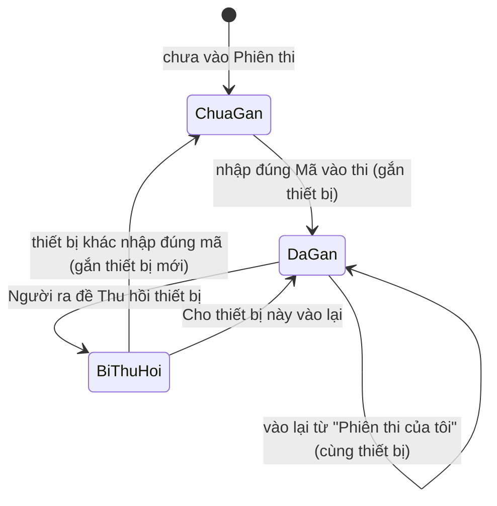
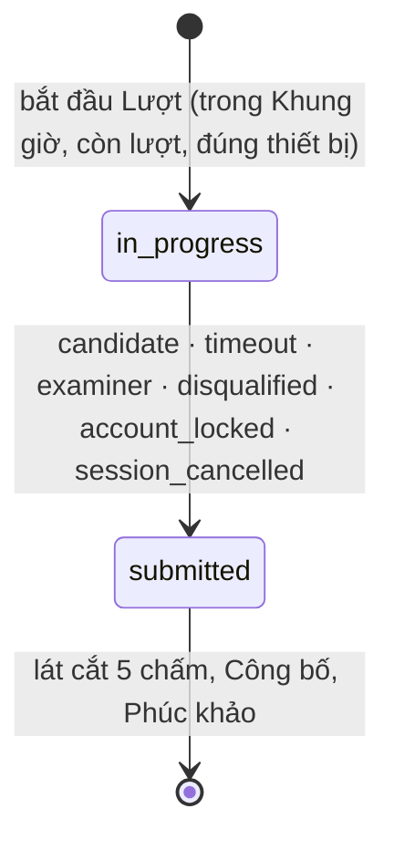
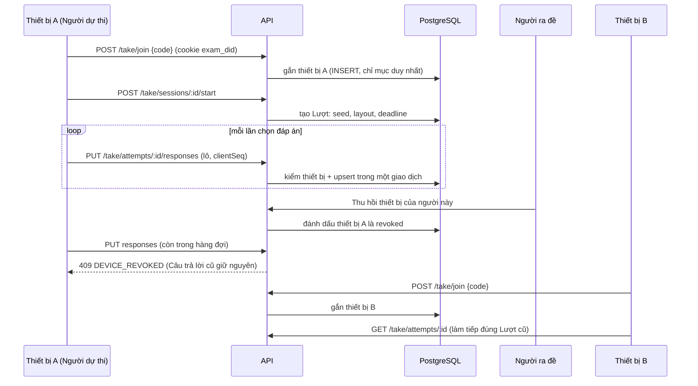

# Lát cắt 4: Phiên thi, Lượt làm bài và Theo dõi phòng thi

> Trạng thái: **accepted** (1/11/2026): chủ dự án đã đồng ý Q192–Q211 qua ba vòng hỏi đáp và Q212–Q222 cùng năm thuật ngữ mới. Chưa có dòng code nào; mỗi PR 4a–4e vẫn cần thiết kế chi tiết và seam test được duyệt riêng. Thuật ngữ theo [GLOSSARY.md](../../GLOSSARY.md) (đã thêm Thiết bị dự thi, Thu hồi thiết bị, Hoàn tác Thu hồi, Cắt cứng, Đóng cửa vào thi, Cộng giờ, Buộc nộp, Hủy Phiên thi); nền tảng ở [architecture.md](../architecture.md), [data-model.md](../data-model.md), [ADR-0005](../adr/0005-chup-noi-dung-khi-phat-hanh.md), [ADR-0007](../adr/0007-gan-thiet-bi-du-thi-bang-ma-thiet-bi.md) (accepted).

## Mục tiêu

Sau lát cắt 4:
- Người ra đề tạo **Phiên thi** từ một Bộ đề đã Phát hành, lập **Danh sách dự thi**, đặt **Mã vào thi**, Khung giờ, Thời lượng và các thiết lập làm bài.
- **Người dự thi** đăng nhập, nhập Mã vào thi, làm bài trên điện thoại (hai chế độ 1 câu / Cả đề), bài tự lưu và chịu được mạng chập chờn, rồi Nộp bài hoặc tự nộp khi hết giờ.
- Mỗi Người dự thi chỉ dự thi trên **một thiết bị** trong một Phiên thi; Người ra đề **Thu hồi thiết bị** khi thiết bị gặp sự cố để người đó làm tiếp trên máy khác.
- Người ra đề **theo dõi phòng thi trực tiếp**: ai đang làm, mất kết nối, rời màn hình; Cộng giờ, Thu hồi thiết bị, Đóng cửa vào thi, Buộc nộp, ghi Vi phạm và Đình chỉ.

**Ngoài phạm vi (lát cắt 5):** Chấm tự động và thủ công, điểm, Mức xử lý áp lên điểm, Công bố kết quả, Phúc khảo, Đính chính đáp án, Chốt kết quả, xuất Excel. Sau lát cắt 4, Lượt làm bài dừng ở trạng thái `submitted`; Người dự thi chỉ thấy "Đã nộp".

Bất biến vẫn giữ: Đáp án đúng không bao giờ có trong response gửi Người dự thi; server quyết định hạn và thời điểm; Câu trả lời ghi vào PostgreSQL trước khi API báo thành công; Lượt làm bài chỉ đọc `exam_items.snapshot`.

## Quyết định (Q192–Q222)

| # | Quyết định | Trạng thái |
|---|---|---|
| Q192 | Thiết bị nhận diện bằng **mã thiết bị** trong cookie `exam_did` (không theo Phiên đăng nhập, không vân tay trình duyệt). ADR-0007 | đã duyệt |
| Q193 | Thiết bị **gắn ở lần đầu nhập đúng Mã vào thi**; thiết bị khác không vào thi, bắt đầu hay lưu bài được, nhưng vẫn đăng nhập được | đã duyệt |
| Q194 | **Thu hồi thiết bị**: thiết bị cũ bị chặn ngay; bị loại vĩnh viễn khỏi Phiên thi cho người đó; thiết bị mới đầu tiên nhập đúng mã làm tiếp đúng Lượt cũ (đồng hồ không dừng, Người ra đề Cộng giờ nếu cần); thu hồi nhầm thì "Cho thiết bị này vào lại"; Câu trả lời đang nằm trong hàng đợi máy cũ bị từ chối | đã duyệt |
| Q195 | Thuật ngữ **Thiết bị dự thi**, **Thu hồi thiết bị**; bỏ cách nói "Cho phép đổi thiết bị" | đã duyệt (đã vào GLOSSARY) |
| Q196 | Chấm tự động thuộc lát cắt 5; lát cắt 4 chỉ lưu Câu trả lời và Nộp bài | đã duyệt |
| Q197 | Không có Tạm dừng toàn Phiên thi (backlog). Sự cố cả phòng: **Cộng giờ** (cá nhân hoặc cả phòng), **Đóng cửa vào thi**, **Buộc nộp cả phòng** | đã duyệt |
| Q198 | Hệ thống chỉ **ghi** sự kiện bất thường (rời màn hình, mất kết nối, thiết bị lạ vào thi); Vi phạm, Cảnh cáo, Đình chỉ, Mức xử lý do Người ra đề quyết định | đã duyệt |
| Q199 | Xáo trộn: công tắc Phiên thi tắt thì không xáo; bật thì xáo thứ tự câu trong từng Phần (không xáo Phần) và Phương án của những câu có `shuffleOptions`; mỗi Lượt có `seed` riêng, thứ tự cố định kể cả khi đổi thiết bị | đã duyệt |
| Q200 | **Danh sách dự thi**: thêm theo tên, Mã định danh hoặc cả Lớp (chụp tại thời điểm bấm); chỉ người mang Nhãn Người dự thi, chưa Khóa hay Xóa; Người ra đề không tự thêm mình (Q144, `owner_cannot_sit`); trước khi mở thêm bớt tự do, sau khi mở chỉ bớt người chưa có Lượt nào; tối đa 500 người; chưa có tài khoản thì dùng Yêu cầu cấp tài khoản; Cấp lại mật khẩu tạm cho người trong Danh sách | đã duyệt |
| Q201 | **Mã vào thi**: 6 ký tự chữ hoa và số bỏ ký tự dễ nhầm (0/O, 1/I/L), không phân biệt hoa thường, Người ra đề đặt tay được (4–12 ký tự); một thông báo lỗi chung cho "sai mã" và "không có trong Danh sách"; sai quá 5 lần/10 phút bị chặn tạm; mã chỉ dùng cho lần vào đầu tiên, sau đó vào lại từ "Phiên thi của tôi"; đổi mã không ảnh hưởng người đã vào | đã duyệt |
| Q202 | Trạng thái hiện cho Người ra đề: **Sắp mở, Đang mở, Đóng cửa vào thi, Đã đóng, Đã hủy** (lát cắt 5 thêm Đã Công bố, Đã Chốt). Sắp mở: sửa mọi thứ. Đã mở: chỉ kéo dài Khung giờ hoặc Thời lượng, đổi mã, thêm người; **không** đổi hai công tắc xáo trộn và Bộ đề. Xóa chỉ khi chưa từng có Lượt làm bài, còn lại **Hủy** | đã duyệt |
| Q203 | **Hủy Phiên thi** (không hoàn tác): nộp mọi Lượt đang làm với lý do `session_cancelled`, không ai vào nữa, không tính Kết quả, vẫn xem lại. Muốn thi lại: Nhân bản Bộ đề, Phát hành, tạo Phiên thi mới (Q173). Q178 giữ nguyên: Bộ đề đã Phát hành không xóa, chỉ Lưu trữ; Bộ đề Lưu trữ không chọn được cho Phiên thi mới, Phiên thi đã tạo vẫn chạy. **Nhân bản Phiên thi** (thiết lập và Danh sách; mã, giờ mới) có | đã duyệt |
| Q204 | Chia PR 4a–4e (xem mục "Chia PR"); mỗi PR có thiết kế chi tiết và seam test duyệt riêng | đã duyệt |
| Q205 | Xóa người dùng là Người ra đề: mọi Phiên thi (kể cả đang diễn ra) sang người nhận cùng Bộ đề; Chuyển giao Chủ đề không đụng Phiên thi; Xóa người dùng là Người dự thi đang có Lượt: Lượt nộp tự động (Q76) | đã duyệt; **sửa ở Q263–Q264 (4/11/2026)**: Xóa Người ra đề chỉ làm được khi không có Phiên thi đang diễn ra, và Xóa hay Khóa người dự thi có Lượt đang làm bị chặn thay vì nộp tự động |
| Q206 | `/take`: ô Nhập Mã vào thi ở đầu, dưới là **Phiên thi của tôi** (Đang mở / Sắp mở / Đã xong); menu chuyển khu "Soạn đề" ↔ "Làm bài" cho người mang cả hai Nhãn (Q143); chưa Công bố thì chỉ thấy "Đã nộp" | đã duyệt |
| Q207 | Trước PR 4d, dựng 2–3 **prototype màn Theo dõi** trên nhánh `prototype/theo-doi` để chủ dự án chọn (Q110) | đã duyệt; **xong 3/11/2026**, chủ dự án duyệt bản gộp (xem Q252–Q254) |
| Q208 | Khung giờ chỉ giới hạn việc **bắt đầu** (đúng GLOSSARY); mỗi Lượt được đủ Thời lượng. Công tắc Phiên thi **"Cắt cứng khi đóng Khung giờ"** (mặc định tắt): Lượt kết thúc lúc đóng. Sửa mâu thuẫn giữa GLOSSARY và kiến trúc 5.1 | đã duyệt |
| Q209 | Một thiết bị chỉ phục vụ **một** Người dự thi trong một Phiên thi; không có công tắc tắt quy tắc 1 thiết bị | đã duyệt |
| Q210 | Màn xác nhận trước khi bắt đầu hiện tên Bộ đề, Thời lượng, số câu, số lượt còn lại và nói rõ hệ thống ghi nhận thiết bị, địa chỉ IP, việc rời màn hình | đã duyệt |
| Q211 | Chuông thông báo cho Người dự thi đúng ba loại: được thêm vào Danh sách, Phiên thi bị Hủy, Phiên thi đổi giờ mở hoặc đóng. Cộng giờ, Cảnh cáo, Đình chỉ hiện trực tiếp trên màn hình bài thi | đã duyệt |
| Q212 | **Tự nộp bằng job quét lặp** (BullMQ repeatable, mỗi 10 giây) cộng với đóng lười khi có request, thay cho một job trễ riêng cho mỗi Lượt như kiến trúc 5.1 bước 4 | đã duyệt |
| Q213 | **Heartbeat bằng REST** (15 giây, kèm sự kiện rời màn hình); response mang trạng thái (hạn mới, đã đóng, thiết bị bị thu hồi, Cảnh cáo). **Socket.IO chỉ để đẩy sớm** cho Người dự thi và để cập nhật màn Theo dõi; mất Socket.IO thì hệ thống vẫn đúng, chỉ chậm tối đa 15 giây | đã duyệt |
| Q214 | **Chưa cache** nội dung Bộ đề trong Redis ở bản đầu; đo bằng k6 ở PR 4e rồi mới quyết (kiến trúc mục 11 dự kiến có cache) | đã duyệt |
| Q215 | **Mệnh đề** của chùm đúng/sai **không xáo** (giữ nhãn a, b, c, d); chỉ xáo Phương án của câu chọn một và chọn nhiều | đã duyệt |
| Q216 | Lưu Câu trả lời **theo lô** (tối đa 50 câu mỗi request), idempotent theo `clientSeq`; một lần lưu một câu là lô có một phần tử | đã duyệt |
| Q217 | Lớp bảo vệ ở **cơ sở dữ liệu** (như Q172): trigger cấm sửa nội dung Lượt làm bài sau khi tạo, cấm sửa `value` của Câu trả lời khi Lượt đã nộp, cấm đổi Bộ đề và xáo trộn của Phiên thi đã có Lượt, cấm bớt người đã có Lượt khỏi Danh sách | đã duyệt |
| Q218 | **Khóa đăng nhập hoặc Xóa người dùng giữa lúc đang thi** (Q76): `identity` gọi các bên đăng ký qua một cổng `UserDeactivationHooks`, `attempt` đăng ký để nộp Lượt với lý do `account_locked`; `identity` không import `attempt` | đã duyệt |
| Q219 | **Ảnh cho Người dự thi**: xem được ảnh của Bộ đề khi có Lượt đang làm trên đúng thiết bị đã gắn; qua cổng `CandidateMedia`, `question-bank` không biết Lượt làm bài | đã duyệt |
| Q220 | **Xem thử qua Phiên thi** của Người ra đề dùng chính giao diện làm bài nhưng không tạo `attempts`, không gắn thiết bị, không lưu Câu trả lời lên server (chỉ giữ trong trình duyệt) | đã duyệt |
| Q221 | Lát cắt 4 chỉ **ghi Vi phạm** (hành động Cảnh cáo hoặc Đình chỉ, lý do); **Mức xử lý** (trừ phần trăm, hủy kết quả) chọn ở lát cắt 5 khi có điểm. Cột `penalty_*` có sẵn nhưng để mặc định `none` | đã duyệt |
| Q222 | **Mã vào thi duy nhất theo thời gian**: ràng buộc loại trừ (`EXCLUDE USING gist`) hai Phiên thi chưa hủy trùng mã mà Khung giờ chồng nhau, thay cho "duy nhất khi chưa Chốt" của data-model (vì Chốt chỉ có ở lát cắt 5 và sẽ giữ mã mãi) | đã duyệt |
| Q223 | **Ranh giới module bằng cổng thô theo nghiệp vụ** (phương án A, chủ dự án duyệt 2/11/2026, làm ở đầu 4b): `ExamCatalog` (`exam` cài đặt, `session` dùng), `CandidateDirectory` (`identity` cài đặt, `session` dùng), `SessionEntry` (`session` cài đặt, `attempt` dùng: một truy vấn nối trong chính `session` trả trạng thái, thiết lập và giờ cộng sẵn). Kèm một test kiến trúc cấm `session` import bảng của `exam` và `identity`. Đo trên 500 người: nối bảng p50 3,1 ms, qua cổng hai truy vấn p50 4,0 ms; đường nóng lúc thi không đi qua `users` hay `exams` | đã duyệt |
| Q224 | **Cấu hình cho 500 người cùng nơi** (làm ở 4b): kích thước nhóm kết nối Postgres đọc từ biến môi trường (`DB_POOL_MAX`, mặc định giữ 10) và kiểm tra lại cách api nhận địa chỉ IP thật sau nginx và Cloudflare; môi trường demo đặt `LOGIN_MAX_PER_IP` từ 1000 trở lên vì cả lớp dùng chung một IP | đã duyệt |
| Q225 | **Demo trên laptop WSL** theo [docs/ops/demo-wsl.md](../ops/demo-wsl.md): pod `prod-exam`, tên miền giá rẻ mua riêng, ra Internet qua `cloudflared`. Chủ dự án sẽ tự dừng và xóa pod `prod-plotracker` khi triển khai | đã duyệt |
| Q252 | **Cần chú ý** là bộ lọc trên màn Theo dõi, không có vùng riêng: một chip "Cần chú ý (N)" cạnh các ô lọc trạng thái. Người đang làm bài thuộc diện này khi có một trong bốn dấu hiệu: mất kết nối, rời màn hình nhiều lần, thiết bị mới hoặc bị Thu hồi, làm chậm bất thường. Ngưỡng cố định ở bản đầu (chưa cho Người ra đề chỉnh), chờ đo ở phòng thi thật. Chỉ là gợi ý để xem, không phải Vi phạm | đã duyệt 3/11/2026 |
| Q253 | **Ba chế độ xem theo mật độ**: Thẻ, Bảng, Lưới, đổi bằng một nút; chế độ mặc định theo số người trong Danh sách dự thi (đến 30 người: Thẻ; đến 150: Bảng; trên đó: Lưới). Bản đầu làm Bảng và Lưới, Thẻ làm sau. Bảng và Thẻ phải phân trang hoặc cuộn ảo khi trên khoảng 100 dòng (prototype đo được 500–620 ms khi đổi chế độ ở 300 người với CPU chậm 4 lần) | đã duyệt 3/11/2026 |
| Q254 | **Phạm vi thao tác**: mọi hành động chọn được một Lượt, một nhóm hoặc cả Phiên thi. Nhóm chọn bằng ô tick hoặc "chọn cả những người đang lọc" (theo Lớp, theo trạng thái, theo Cần chú ý). Cộng giờ và Buộc nộp áp dụng cho cả ba phạm vi; **Đình chỉ chỉ áp dụng cho một Lượt** (Vi phạm gắn với từng Lượt và lý do cụ thể). Thao tác nặng luôn qua hộp xác nhận nêu số người bị ảnh hưởng; Cộng giờ bắt nhập lý do. `attempt_time_extensions.scope` thêm giá trị `group` (0014 chưa chạy) | đã duyệt 3/11/2026 |

### Lý do của Q212–Q222

- **Q212.** Kiến trúc đặt một job trễ cho mỗi Lượt. Mỗi lần Cộng giờ phải dời job (BullMQ có `changeDelay`, nhưng chỉ khi job còn ở trạng thái chờ), và mất Redis là mất hẹn giờ. Job quét lặp cần thao tác `UPDATE ... WHERE status = 'in_progress' AND deadline + ân hạn < now() ... FOR UPDATE SKIP LOCKED`, đọc hạn từ PostgreSQL (nguồn sự thật duy nhất), nên Cộng giờ không phải đụng hàng đợi và mất Redis không mất bài. Độ trễ tối đa 10 giây không ảnh hưởng điểm: Câu trả lời gửi sau `deadline + ân hạn (30 giây)` đã bị từ chối ngay ở request. *Loại:* job trễ mỗi Lượt (phức tạp hơn, không đúng hơn); chỉ dựa đóng lười (Lượt không ai chạm vào sẽ treo ở `in_progress`, làm sai màn Theo dõi).
- **Q213.** Safari/iPhone không đáng tin cậy với WebSocket nền và Background Sync (Workbox chỉ phát lại khi service worker khởi động), và Người dự thi chủ yếu dùng điện thoại. 300 người heartbeat mỗi 15 giây chỉ là 20 request/giây. Việc chặn thiết bị cũ luôn được thực thi ở lần lưu kế tiếp, không phụ thuộc kênh đẩy. *Loại:* heartbeat qua WebSocket (như kiến trúc 5.4): thêm một đường lỗi và mỗi kết nối phải xác thực lại.
- **Q214, Q215, Q216:** đơn giản hóa bản đầu, đo trước khi tối ưu; Mệnh đề giữ nhãn a, b, c, d vì xáo thứ tự dễ gây nhầm khi Người dự thi đối chiếu với đề in; lô giúp xả hàng đợi IndexedDB sau khi có mạng lại bằng một request.
- **Q217–Q222:** các lớp bảo vệ và quy tắc phụ giữ cho thiết kế nhất quán; lý do ghi trong từng mục tương ứng bên dưới.

## Luồng chính

### Vòng đời thiết bị và Lượt làm bài





### Vào thi, làm bài, Thu hồi thiết bị



### Hạn nộp bài

```text
Khi bắt đầu Lượt:
  deadline = bắt đầu + Thời lượng + roster.extra_minutes
  nếu Phiên thi bật "Cắt cứng": deadline = min(deadline, closes_at)

Cộng giờ (cá nhân/cả phòng): attempts.deadline += phút   (ghi attempt_time_extensions)
Nhận Câu trả lời : chỉ khi status = in_progress và now ≤ deadline + ân hạn (30 giây)
Quá hạn           : job quét lặp / đóng lười → submitted, reason = timeout
```

Mọi lúc, client chỉ hiển thị: `deadline` và `serverNow` trả về trong response để client tự tính độ lệch đồng hồ.

## Mô hình dữ liệu (đề xuất, thay đổi so với data-model mục 4–5)

Mỗi PR có migration riêng (expand-only): **0012** (4a), **0013** (4b), **0014** (4d). `data-model.md` và `architecture.md` được cập nhật khi PR tương ứng hợp nhất.

```sql
-- 0012 (PR 4a) -----------------------------------------------------------------------------
CREATE EXTENSION IF NOT EXISTS btree_gist;

sessions (
  id, exam_id → exams (không phải nháp; trigger kiểm), owner_id → users, title,
  opens_at, closes_at CHECK (closes_at > opens_at), duration_minutes CHECK (1..600),
  hard_close bool DEFAULT false,                        -- Q208
  max_attempts int DEFAULT 1 CHECK (1..5),
  attempt_scoring enum('highest','latest') DEFAULT 'highest',
  shuffle_items bool DEFAULT false, shuffle_options bool DEFAULT false,   -- Q199
  show_scoring_rules bool DEFAULT false,                -- Q170: Người dự thi có thấy scoringRule/ladder không
  access_code text NOT NULL CHECK (access_code = upper(access_code) AND length(access_code) BETWEEN 4 AND 12),
  entry_closed_at NULL,                                 -- "Đóng cửa vào thi"
  cancelled_at NULL, cancelled_by → users, cancel_reason text NULL,   -- "Hủy Phiên thi"
  version int DEFAULT 1                                 -- khóa lạc quan khi sửa
)
-- Q222: hai Phiên thi chưa hủy không trùng mã khi Khung giờ chồng nhau
EXCLUDE USING gist (access_code WITH =, tstzrange(opens_at, closes_at, '[]') WITH &&) WHERE (cancelled_at IS NULL)
-- Cột released_at, finalized_at, appeal_period_hours thêm ở lát cắt 5.

session_roster (
  session_id → sessions ON DELETE CASCADE, user_id → users, added_by → users, added_at,
  extra_minutes int DEFAULT 0 CHECK (0..600),           -- giờ cộng sẵn cho từng người (ví dụ hỗ trợ đặc biệt)
  PK (session_id, user_id)
)
INDEX (user_id)                                         -- "Phiên thi của tôi"
-- Trigger: INSERT thì user_id <> sessions.owner_id (Q144; đổi chủ sau đó xử lý ở mục Rủi ro); cấm DELETE dòng của người đã có Lượt (Q217).

-- 0013 (PR 4b) -----------------------------------------------------------------------------
session_devices (                                       -- Thiết bị dự thi (ADR-0007)
  id, session_id → sessions, user_id → users,
  device_hash text NOT NULL,                            -- SHA-256 của cookie exam_did
  ip inet, user_agent text,                             -- để Người ra đề nhận ra thiết bị lạ
  status enum('active','revoked'),                      -- Hoàn tác Thu hồi: revoked → active, ghi pardoned_at (Q234)
  bound_at, revoked_at, revoked_by → users, revoke_reason text NULL, pardoned_at NULL
)
UNIQUE (session_id, user_id)     WHERE status = 'active'    -- tối đa một thiết bị đang gắn mỗi người
UNIQUE (session_id, device_hash) WHERE status = 'active'    -- một thiết bị chỉ phục vụ một người (Q209)
-- Thiết bị bị loại = tồn tại dòng status='revoked' cho (session_id, user_id, device_hash).

attempts (
  id, session_id → sessions ON DELETE RESTRICT, user_id → users, attempt_no int,
  seed bigint, layout jsonb,                            -- thứ tự câu/Phương án, cố định suốt Lượt
  started_at, deadline timestamptz NOT NULL,            -- nguồn sự thật của hạn
  submitted_at NULL,
  submit_reason enum('candidate','timeout','examiner','disqualified','account_locked','session_cancelled') NULL,
  status enum('in_progress','submitted'),               -- lát cắt 5 thêm 'graded'
  UNIQUE (session_id, user_id, attempt_no)
)
UNIQUE (session_id, user_id) WHERE status = 'in_progress'
INDEX (status, deadline) WHERE status = 'in_progress'   -- job quét
-- Bỏ cột active_auth_session_id của data-model: thiết bị nằm ở session_devices.
-- Cột điểm (auto_score, manual_score, raw_score, max_score) thêm ở lát cắt 5.

responses (
  attempt_id → attempts ON DELETE RESTRICT, item_id → exam_items,
  value jsonb, client_seq int, saved_at, flagged bool DEFAULT false,
  PK (attempt_id, item_id)
)
-- Cột điểm và chấm thủ công thêm ở lát cắt 5.
-- Trigger (Q217): attempts: không đổi session_id, user_id, attempt_no, seed, layout, started_at; chỉ in_progress → submitted.
--   responses: không INSERT/UPDATE value, client_seq, flagged khi attempts.status <> 'in_progress'.
--   sessions: không đổi exam_id, shuffle_items, shuffle_options khi đã có attempts.

-- 0014 (PR 4d) -----------------------------------------------------------------------------
session_events (                                        -- Q198: chỉ ghi nhận
  id bigserial, session_id, user_id, attempt_id NULL,
  type enum('tab_hidden','tab_visible','went_offline','back_online','device_rejected'),
  data jsonb, at timestamptz                            -- `at` là giờ server nhận
)
attempt_time_extensions (
  id, attempt_id, minutes int, scope enum('one','all'), reason text, by → users, at
)
violations (                                            -- giữ nguyên data-model; Q221 chỉ dùng action + reason ở lát cắt 4
  id, attempt_id, session_id, user_id, action enum('warning','disqualify'), reason text NOT NULL,
  penalty_type enum('none','percent','void') DEFAULT 'none', penalty_percent NULL,
  recorded_by → users, recorded_at, penalty_decided_at NULL
)
```

Cấu trúc `value` của Câu trả lời (kiểm theo `snapshot`, id không có trong snapshot bị từ chối):

| Loại | `value` |
|---|---|
| Chọn một | `{ "optionId": "o2" }` hoặc `null` |
| Chọn nhiều | `{ "optionIds": ["o2", "o4"] }` |
| Chùm đúng/sai | `{ "answers": { "s1": true, "s2": false } }` (có thể thiếu Mệnh đề) |
| Tự luận ngắn | `{ "text": "..." }`, độ dài ≤ `maxLength` |

`layout`: `{ sections: [{ sectionId, items: [{ itemId, optionOrder?: [id...] }] }] }`, tạo bằng hàm thuần `layoutOf(seed, snapshotItems, { shuffleItems, shuffleOptions })` dùng bộ sinh số giả ngẫu nhiên có hạt giống, nên cùng `seed` cho cùng thứ tự.

## Cấu trúc module và seam

Theo kỹ năng `codebase-design`: mỗi module sâu, giao diện nhỏ, seam đặt ở nơi test và người gọi cùng đi qua.

```text
apps/api/src/modules/
  session/     Phiên thi, Danh sách dự thi, thiết lập, hành động của Người ra đề
  attempt/     vào thi, Thiết bị dự thi, Lượt làm bài, Câu trả lời, Nộp bài, hạn
  realtime/    Socket.IO gateway: đẩy sự kiện, presence (Q213)
```

### `attempt` (module sâu nhất)

Giao diện công khai (mọi thứ ngoài module chỉ biết các hàm này):

```ts
interface Attempts {
  join(user, deviceKey, code): Promise<JoinResult>;                    // gắn thiết bị, trả Phiên thi + trạng thái
  start(user, deviceKey, sessionId): Promise<AttemptView>;             // tạo Lượt hoặc làm tiếp Lượt đang mở
  view(user, deviceKey, attemptId): Promise<AttemptView>;              // nội dung đã lọc, theo layout, kèm Câu trả lời đã lưu
  saveResponses(user, deviceKey, attemptId, items): Promise<SaveResult[]>;  // lô, idempotent theo clientSeq
  submit(user, deviceKey, attemptId): Promise<void>;
  heartbeat(user, deviceKey, attemptId, events): Promise<AttemptState>;
  close(attemptId, reason): Promise<void>;                             // dùng cho worker, Người ra đề, Khóa đăng nhập, Hủy Phiên thi
}
```

Sau giao diện này là: `DeviceGate` (kiểm thiết bị **trong cùng giao dịch** với thao tác ghi, khóa dòng gắn bằng `FOR SHARE`, nên không có chuyện lưu xen vào giữa lúc Thu hồi), các hàm thuần `deadlineOf`, `layoutOf`, `responseSchemaFor(snapshot)`, `phaseOf`, và việc dựng `AttemptView` từ `candidateViewOf` (Đáp án không thể lọt vào). Seam nội bộ: `CLOCK` (đã có) để tua thời gian trong test.

**Thiết kế hai lần (giao diện của `attempt`)**

| | A. Một hàm cho mỗi việc (đề xuất) | B. Một lệnh `act(attemptId, command)` |
|---|---|---|
| Độ sâu | Mỗi hàm sâu, ít tham số | Một lối vào nhưng `command` là union lớn, gọi phải biết cả union |
| Test | Test theo từng hành vi, đọc như đặc tả | Test phải dựng lệnh, gom nhiều hành vi vào một chỗ |
| Quyền | Mỗi route khai báo quyền riêng, `@RequireTag('candidate')` rõ ràng | Phải phân quyền theo loại lệnh bên trong |
| Phù hợp NestJS/REST | Trùng với route | Phải ánh xạ lại |

Chọn A. Examiner không gọi `attempt` trực tiếp ngoài `close`; hành động của Người ra đề đi qua `session` (xem dưới), để quyền sở hữu được kiểm ở một nơi.

### `session`

```ts
interface Sessions {
  create / update / duplicate / cancel / remove(owner, ...)
  roster: add / addClass / remove / reissuePassword(owner, ...)
  monitor(owner, sessionId): MonitorSnapshot
  extendTime / closeEntry / forceSubmit / revokeDevice / pardonDevice / recordViolation(owner, ...)
}
```

`session` gọi `attempt.close` và `attempt.listOf(sessionId)` qua service công khai; `attempt` đọc `sessions` để biết thiết lập. Quan hệ hai chiều này nằm trong một cổng đọc nhỏ `SessionSettings` mà `session` cài đặt và `attempt` dùng, để không import vòng.

### Các cổng nối module (cùng mẫu `EXAM_USAGE`, `OWNED_CONTENT`)

| Cổng | Bên dùng | Bên cài | Việc |
|---|---|---|---|
| `SessionSettings` | `attempt` | `session` | đọc Phiên thi, Danh sách dự thi, giờ, thiết lập |
| `CandidateMedia` (Q219) | `question-bank` (phục vụ ảnh) | `attempt` | Người dự thi có Lượt đang làm trên đúng thiết bị thì xem được ảnh của Bộ đề |
| `UserDeactivationHooks` (Q218) | `identity` | `attempt` | Khóa đăng nhập hoặc Xóa người dùng thì nộp Lượt `account_locked` |
| `SessionUsage` (`SESSION_USAGE`) | `exam` | `session` | số Phiên thi chưa hủy dùng một Bộ đề (hiện ở Bộ đề) |
| `OWNED_CONTENT` thêm nhà cung cấp | `identity` | `session` | Xóa người dùng chuyển cả Phiên thi (Q205) |

### Seam test (đề nghị duyệt theo quy trình tdd)

| # | Seam | Bắt được | Không bắt được |
|---|---|---|---|
| S1 | Hàm thuần (unit): `phaseOf`, `deadlineOf` (cả "Cắt cứng"), `layoutOf` (xáo, hạt giống, Phần không xáo, Mệnh đề không xáo), `responseSchemaFor`, chuẩn hóa và sinh Mã vào thi | luật Q199, Q201, Q202, Q208 | nối dây, SQL |
| S2 | HTTP + PostgreSQL + Redis thật (integration) cho `session` và `attempt` | quyền sở hữu, luồng đầy đủ, mã lỗi, `NOT_FOUND` cho người khác, Đáp án không lọt vào JSON | giao diện |
| S3 | SQL trực tiếp vào bảng (như Q172): trigger, chỉ mục duy nhất, ràng buộc loại trừ | lớp bảo vệ thứ hai ở DB | hành vi service |
| S4 | Đồng thời: hai thiết bị nhập mã cùng lúc; lưu xen Thu hồi; lưu xen Nộp bài; hai lần bắt đầu; job quét xen Nộp bài | điều kiện tranh chấp | hành vi trên mạng thật |
| S5 | Worker: gọi trực tiếp hàm xử lý job với `CLOCK` giả | tự nộp đúng giờ, không nộp sớm, an toàn khi chạy hai lần | Redis/BullMQ thật |
| S6 | Playwright (điện thoại và máy tính): 4a luồng Người ra đề; 4c Người dự thi vào, làm, mất mạng (`setOffline`), tải lại, hết giờ, hai ngữ cảnh trình duyệt để thử thiết bị thứ hai; 4d Người ra đề Thu hồi, Người dự thi làm tiếp ở ngữ cảnh khác | toàn tuyến | tải lớn |
| S7 | Socket.IO bằng `socket.io-client` trong integration test | sự kiện đẩy đến đúng phòng; hỏng kênh đẩy vẫn đúng nhờ heartbeat | trình duyệt thật |
| S8 | Quét JSON mọi response `/take/*` | bất biến "không có Đáp án" (khóa `key`, `rubric`, và `scoringRule`/`ladder` khi tắt) | |
| S9 | k6 500 người (PR 4e) | điểm nghẽn, cần cache hay không (Q214) | |

Không kiểm: service worker và cache PWA ở mức đơn vị (kiểm bằng Playwright); giao diện từng pixel.

## API (đề xuất)

Người ra đề (`@RequireTag('examiner')`, chỉ chủ Phiên thi, người khác nhận `NOT_FOUND`):

| Route | Việc |
|---|---|
| `GET/POST /sessions`, `GET/PUT /sessions/:id` | danh sách, tạo, chi tiết, sửa (kèm `version`) |
| `POST /sessions/:id/duplicate`, `/cancel`; `DELETE /sessions/:id` | Nhân bản, Hủy, Xóa (chỉ khi chưa có Lượt) |
| `GET /sessions/:id/roster/search?q=&class=`; `POST/DELETE /sessions/:id/roster` | tìm người, thêm theo người hoặc theo Lớp, bớt |
| `POST /sessions/:id/roster/:userId/reissue-password` | Cấp lại mật khẩu tạm (hiện một lần) |
| `GET /sessions/:id/monitor` | ảnh chụp trạng thái cả phòng (cũng là đường dự phòng khi Socket.IO hỏng) |
| `POST /sessions/:id/close-entry`, `/force-submit` | Đóng cửa vào thi, Buộc nộp cả phòng |
| `POST /sessions/:id/attempts/:attemptId/extend \| force-submit \| violations` | Cộng giờ, Buộc nộp, ghi Vi phạm (Cảnh cáo hoặc Đình chỉ) |
| `POST /sessions/:id/roster/:userId/revoke-device \| pardon-device` | Thu hồi thiết bị, Hoàn tác Thu hồi |
| `GET /sessions/:id/try` | Xem thử qua Phiên thi (nội dung như Người dự thi, không ghi gì, Q220); ảnh ở `GET /sessions/:id/try-media/:illustrationId/:side` (Q248) |

Người dự thi (`@RequireTag('candidate')`, cookie `exam_did` bắt buộc):

| Route | Việc |
|---|---|
| `GET /take/sessions` | Phiên thi của tôi |
| `POST /take/join` | nhập Mã vào thi, gắn thiết bị |
| `POST /take/sessions/:id/start` | bắt đầu hoặc làm tiếp Lượt |
| `GET /take/attempts/:id` | nội dung đã lọc, theo layout, kèm Câu trả lời và `deadline`, `serverNow` |
| `PUT /take/attempts/:id/responses` | lưu lô Câu trả lời |
| `POST /take/attempts/:id/submit`, `/heartbeat` | Nộp bài, heartbeat |

Mã lỗi mới: `INVALID_ACCESS_CODE` (một mã chung, Q201), `INVALID_STATE` với `reason` thuộc `DEVICE_BOUND_ELSEWHERE`, `DEVICE_REVOKED`, `NOT_OPEN_YET`, `ENTRY_CLOSED`, `WINDOW_CLOSED`, `ATTEMPTS_EXHAUSTED`, `ATTEMPT_CLOSED`, `SESSION_CANCELLED`, `OWNER_CANNOT_SIT`; `CONFLICT {field: version}` khi sửa Phiên thi từ hai nơi.

## Thời gian thực (PR 4d)

- **Presence** trong Redis: hash `presence:{sessionId}`, mỗi người một trường `{lastSeen, visible}`; trạng thái "mất kết nối" suy ra khi đọc (`now - lastSeen > 45 giây`), không cần bộ đếm giờ.
- **Heartbeat** `POST /take/attempts/:id/heartbeat` mỗi 15 giây, kèm các thay đổi hiển thị tab từ lần trước (`tab_hidden`/`tab_visible`, giờ nhận của server làm chuẩn). Response mang `{deadline, status, serverNow, deviceOk, notices[]}` nên mọi thay đổi (Cộng giờ, đã đóng, thiết bị bị thu hồi, Cảnh cáo) đến Người dự thi trong tối đa 15 giây dù Socket.IO hỏng.
- **Socket.IO** (`/ws`, xác thực cookie `exam_sid` ngay lúc bắt tay, kiểm `Origin`): phòng `session:{id}` cho Người ra đề nhận **gói cập nhật gộp mỗi 2 giây** (không đẩy từng sự kiện, tránh 300 sự kiện/giây); phòng `attempt:{id}` đẩy sớm `time.extended`, `attempt.closed`, `device.revoked`, `warning`. Redis adapter đã nằm trong kiến trúc để chạy nhiều tiến trình.
- Màn Theo dõi mở bằng `GET /sessions/:id/monitor` rồi nhận gói gộp; mất Socket.IO thì tự hỏi lại mỗi 5 giây.
- Con số "đã trả lời N/M câu" lấy từ một truy vấn nhóm `responses` mỗi 5 giây, dùng chung cho mọi người đang xem.

## Chia PR (Q204)

| PR | Phạm vi | Migration | Kiểm thử chính |
|---|---|---|---|
| **4a** Phiên thi và Danh sách dự thi | `session`: tạo theo các bước, danh sách và lọc trạng thái, chi tiết, sửa theo trạng thái (Q202), thiết lập, Mã vào thi, thêm theo người hoặc Lớp, Cấp lại mật khẩu tạm, Nhân bản, Hủy, Xóa, thông báo "được thêm vào" và "bị Hủy" và "đổi giờ"; `ExamUsage` hiện số Phiên thi trên Bộ đề; ràng buộc loại trừ mã | 0012 | S1, S2, S3, S6 |
| **4b** Vào thi và Lượt làm bài (API), chia 4b-1 và 4b-2 (Q226) | `attempt`: `join`, Gắn thiết bị, `start`, `view`, `saveResponses`, `submit`, `close`, job quét tự nộp, hook Khóa đăng nhập (Q218), ảnh cho Người dự thi (Q219), cookie `exam_did` | 0013 | S1, S2, S3, S4, S5, S8 |
| **4c** Khu làm bài `/take` | giao diện điện thoại theo prototype đã duyệt: Phiên thi của tôi, nhập mã, màn xác nhận (Q210), hai chế độ, lưới số câu, đồng hồ có cảnh báo 5 và 1 phút, hàng đợi IndexedDB tự xả, hộp thoại xác nhận Nộp bài, báo thiết bị bị thu hồi, menu chuyển khu (Q143), Xem thử qua Phiên thi (Q220), PWA | không | S6 |
| **4d** Theo dõi phòng thi, chia 4d-1 (API), 4d-2 (giao diện), 4d-3 (Socket.IO) (Q255) | prototype trước (Q207, xong), rồi: presence, `session_events`, Cộng giờ, Thu hồi thiết bị và Hoàn tác Thu hồi, Đóng cửa vào thi, Buộc nộp, Vi phạm và Đình chỉ (Q221), cuối cùng Socket.IO | 0014 | S1–S8 (xem "PR 4d: thiết kế chi tiết") |
| **4e** **Xong 4/11/2026** — Hoàn thiện (xem "PR 4e: thiết kế chi tiết") | Phiên thi trong Xóa người dùng và chặn Khóa, Xóa khi Phiên thi đang diễn ra (Q263, Q264, Q271), Đình chỉ chặn Lượt mới (Q272), đo tải 500 người phần 4d (Q266–Q268), `demo:room` và README lát cắt 4 (Q269, Q270) | không | S1, S2, S4, S6, S9 |

Quy trình mỗi PR: thiết kế chi tiết và seam test cho riêng PR đó chốt với chủ dự án trước; làm theo từng lát dọc đỏ-xanh; chạy `code-review` (Standards và Spec); mở PR bằng skill `pr`; chờ CI xanh; chỉ merge khi chủ dự án ra lệnh.

## PR 4a: thiết kế chi tiết (đã duyệt 2/11/2026)

Chủ dự án đã đồng ý sáu điểm sau (không đánh số Q mới vì chỉ chi tiết hóa Q200–Q203, Q211):

1. **Tạo Phiên thi 3 bước** (Bộ đề và tên; Thời gian; Thiết lập làm bài và Mã vào thi), tạo xong chuyển sang tab Danh sách dự thi. Mã được gợi ý sẵn (`GET /sessions/access-code-suggestion`), có nút "Gợi ý mã khác".
2. **Cấp lại mật khẩu tạm bởi Người ra đề**, ba lớp chặn: chỉ cho tài khoản do chính Người ra đề xin cấp qua Yêu cầu cấp tài khoản (`account_request_items.outcome = 'created'`, `account_requests.requested_by`; không dùng `users.created_by` vì cột đó là người duyệt) và chủ tài khoản còn `must_change_password`, chưa Khóa; mật khẩu hiện một lần, hạn 7 ngày, thu hồi mọi phiên đăng nhập, ghi nhật ký và báo cho chủ tài khoản; điều kiện kiểm trong cùng giao dịch với việc đặt mật khẩu. Trường hợp khác trả `INVALID_STATE` với `reason: ASK_ADMIN`.
3. **Thêm người** theo tên, Mã định danh, Lớp, hoặc dán nhiều Mã định danh; mọi cách đều qua một đường duy nhất `POST /sessions/:id/roster` với `dryRun` để xem trước kết quả khớp.
4. **Giờ cố định GMT+7** khi nhập và hiển thị; năm hiển thị đủ bốn chữ số.
5. **Danh sách Phiên thi** lọc trạng thái, tìm tên không dấu, sắp theo giờ mở mới nhất; **Chi tiết** hai tab Tổng quan và Danh sách dự thi; **Danh sách dự thi** có tìm, phân trang 50, phút cộng sẵn sửa tại chỗ, Bớt từng người hoặc hàng loạt.
6. **Seam test** S1, S2, S3, S6 (không dùng S4, S5, S7 ở 4a vì chưa có Lượt làm bài); thêm một test cho tranh chấp trùng mã.

### Chi tiết thực hiện cần biết

- **Hàm thuần** ở `packages/shared/src/session.ts`: `phaseOf`, `sessionEditableFields`, `sessionChangeProblems`, `sessionSettingsSchema`, `sessionUpdateSchema`, `normalizeAccessCode`, `generateAccessCode`, `parseCodeList`.
- **Sửa theo trạng thái (Q202)** hiểu chặt: khi đã mở chỉ còn Giờ đóng (chỉ kéo dài), Thời lượng (chỉ kéo dài) và Mã vào thi; đổi tên cũng bị khóa (chủ dự án chốt 2/11/2026: tên chỉ khóa khi đã có Người dự thi tham gia; chưa ai vào thì vẫn đổi được trước giờ mở, nên với 4a "Sắp mở" đổi được và "đã mở" bị khóa là đủ; xét lại ở 4b nếu muốn cho đổi cả khi đang mở mà chưa ai vào). Vi phạm trả `VALIDATION_FAILED` với `locked` hoặc `cannot_shorten`.
- **Thông báo** (Q211): `session.added`, `session.rescheduled` (chỉ khi đổi giờ mở hoặc giờ đóng), `session.cancelled` (cả khi Xóa Phiên thi chưa hủy mà đã có người trong Danh sách), cùng `account.password_reissued`.
- **Hủy** gọi được ở mọi trạng thái trừ Đã hủy; từ 4b sẽ nộp các Lượt đang làm với lý do `session_cancelled`. **Xóa** chỉ khi chưa có Lượt (ở 4a luôn đúng; 4b thêm kiểm).
- **Nhân bản** dời giờ sang tuần sau (hoặc đủ số tuần để còn ở tương lai), mã mới, tên thêm " (bản sao)", mang theo người còn đủ điều kiện kèm phút cộng sẵn và báo họ.
- **Sắp xếp Danh sách dự thi** theo tên gọi (từ cuối của họ tên) rồi họ và tên lót, như cách xếp danh sách lớp.
- **Cổng `SESSION_USAGE`** (thay cho "ExamUsage mở rộng" của bảng cổng): `exam` hỏi số Phiên thi chưa hủy của Bộ đề (`sessionCount` ở danh sách và chi tiết Bộ đề); nối ở `SessionUsageWiringModule`, có mặt cả ở CLI và worker.
- **Trigger Q217 chuyển sang migration 0013** vì bảng `attempts` chưa tồn tại: cấm bớt người đã có Lượt khỏi Danh sách, và cấm đổi `exam_id`, `shuffle_items`, `shuffle_options` của Phiên thi đã có Lượt. Trigger `sessions_guard` của 0012 thêm quy tắc không hoàn tác Hủy (sau Hủy chỉ đổi chủ).
- **Cấp lại mật khẩu** bị chặn khi Phiên thi Đã đóng hoặc Đã hủy (không còn lý do cấp); nhật ký ghi `via: session-roster` và `sessionId`.
- **Giới hạn đã biết:** ô chọn Bộ đề liệt kê tối đa 100 Bộ đề đã Phát hành gần nhất; Người dự thi chưa có giao diện nào để thấy thông báo "được thêm vào" ngoài chuông thông báo (khu `/take` làm ở 4c).

## Prototype màn Theo dõi (Q207)

Trước 4d, dựng trên nhánh `prototype/theo-doi` với dữ liệu giả (300 người, trạng thái đổi theo thời gian), chạy được ở kích thước điện thoại và máy tính, để chủ dự án chọn một:

| | A. Bảng dày đặc | B. Lưới ghế | C. Ngoại lệ trước |
|---|---|---|---|
| Ý tưởng | một dòng mỗi người, cột trạng thái, đã làm, giờ còn lại, thiết bị; lọc theo chip | mỗi người một ô vuông tô màu theo trạng thái, giống sơ đồ phòng | hàng đầu chỉ hiện người cần chú ý (mất kết nối, rời màn hình nhiều lần, thiết bị lạ); cả danh sách thu gọn bên dưới |
| Mạnh | đủ chi tiết, hợp máy tính | nhìn một lần thấy cả phòng | nhanh với phòng đông người |
| Yếu | khó nhìn tổng thể trên điện thoại | ít chữ, khó thấy chi tiết | có thể bỏ sót người im lặng |

Dùng skill `prototype` và `ui-ux-pro-max`, kiểm bằng Playwright ở hai kích thước màn hình.

**Kết quả (3/11/2026).** Chủ dự án không chọn một phương án mà yêu cầu gộp: mỗi phương án thành một chế độ xem (A thành Bảng, B thành Lưới, C thành Thẻ cùng bộ lọc Cần chú ý và biểu đồ phân bố tiến độ), thêm chọn nhóm và thao tác cả phòng (Q252–Q254). Bản gộp nằm ở nhánh `prototype/theo-doi` (đã đẩy lên GitHub, ở ngoài `main`), chạy ở `/examiner/sessions/theo-doi-thu?n=20|120|300`. Số đo: lọc và chọn nhóm 25–170 ms; đổi chế độ ở 300 người: Lưới 50 ms, Bảng và Thẻ 140–170 ms (500–620 ms khi CPU chậm 4 lần); vẽ lại mỗi nhịp 2 giây không tạo tác vụ dài (tối đa 105 ms khi CPU chậm 4 lần). Điểm còn mở cho thiết kế chi tiết 4d: trên điện thoại ô tìm và Lớp vào bottom sheet "Bộ lọc"; ô lưới cao khoảng 42 px (dưới mức 48 px); Cảnh cáo cần ô lý do; Thu hồi và Hoàn tác Thu hồi có hỏi lại hay không.

## Rủi ro và giới hạn đã biết

- **Người nhận Xóa người dùng cũng nằm trong Danh sách dự thi của một Phiên thi được chuyển** (vi phạm Q144 sau khi đổi chủ): cho phép chuyển, người đó không bắt đầu được (`OWNER_CANNOT_SIT`), và giao diện Danh sách hiện cảnh báo. Trường hợp hiếm; không chặn Xóa người dùng vì lý do này.
- **Phòng máy xóa sạch trình duyệt mỗi lần đăng nhập** làm mỗi lần là một thiết bị mới (ADR-0007). Chấp nhận, xét lại nếu thực tế gặp nhiều.
- **Câu trả lời trong hàng đợi của máy bị Thu hồi bị mất** (Q194), chỉ khi máy đó đang mất mạng lúc bị thu hồi.
- **Mã thiết bị không chứng minh danh tính**: người có cả mật khẩu lẫn thiết bị trong phòng vẫn thi hộ được. Quy tắc chỉ chặn thi hộ từ xa.
- **Người dự thi mở hai tab cùng thiết bị**: hợp lệ (cùng thiết bị); mọi tab dùng chung Lượt, `clientSeq` chống ghi đè cũ; tab sau cùng thắng ở mức từng câu.
- **Giờ máy của Người dự thi sai**: không ảnh hưởng, vì hạn do server giữ; đồng hồ hiển thị dùng độ lệch tính từ `serverNow`.
- **Kênh đẩy hỏng**: đúng nhưng chậm tối đa 15 giây (Q213).
- **Redis mất**: mọi người phải đăng nhập lại và Theo dõi tạm mất trạng thái trực tuyến; không mất Câu trả lời hay hạn (ADR-0002, Q212).

## Việc cần làm ở tài liệu khác khi hợp nhất

- `architecture.md`: 5.1 (hạn theo Q208, job quét Q212, thiết bị), 5.4 (heartbeat REST Q213, "Thu hồi thiết bị" thay "Cho phép đổi thiết bị"), mục 6 ("Mỗi Lượt làm bài chỉ cho một phiên hoạt động" thành quy tắc Thiết bị dự thi), mục 11 (bỏ cache cho đến khi đo, Q214), mục 12.
- `data-model.md`: mục 4–5 theo phần "Mô hình dữ liệu" ở trên.
- `ui-design.md`: mẫu màn Theo dõi sau khi chọn prototype.

## PR 4b: thiết kế chi tiết (đã duyệt 2/11/2026)

Chủ dự án đồng ý cả mười một điểm Q226–Q236. Không có thuật ngữ mới (ân hạn 30 giây là dung sai kỹ thuật, không vào GLOSSARY).

| # | Quyết định |
|---|---|
| Q226 | Chia 4b thành **4b-1** (ranh giới module và cấu hình, không đổi hành vi, lưới an toàn là test 4a) và **4b-2** (vào thi và Lượt làm bài) |
| Q227 | 4b-2 làm: `join`, Gắn thiết bị, "Phiên thi của tôi", `start`, `view`, lưu lô, Nộp bài, `close`, job quét, Thu hồi và Hoàn tác Thu hồi (API), Hủy Phiên thi nộp Lượt, chặn Xóa Phiên thi và bớt người khi đã có Lượt, hook Q218, ảnh Q219. Để lại: heartbeat, presence, `session_events`, Cộng giờ, Buộc nộp, Vi phạm, Đóng cửa vào thi, màn Theo dõi (4d); Xem thử (4c); Chuyển giao (4e) |
| Q228 | Bảy cổng: `ExamCatalog` (`exam`→`session`), `CandidateDirectory` (`identity`→`session`), `SessionEntry` (`session`→`attempt`), `ExamContent` (`exam`→`attempt`), `SessionAttempts` (`attempt`→`session`), `CandidateMedia` (`attempt`→`question-bank`), `UserDeactivationHooks` (`attempt`→`identity`). Test kiến trúc cấm import chéo bảng với `session` và `attempt`; 8 import nợ cũ (5 cặp module) nằm trong danh sách cố định. Cấm bớt người đã có Lượt bằng khóa ngoại ghép `attempts(session_id,user_id)→session_roster ON DELETE RESTRICT` thay cho trigger; dòng thiết bị dùng khóa ngoại ghép `CASCADE` |
| Q229 | `join`: cookie `exam_did` 128 bit cấp ở lần `join` đầu; một lỗi chung `INVALID_ACCESS_CODE`; sau khi tìm thấy mới báo `NOT_OPEN_YET`, `ENTRY_CLOSED`, `WINDOW_CLOSED`, `SESSION_CANCELLED`; sai quá 5 lần/10 phút/người thì `RATE_LIMITED`; người đang có Lượt vẫn `join` được khi Đóng cửa vào thi hoặc Khung giờ đã đóng; `start` khi chưa `join` là `INVALID_STATE NOT_JOINED` |
| Q230 | `start`: làm tiếp Lượt đang mở nếu có; tạo mới chỉ khi Đang mở và còn lượt (`ATTEMPTS_EXHAUSTED`); `deadline = bây giờ + Thời lượng + giờ cộng sẵn`, Cắt cứng lấy `min` với giờ đóng; Cắt cứng mà còn dưới 60 giây thì `WINDOW_CLOSED`; `seed` 48 bit, `layout` lưu một lần |
| Q231 | Lưu lô 1–50 phần tử (kích thước **một lần gửi**, không giới hạn số câu của đề: tối đa 200 câu/Bộ đề, 500 người/Phiên thi); một giao dịch khóa thiết bị và Lượt `FOR SHARE`; ân hạn 30 giây; kết quả từng câu `saved`/`stale`/`rejected`; chỉ trả 200 sau khi đã ghi |
| Q232 | `view` theo `layout` qua `candidateViewOf`, kèm `points`; ảnh qua `GET /take-media/:attemptId/:illustrationId/:variant`; Lượt đã nộp chỉ trả `{status, submittedAt}`; "Phiên thi của tôi" mang đủ dữ liệu cho màn xác nhận Q210 |
| Q233 | Nộp bài idempotent; `close(tx, attemptId, reason)` nội bộ idempotent; job `attempt.sweep` cron `*/10 * * * * *`, lô 200, `FOR UPDATE SKIP LOCKED`; Hủy Phiên thi đóng Lượt cùng giao dịch, khóa Phiên thi trước rồi Lượt theo `id` |
| Q234 | Thu hồi: `active→revoked`; Hoàn tác Thu hồi: thu hồi thiết bị mới (nếu có) và kích hoạt lại thiết bị cũ trong một thao tác. Bỏ giá trị `pardoned` khỏi enum, giữ cột `pardoned_at`. Danh sách dự thi mang thông tin thiết bị và số Lượt |
| Q235 | `DB_POOL_MAX` (1–100, mặc định 10); `TRUST_PROXY` (mặc định `loopback`; chỉ nhận `loopback` hoặc danh sách địa chỉ/dải, không nhận số bước vì Fastify không hỗ trợ kiểu số); nginx đặt `X-Forwarded-For` từ `CF-Connecting-IP` hoặc `$remote_addr`, bỏ `$proxy_add_x_forwarded_for` |
| Q236 | Script tải 500 người `pnpm load:exam` (không chạy trong CI), ngưỡng: 0 lỗi, lưu p99 < 100 ms, `start` p99 < 1 giây, xem đề p99 < 500 ms; k6 ở 4e vẫn làm |

Seam test: S1 (`deadlineOf`, `layoutOf`, `responseSchemaFor`, đỏ trước), S2, S3, S4, S5, S8, A1 (kiến trúc), L1 (tải). Không có S6, S7 ở 4b.

Thứ tự 4b-1: test kiến trúc đỏ, tách `ExamCatalog`, tách `CandidateDirectory`, xanh; rồi `DB_POOL_MAX`, `TRUST_PROXY` và `nginx.conf`. Thứ tự 4b-2: S1, migration 0013 và S3, `join`, "Phiên thi của tôi", `start`, `view`, lưu lô, nộp và `close`, job quét, Thu hồi, hook Q218, ảnh Q219, L1, tài liệu.

### Bổ sung sau 4a: sắp Danh sách dự thi (chủ dự án chốt 2/11/2026)

Danh sách dự thi sắp theo **tên gọi, rồi họ, rồi tên lót** (mặc định, `sort=name`) hoặc theo **Mã định danh** (`sort=code`). Mã định danh ở trường thật dài cố định (ví dụ `237480201001`: 23 là khóa, `7480201` là mã ngành, `001` là số thứ tự), và mã demo viết `SV01`…`SV99`, nên chỉ cần so **từng ký tự** (chữ và số, không phân biệt hoa thường), không cần sắp "tự nhiên"; người chưa có mã đứng cuối. Theo tên gọi, họ và tên lót đều xếp **theo thứ tự từ điển tiếng Việt** (a ă â b c d đ e ê ... o ô ơ ... u ư ...; thanh điệu: không dấu, huyền, hỏi, ngã, sắc, nặng), nên "Đ" đứng sau "D" (chủ dự án chốt 2/11/2026). Cài đặt bằng collation ICU `vi-x-icu` của PostgreSQL (image postgres chính thức có sẵn; test `session-roster.int.test.ts` bắt nếu thiếu).

### PR 4b-2: ghi chú triển khai (2/11/2026)

Làm đúng Q226–Q236, kèm các điều chỉnh nhỏ đã phát sinh khi cài đặt:

- **Trạng thái thiết bị** chỉ còn `active` và `revoked` (bỏ `pardoned`, giữ `pardoned_at`), theo Q234.
- **Lý do `INVALID_STATE` mới:** `NOT_JOINED`, `HAS_ATTEMPTS` (Xóa Phiên thi hoặc bớt người đã có Lượt; bớt người trả thêm `userIds`), `NO_ACTIVE_DEVICE` (Thu hồi khi chưa có thiết bị đang gắn).
- **Cổng thêm so với Q228:** `CANDIDATE_MEDIA` và `USER_DEACTIVATION_HOOKS` (đúng Q218, Q219); `ExamContent` có thêm `hasIllustration` và `summariesOf`.
- **Hàng đợi** chỉ có `schedule(name, cron)`; job quét dùng cron 6 trường `*/10 * * * * *`.
- **Đo tải 500 người** bằng `pnpm --filter @exam/api load:exam` (Q236): 0 lỗi, p99 lưu 28 ms, `start` 75 ms, xem đề 37 ms; xem [ops/demo-wsl.md](../ops/demo-wsl.md).
- **Thứ tự khóa** (sau review): Hủy, Thu hồi, Hoàn tác Thu hồi, Bớt người khóa Phiên thi trước; `start` khóa Phiên thi `FOR SHARE` ngay câu đọc đầu (qua `SessionEntry.gateFor(..., { lock: true })`), rồi thiết bị, rồi Lượt. `save` khóa thiết bị rồi Lượt (không khóa Phiên thi), `submit` khóa Lượt rồi thiết bị: không vòng nào. `closeAll`/`closeForUser` đóng theo thứ tự `id`.
- **Làm tiếp Lượt đã quá ân hạn:** `start` đóng Lượt cũ (hết giờ) trong giao dịch riêng rồi xét như chưa có Lượt dở: còn lượt và Phiên thi còn mở thì tạo Lượt mới (tốn một lượt), hết lượt thì `ATTEMPTS_EXHAUSTED`; việc đóng được giữ lại.
- **"Phiên thi của tôi"** mang `deviceStatus` (`active`, `revoked`, `other`, `none`) để giao diện chọn ô nhập mã hay nút Bắt đầu.
- **Giới hạn nhập mã** là cửa sổ cố định 10 phút theo ô giờ (như giới hạn đăng nhập), nên quanh ranh giới ô có thể nhiều hơn 5 lần.
- **Chưa làm (đúng phạm vi):** heartbeat, presence, `session_events`, Cộng giờ, Buộc nộp, Vi phạm, Đóng cửa vào thi, màn Theo dõi (4d); Xem thử (4c); Chuyển giao Phiên thi (4e). Giao diện cho Thu hồi và Hoàn tác Thu hồi thiết bị ở 4d.

## PR 4c: thiết kế chi tiết (đã duyệt 2/11/2026)

Chủ dự án đồng ý cả mười một điểm Q237–Q247 và yêu cầu **mỗi nhánh kèm hướng dẫn thử** các điểm của thiết kế để góp ý ngay trên sản phẩm. Không có thuật ngữ mới.

| # | Quyết định |
|---|---|
| Q237 | Chia 4c thành **4c-1** (làm bài trực tuyến), **4c-2** (chịu mất mạng: hàng đợi IndexedDB, đọc lại đề khi ngoại tuyến, PWA, màn thiết bị bị thu hồi), **4c-3** (Xem thử qua Phiên thi) |
| Q238 | `/take` (ô nhập mã và Phiên thi của tôi chia Đang mở / Sắp mở / Đã xong), `/take/sessions/$sessionId` (xác nhận), `/take/attempts/$attemptId` (làm bài, đã nộp). Khung riêng gọn, không thanh bên; người mang cả hai Nhãn có mục chuyển khu ở menu |
| Q239 | Ô mã: tự viết hoa, bỏ khoảng trắng và gạch nối, lỗi hiện dưới ô; nút mỗi dòng chọn theo `deviceStatus`, `inProgressAttemptId`, `attemptsUsed`; màn xác nhận chỉ nêu thiết bị và địa chỉ IP (câu về rời màn hình thêm ở 4d) |
| Q240 | Màn làm bài theo prototype: "1 câu" / "Cả đề", lưới số câu, đánh dấu, chỉ báo lưu; nút Aa lưu `exam:prefs`; vùng chạm ≥ 48 px; chữ nội dung đề Noto Serif (`@fontsource/noto-serif`, chỉ nạp ở khu làm bài) |
| Q241 | Chọn đáp án lưu gộp 300 ms, tự luận sau khi ngừng gõ 800 ms; lô ≤ 50; `clientSeq` theo từng câu, `view` trả thêm `clientSeq` đã lưu; thử lại 1, 2, 4, 8, tối đa 15 giây; chỉ báo "Đã lưu" sau khi server trả `saved` hoặc `stale`; câu `rejected` bị gỡ khỏi hàng đợi và báo nhẹ |
| Q242 | Đồng hồ chỉ hiển thị: độ lệch `serverNow`, đồng hồ đơn điệu, cập nhật lại mỗi response; cảnh báo 5 và 1 phút (có rung); hết giờ tự nộp, mất mạng thì thử lại liên tục |
| Q243 | (4c-2) IndexedDB giữ hàng đợi và bản sao `view` theo Lượt, xóa khi nộp hoặc đóng; service worker viết tay chỉ lưu đệm vỏ ứng dụng và `take-media`, không lưu đệm response API; có `manifest` |
| Q244 | `DEVICE_REVOKED` thì màn chiếm toàn bộ; `ATTEMPT_CLOSED` thì chuyển sang "Đã nộp" kèm lý do; hộp thoại Nộp bài liệt kê câu chưa làm và câu đánh dấu |
| Q245 | (4c-3) `GET /sessions/:id/try` chỉ chủ Phiên thi, không ghi gì; `SessionEntry.gateForOwner` |
| Q246 | JS riêng của khu làm bài (không tính lõi dùng chung) ≤ 40 KB gzip; KaTeX nạp lười chỉ khi đề có công thức; không nạp trình soạn; test E2E đo tổng JS ở `/take` |
| Q247 | Seam: U1 hàm thuần, U2 hàng đợi với kho giả, S6a–e Playwright, B1 đo gói, A11y. Test đỏ trước, kể cả E2E |

Thứ tự 4c-1: U1, khung `/take` và menu chuyển khu, Phiên thi của tôi và nhập mã, màn xác nhận, màn làm bài (1 câu, Cả đề, lưới, đánh dấu), lưu bài (hàng đợi trong bộ nhớ) kèm `clientSeq` ở API, đồng hồ, Nộp bài, tùy chọn hiển thị, B1.

### PR 4c-1: ghi chú triển khai (2/11/2026)

Làm đúng Q237–Q242 và Q244, Q246, Q247 (phần trực tuyến), kèm các điều chỉnh nhỏ:

- **API:** `view` trả thêm `clientSeq` đã lưu của từng Câu trả lời (Q241), để máy khác tiếp tục đếm đúng.
- **Giao diện sáng/tối** dùng chung công tắc của cả ứng dụng (`exam:theme`); bảng "Hiển thị" (nút Aa) nhúng công tắc đó, chỉ cỡ chữ, kiểu chữ và chế độ xem lưu ở `exam:prefs`. Không có hai nơi lưu cùng một thiết lập.
- **Chữ có chân:** `font-serif` dùng Noto Serif tự host (`@fontsource/noto-serif` 5.3.0, giấy phép OFL-1.1): bộ `latin` + `vietnamese`, độ đậm 400 và 600, tổng khoảng 41 KB woff2. CSS chỉ nạp ở chunk khu làm bài (`take-attempt.tsx`), trang khác không tải; Be Vietnam Pro vẫn cho phần giao diện. Có E2E dò phông thật của lời dẫn (Chromium, `CSS.getPlatformFontsForNode`), nên máy nào cũng thấy cùng một phông kể cả máy không cài sẵn.
- **Ô chọn Phương án** là `<input>` thật phủ kín cả dòng, trong suốt: chạm chỗ nào trên dòng cũng chọn, trình đọc màn hình vẫn đọc đúng.
- **Khung riêng:** màn làm bài khai báo `staticData: { bare: true }` nên bỏ khung chung; ảnh trong đề lấy qua `/api/take-media/<lượt>/...` nhờ `MediaSourceContext`.
- **Đo gói (B1):** JS riêng của khu làm bài **10,2 KB gzip** (ngưỡng 40 KB); không tải trình soạn, KaTeX, MathLive khi đề không có công thức.
- **Sau review hai trục:** `view` và Nộp bài trả thêm `submitReason` (màn "Đã nộp" nêu lý do khi không phải tự nộp); 4xx khác 400/413/422 (401, 408, 429) được thử lại, không bao giờ âm thầm bỏ câu trả lời; nhịp thử lại 1, 2, 4… giây không bị phá bởi thao tác mới hay rời ô tự luận; rời màn (chuyển trang) gửi nốt phần chờ; hết giờ chỉ nộp sau khi lưu xong các câu còn chờ, mất mạng thì thử lại; hiện lại tab thì hỏi server giờ chính xác; câu bị server từ chối (`rejected`) có thông báo; nút đánh dấu giữ một nhãn cố định với `aria-pressed`.
- **Giới hạn đã biết (4c-1):** tải lại trang thì quay về câu 1 (đáp án vẫn còn); bảng "Hiển thị" chưa có ô xem trước một câu mẫu (ui-design 4.1); chưa có E2E màn thu hồi và kiểm thử `use-saver` bằng kho giả (U2, thuộc 4c-2 cùng IndexedDB). Thử mất mạng ngắn đã có E2E.
- **Chưa có (đúng phạm vi):** hàng đợi giữ qua IndexedDB, đọc lại đề lúc ngoại tuyến, PWA, màn thu hồi đầy đủ (4c-2); Xem thử (4c-3). Hiện tải lại trang lúc mất mạng thì chưa làm tiếp được, và trình duyệt hỏi lại trước khi đóng tab nếu còn câu chưa lưu.

#### Hướng dẫn thử 4c-1 (cho chủ dự án)

Chuẩn bị: `podman pod start dev-exam`, `pnpm dev`, mở `http://localhost:5173`. Cookie thiết bị `exam_did` có thuộc tính `Secure` nên chỉ chạy trên `localhost` hoặc HTTPS; thử "như điện thoại" bằng chế độ giả lập thiết bị của Chrome (360 × 780), không dùng địa chỉ mạng LAN dạng `http://192.168…`.

1. Người ra đề: tạo Bộ đề Phát hành (đủ bốn Loại câu), tạo Phiên thi mở từ bây giờ, Thời lượng 5 phút để thử cảnh báo, thêm một Người dự thi vào Danh sách, ghi Mã vào thi.
2. Người dự thi (cửa sổ ẩn danh hoặc trình duyệt khác):

| Điểm thiết kế | Cách thử | Mong đợi |
|---|---|---|
| Q238 khung và danh sách | Đăng nhập, vào `/take` | Ô "Mã vào thi" ở đầu; Phiên thi nằm ở nhóm "Đang mở"; có nút "Nhập mã" |
| Q239 ô nhập mã | Gõ `  ab-c 12 ` và mã sai | Tự viết hoa, bỏ khoảng trắng và gạch; mã sai báo một lỗi chung ngay dưới ô |
| Q239 màn xác nhận | Nhập mã đúng | Tên Bộ đề, số câu, Thời lượng, số lượt; câu nêu việc ghi nhận thiết bị và địa chỉ IP; chưa chạy đồng hồ |
| Q239 thiết bị thứ hai | Mở trình duyệt khác, đăng nhập cùng tài khoản, nhập cùng mã | Bị từ chối "đã vào trên một thiết bị khác" |
| Q240 hai chế độ | Bấm "Từng câu" / "Cả đề"; thu cửa sổ xuống 360 px | Mặc định "Từng câu" dưới 900 px, "Cả đề" từ 900 px; không cuộn ngang; nút ≥ 48 px |
| Q240 lưới và đánh dấu | Làm câu 1, làm dở chùm đúng/sai, đánh dấu câu 2, mở "Danh sách câu" | Ô số đổi màu theo đã làm / làm dở / chưa làm, câu đánh dấu có viền riêng; chạm ô để nhảy tới câu |
| Q240 nút Aa | Mở "Hiển thị", đổi cỡ chữ, kiểu chữ, sáng/tối, tải lại trang | Nội dung đề đổi theo; lựa chọn còn nguyên sau khi tải lại |
| Q241 lưu bài | Chọn đáp án, gõ tự luận | Chỉ báo "Đang lưu…" rồi "Đã lưu"; tải lại trang thấy đủ đáp án và đánh dấu |
| Q241 mất mạng | Trong DevTools bật Offline, trả lời vài câu, bật lại mạng | Chỉ báo "Mất kết nối (n câu chưa lưu)"; có mạng lại thì tự lưu và về "Đã lưu" |
| Q242 đồng hồ | Phiên 5 phút: quan sát; hoặc để đồng hồ chạy tới mốc | Còn 5 phút và 1 phút có dải cảnh báo (rung nếu máy hỗ trợ); hết giờ tự nộp |
| Q244 Nộp bài | Bấm "Nộp bài" khi còn câu chưa làm | Hộp thoại nêu số câu chưa làm, làm dở, đánh dấu; chạm số để nhảy tới; "Làm tiếp" quay lại; "Nộp bài" xong hiện "Đã nộp", không còn đề, không có điểm |
| Q244 Thu hồi | Người ra đề Thu hồi thiết bị (API; giao diện ở 4d) khi đang làm | Lần lưu kế tiếp hiện màn "Thiết bị này đã bị thu hồi" |

Chỗ cần anh nhận xét: bố cục thanh trên (đồng hồ, chỉ báo lưu, Aa, Nộp bài) trên 360 px; thứ tự và chữ trên các nút; mức nổi bật của dải cảnh báo; chữ trong màn xác nhận.

### PR 4c-2: ghi chú triển khai (3/11/2026)

Làm đúng Q243, Q244, Q247 (phần ngoại tuyến), không thuật ngữ mới:

- **Kho trên máy (IndexedDB `exam-take`)** sau giao diện `QueueStore` (bản thật `idb-store.ts`, bản giả trong test). Mỗi Lượt có hai bản ghi: *bản sao `view`* (đề, kèm giờ máy lúc nhận để bù giờ khi đọc lại) và *hàng đợi* gồm `answers` (câu trả lời mới nhất của từng câu, kể cả đã gửi xong) và `items` (phần server chưa xác nhận). Chỉ giữ `answers` mà không giữ bản đã gửi xong là sai: bản sao đề chụp lúc bắt đầu sẽ không có câu server nhận sau đó, tải lại lúc mất mạng thấy câu ấy trống. Đã bắt được ở E2E.
- **Đọc Lượt có chịu mất mạng (`loadAttempt`).** Đọc được từ server thì cập nhật bản sao và phủ phần còn giữ trên máy nếu mới hơn (`clientSeq` lớn hơn server); không tới được server (mất mạng, 502/503/504) thì mở bản sao với `serverNow` bù theo thời gian đã trôi (không bù âm nếu đồng hồ máy bị chỉnh lùi); `deadline` luôn là của server. Lượt đã nộp, đóng hoặc 404 thì xóa sạch; `DEVICE_REVOKED` thì giữ dữ liệu để hoàn tác Thu hồi thì làm tiếp được.
- **Hàng đợi tự khôi phục:** phần chưa gửi nạp lại vào hàng đợi lúc mở màn và gửi ngay khi có mạng (nhịp thử lại 1, 2, 4… giây như cũ). `beforeunload` chỉ còn hỏi khi máy không có IndexedDB (kho rơi về bộ nhớ trang).
- **Hỏi thẳng server khi cần biết Lượt đã đóng** (`fetchAttemptOnline`): bản sao trên máy không được trả lời câu "Lượt đã đóng chưa", nên `closeNow` và hiện lại tab không dùng đường rơi về bản sao.
- **PWA:** `manifest.webmanifest` (khởi động ở `/take`, `standalone`), biểu tượng, và `sw.js` viết tay. Chỉ lưu đệm vỏ ứng dụng (`index.html` và `/assets/*`) và `/api/take-media/*`; không lưu response API nào khác (E2E kiểm). Điều hướng: ưu tiên mạng, quá 4 giây hoặc mất mạng thì mở `index.html` đã lưu. Mỗi bản dựng một kho vỏ riêng (mã băm điền vào `sw.js` lúc build), bản mới không `skipWaiting` để đề đang làm không bị đổi mã giữa chừng. Lần mở đầu tiên, trang nhờ service worker lưu nốt các file đã tải trước khi nó điều khiển được trang.
- **Mở trang khi mất mạng:** `meQuery` rơi về người dùng đăng nhập lần cuối (`localStorage`) khi không tới được server, chỉ để dựng giao diện; mọi lời gọi API vẫn cần phiên hợp lệ. Đăng xuất xóa bản nhớ này, bản sao đề và ảnh đã lưu đệm, nhưng giữ hàng đợi còn câu chưa gửi để đăng nhập lại gửi nốt. Nộp bài hoặc Lượt đóng xóa mọi thứ của Lượt đó, kể cả ảnh.
- **Tải trước ảnh và KaTeX** của đề khi còn mạng (đúng cỡ ảnh trình duyệt sẽ chọn), để câu ở sau vẫn có ảnh khi mất mạng rồi tải lại.
- **Màn thu hồi (Q244):** thêm câu cho biết các câu chưa gửi còn giữ trên máy và làm tiếp được nếu Người ra đề cho thiết bị vào lại; có E2E (S6e).
- **Sau review hai trục:** đăng xuất và phiên hết hạn (401) bỏ bản sao đề và ảnh; hàng đợi còn câu chưa gửi được giữ nhưng chỉ phần chưa gửi (câu đã gửi xong không còn đọc được trên máy dùng chung); Lượt đóng khi còn câu chưa gửi thì màn "Đã nộp" nói rõ số câu không được ghi nhận; dải ngoại tuyến nói giờ còn lại chỉ là ước tính; giao diện dùng "Hoàn tác Thu hồi" thay cho "Cho thiết bị vào lại" (thuật ngữ chính thức trong GLOSSARY từ 3/11/2026).
- **Phông KaTeX (sau rà soát phông, 3/11/2026):** chỉ tải mã và CSS KaTeX thì file phông chưa được tải, vì trình duyệt chỉ tải phông khi có chữ dùng đến nó; ở chế độ "Từng câu", công thức ở câu chưa xem sẽ mất phông khi mất mạng rồi tải lại. `warmMedia` nay đưa công thức của đề (mỗi cặp latex/display một lần) cho `preloadFormulas`, vẽ thử ngoài màn hình để tải đúng các mặt chữ đề cần; có E2E (công thức dùng `\mathbb` ở câu 4, câu 1 không có công thức, tải lại lúc mất mạng vẫn dựng đúng bằng phông từ bộ nhớ đệm).
- **Giới hạn đã biết (4c-2):** nhiều tab cùng một Lượt trên cùng thiết bị ghi đè hàng đợi của nhau trong IndexedDB (tab ghi sau thắng, server vẫn chặn bản cũ bằng `clientSeq`); đồng hồ máy chỉnh lùi lúc ngoại tuyến làm giờ còn lại hiển thị đứng ở số lúc chụp (server vẫn là bên quyết định hạn, câu gửi sau hạn bị từ chối và được báo); ảnh phóng to (cỡ 1600) và ảnh ở cỡ trình duyệt không chọn không được tải trước; đề có đổi giờ (Cộng giờ, 4d) lúc mất mạng chỉ được biết khi lưu thành công lần đầu; `@fontsource/noto-serif` cài ở PR riêng. Safari/iOS xóa dữ liệu trang web sau 7 ngày không dùng, không ảnh hưởng một buổi thi.
- **Kiểm thử:** U1/U2 (`save-queue`, `offline-attempt` với kho giả, `warm-media`), S6b ngoại tuyến, S6e thu hồi, PWA (`take-offline.spec.ts`).

#### Hướng dẫn thử 4c-2 (cho chủ dự án)

Chuẩn bị như 4c-1, nhưng **service worker chỉ chạy ở bản dựng thật**, không chạy ở `pnpm dev`. Dựng và mở bản xem trước: `pnpm -C apps/web build && pnpm -C apps/web preview` (cổng 4173, `API_URL` mặc định `http://localhost:3000`, api vẫn chạy ở 3000), mở `http://localhost:4173`. Thử bằng Chrome giả lập thiết bị; ô Offline ở DevTools > Network. Mở DevTools > Application để xem Service Workers, Cache Storage (`exam-shell-…`, `exam-take-media`) và IndexedDB (`exam-take`).

| Điểm thiết kế | Cách thử | Mong đợi |
|---|---|---|
| Q243 PWA | Mở `/login`, vào Application > Manifest | Có tên, biểu tượng, `start_url` là `/take`; Chrome cho "Cài đặt ứng dụng" |
| Q243 vỏ ứng dụng | Application > Service Workers; Cache Storage | Có một service worker "activated"; kho `exam-shell-…` có `/` và các file `/assets/…`; không có response `/api/...` nào (trừ ảnh đề `exam-take-media`) |
| Q243 giữ đề trên máy | Đăng nhập Người dự thi, bắt đầu làm bài, xem IndexedDB `exam-take` | Có một bản ghi ở `views` và một ở `queues` |
| Q243 tải lại lúc mất mạng | Trả lời vài câu, bật Offline, trả lời thêm, **tải lại trang** (F5) | Trang vẫn mở, có dải "Đang mở đề đã lưu trên máy"; mọi đáp án (cả câu đã lưu lẫn câu làm lúc mất mạng) còn nguyên; đồng hồ vẫn chạy đúng; chỉ báo "Mất kết nối (n câu chưa lưu)" |
| Q243 có mạng lại | Tắt Offline | Tự gửi, về "Đã lưu", dải "Đang mở đề…" biến mất; tải lại thấy đủ đáp án |
| Q243 đóng hẳn trình duyệt | Mất mạng, trả lời, đóng tab, mở lại `/take` rồi vào Lượt đang làm | Đáp án làm lúc mất mạng vẫn còn; có mạng thì tự gửi |
| Q243 ảnh đề | Đề có ảnh ở câu sau; làm bài khi còn mạng, bật Offline, tải lại, đi tới câu đó | Ảnh vẫn hiện |
| Q243 nộp thì xóa | Nộp bài, xem lại IndexedDB và `exam-take-media` | Không còn bản ghi của Lượt đó |
| Q243 đăng xuất | Đăng xuất (đã nộp hết) | `views` trống, `exam-take-media` bị xóa |
| Q244 thiết bị bị thu hồi | Người ra đề Thu hồi thiết bị (API; giao diện ở 4d), Người dự thi chọn một đáp án | Màn "Thiết bị này đã bị thu hồi" chiếm toàn bộ, không còn đề; tải lại vẫn thế; `queues` vẫn giữ câu vừa chọn |

Chỗ cần anh nhận xét: chữ và vị trí dải "Đang mở đề đã lưu trên máy"; chữ ở màn thu hồi; biểu tượng ứng dụng (mũ tốt nghiệp trên nền xanh của thương hiệu); anh có muốn thêm nút "Cài ứng dụng" hay để người dùng tự cài từ trình duyệt.

### PR 4c-3: Xem thử qua Phiên thi (3/11/2026)

| # | Quyết định | Trạng thái |
|---|---|---|
| Q248 | API: `GET /sessions/:id/try` trả nội dung đề cùng hình dạng như `view` của Người dự thi (dựng bằng `candidateViewOf`, nên không có `key` hay `rubric`), kèm `status: 'preview'`, `durationMinutes`, `mediaBase`. Ảnh ở `GET /sessions/:id/try-media/:illustrationId/:side`. Chỉ chủ Phiên thi (`SessionEntry.gateForOwner`); người khác, kể cả Người dự thi trong Danh sách và Người ra đề khác, nhận 404 như khi Phiên thi không tồn tại. Không tạo `attempts`, không gắn thiết bị, không ghi gì. Admin chưa được Xem thử Phiên thi của người khác | đã duyệt |
| Q249 | Xem thử ở mọi trạng thái của Phiên thi: chưa mở, đã đóng, đã Hủy. Thứ tự đề theo thiết lập trộn câu và trộn Phương án của Phiên thi, hạt giống mới mỗi lần mở | đã duyệt |
| Q250 | Dùng lại màn làm bài, có dải "Đang xem thử"; không đồng hồ, không chỉ báo lưu; câu trả lời chỉ ở bộ nhớ trang (tải lại thì mất và đề trộn lại); nút "Nộp bài" thành "Kết thúc xem thử" và quay về trang Phiên thi, không gọi server; không đụng IndexedDB hay bộ nhớ đệm làm bài của 4c-2 | đã duyệt |
| Q251 | Test seam: (1) API tích hợp qua HTTP (`session-preview.int.test.ts`); (2) E2E desktop và mobile (`take-preview.spec.ts`). Không viết unit riêng cho `gateForOwner` | đã duyệt |

**Ghi chú triển khai**

- **Đường dẫn giao diện là `/examiner/sessions/:id/try`** (chủ dự án đã duyệt 3/11/2026), không phải `/take/try/...` như Q250 viết: khu `/take` chỉ cho Người dự thi (`beforeLoad` kiểm vai trò), còn Xem thử là việc của Người ra đề. Nút "Xem thử" nằm ở đầu trang chi tiết Phiên thi.
- **Không dùng `@RequireTag('examiner')`** trên hai đường Xem thử: thẻ trả 403 và cho biết đường dẫn có thật, trái với điều đã duyệt ở Q251 ("Người dự thi nhận 404"). Thay vào đó controller kiểm thẻ `examiner` rồi trả 404, cộng với `gateForOwner` (chỉ chủ); người còn sở hữu Phiên thi nhưng đã mất thẻ cũng nhận 404 (có test). Chủ dự án đã duyệt việc này (3/11/2026).
- **Kiểm thử bổ sung sau review:** trộn câu và trộn Phương án theo thiết lập của Phiên thi (nhiều lần mở cho thứ tự khác nhau, giữ đủ câu), `showScoringRules`, quản trị viên không Xem thử Phiên thi của người khác. Đột biến (bỏ trộn, ép `showScoringRules` tắt) làm các test này đỏ.
- **`AttemptRunner` được tách** thành `useAttemptSession` (mọi thứ gắn server: lưu, đồng hồ, nộp, mất mạng, giữ nguyên logic 4c-2), `AttemptScreen` (giao diện) và `PreviewRunner`. Hai bên đưa vào màn một `RunnerSession`; `clock`, `saving`, `submit` là `null` khi xem thử, nên không phải rải điều kiện `preview` khắp hook.
- `previewQuery` đặt `gcTime: 0`, không tự làm mới khi đổi tab hay có mạng lại (nếu không đề sẽ đổi chỗ giữa chừng), `retry: false` (404 báo ngay).
- Đường ảnh Xem thử qua cổng `CANDIDATE_MEDIA.canPreview`; `question-bank` vẫn không biết Phiên thi. Đường ảnh này nằm dưới `/api/sessions/…` nên service worker của 4c-2 không lưu đệm.
- `layoutInputOf` tách từ `start` để Xem thử và bắt đầu Lượt dùng chung cách dựng đầu vào của `layoutOf`.
- E2E dùng hai Người ra đề riêng (`e2e-lb-pvgv-*`, `e2e-lb-pvlg-*`): giới hạn đăng nhập 10 lần mỗi 10 phút cho một tên đăng nhập đã bị chạm khi dồn thêm test vào `e2e-lb-gv-*`.

#### Hướng dẫn thử 4c-3 (cho chủ dự án)

| Mục | Làm | Kỳ vọng |
|---|---|---|
| Q248 nút | Đăng nhập Người ra đề, mở một Phiên thi, bấm "Xem thử" | Mở màn làm bài với dải "Đang xem thử: <tên Phiên thi>"; không có đồng hồ, không có chỉ báo lưu |
| Q248 không ghi gì | Làm thử vài câu, chuyển hai chế độ, mở lưới câu; xem tab Network | Chỉ có một yêu cầu `GET .../try` (và ảnh nếu có); không có yêu cầu ghi nào |
| Q249 mọi trạng thái | Thử với Phiên thi chưa mở, đã đóng, đã Hủy | Đều Xem thử được |
| Q249 trộn | Phiên thi bật trộn câu hoặc Phương án; mở Xem thử hai lần | Thứ tự đề khác nhau giữa hai lần |
| Q250 tải lại | Trả lời rồi tải lại trang | Đáp án mất, đề trộn lại |
| Q250 kết thúc | Bấm "Kết thúc xem thử" | Về trang Phiên thi, không có hộp thoại nộp |
| Q248 quyền | Đăng nhập Người ra đề khác, mở thẳng đường dẫn `/examiner/sessions/<id>/try` của Phiên thi này | Chỉ thấy thông báo lỗi và nút "Về Phiên thi" |
| Q248 Danh sách dự thi | Vào Danh sách dự thi của Phiên thi sau khi Xem thử | Không có Lượt làm bài nào mới |

## PR 4d: thiết kế chi tiết (đã duyệt 4/11/2026)

Chủ dự án đồng ý cả tám điểm Q255–Q262 (cộng với Q252–Q254 ở trên). Thuật ngữ mới: không; hai câu bổ sung vào GLOSSARY (Mở lại cửa vào thi, Cảnh cáo hiện cho Người dự thi).

| # | Quyết định |
|---|---|
| Q255 | Chia 4d thành **4d-1** (API và migration 0014), **4d-2** (giao diện: heartbeat phía `/take`, màn Theo dõi, giao diện thiết bị, cập nhật bằng hỏi lại mỗi 5 giây), **4d-3** (Socket.IO). Hệ thống vẫn đúng khi chỉ có heartbeat và hỏi lại (Q213), nên Socket.IO chỉ là phần tăng tốc và làm cuối |
| Q256 | Cộng giờ: mỗi lần 1–180 phút, bắt buộc lý do (tối đa 200 ký tự), tổng phần cộng thêm của một Lượt không quá 600 phút (cùng trần với giờ cộng sẵn). Thao tác nhóm ghi **một dòng cho mỗi Lượt**, cùng một mã lô |
| Q257 | Thông báo cho Người dự thi (Cộng giờ, Cảnh cáo) lấy từ `attempt_time_extensions` và `violations` qua con trỏ `since` trong heartbeat, không giữ trong Redis; mất Redis không mất thông báo |
| Q258 | **Mở lại cửa vào thi** được phép, ghi nhật ký, đối xứng với Đóng. Chỉ xóa `entry_closed_at`; không mở lại khi Khung giờ đã đóng (`phaseOf` vẫn trả đã đóng) |
| Q259 | Vi phạm: Cảnh cáo và Đình chỉ đều bắt buộc lý do (tối đa 500 ký tự). Người dự thi thấy nội dung Cảnh cáo trên màn hình của mình. Đình chỉ nộp Lượt ngay với lý do `disqualified` |
| Q260 | Thu hồi thiết bị và Hoàn tác Thu hồi đều hỏi xác nhận (có hiệu lực ngay trên máy của Người dự thi); Thu hồi có ô lý do tùy chọn |
| Q261 | Ngưỡng Cần chú ý là hằng số trong `packages/shared`: mất kết nối quá 45 giây; rời màn hình từ 3 lần; thiết bị mới hoặc bị Thu hồi; đã qua 25% thời gian và tỉ lệ đã trả lời thấp hơn tỉ lệ thời gian đã trôi quá 30 điểm phần trăm. Chưa cho Người ra đề chỉnh |
| Q262 | Chống cộng giờ hai lần khi thử lại: giao diện sinh mã yêu cầu (UUID) mỗi lần mở hộp Cộng giờ và gửi kèm; server lưu làm mã lô, ràng buộc duy nhất (Lượt, mã lô). Gửi lại cùng mã thì không cộng thêm mà trả kết quả lần đầu. Giao diện giữ mã đến khi hộp đóng hoặc nhận được kết quả |

### Máy của Người ra đề không nằm trong đường găng

Hạn, job quét tự nộp, lưu Câu trả lời, nộp bài, đóng cửa vào thi theo `closesAt`, ghi trạng thái trực tuyến và sự kiện rời tab đều chạy ở server từ phía Người dự thi; không thứ nào cần máy của Người ra đề. Mất mạng hay thoát đột ngột chỉ làm mất cửa sổ xem và nơi gửi lệnh. Mỗi lệnh là một yêu cầu đã ghi vào PostgreSQL nên có hiệu lực dù máy gửi mất mạng ngay sau đó. Đăng nhập nhiều thiết bị cùng lúc được (Q51), nên Người ra đề vào lại bằng thiết bị khác và nhận ngay ảnh chụp từ `GET /sessions/:id/monitor`. Quy tắc cho 4d-3: **khi Socket.IO kết nối lại, tải lại ảnh chụp trước rồi mới nhận tin đẩy**, không bù lại tin lỡ. Chưa có người trông thay giữa chừng (Chuyển giao ở 4e); chấp nhận ở bản đầu.

### API (4d-1)

```text
POST /take/attempts/:id/heartbeat          {events[], since} → {deadline, status, serverNow, deviceOk, notices[]}
GET  /sessions/:id/monitor                 → {summary, people[] kèm state, answered, deadline, hiddenCount, warnings, device, reasons[]}
POST /sessions/:id/extend-time             {attemptIds[] | scope:'all', minutes, reason, batchId}
POST /sessions/:id/force-submit            {attemptIds[] | scope:'all'}
POST /sessions/:id/attempts/:attemptId/violations   {action:'warning'|'disqualify', reason}
POST /sessions/:id/close-entry   và   /reopen-entry
```

- Mọi endpoint của Người ra đề chỉ chủ Phiên thi gọi được; người khác nhận 404 như các endpoint hiện có. Mọi thao tác ghi vào `audit_logs` kèm người thực hiện.
- Heartbeat chỉ ghi trạng thái trực tuyến vào Redis; PostgreSQL nhận sự kiện rời tab và mất mạng, không lưu từng nhịp.
- Cộng giờ: `UPDATE attempts SET deadline = deadline + interval` cho các Lượt còn đang làm và chèn `attempt_time_extensions` trong một giao dịch (trigger `attempts_guard` chỉ cho kéo dài), khóa theo thứ tự `id`. Buộc nộp và Đình chỉ dùng lại `closeInProgress` với lý do `examiner` và `disqualified`.
- `attentionReasonsOf` là hàm thuần ở `packages/shared`; server trả sẵn `reasons[]`, giao diện không tự tính lại.
- Migration 0014: `session_events`, `attempt_time_extensions` (`scope` gồm `one`, `group`, `all`; cột `batch_id`), `violations`. Cả ba chỉ ghi thêm, có trigger chặn sửa và xóa như Q172.

### Ngân sách phản hồi

| Việc | Mục tiêu |
|---|---|
| `GET monitor` cho 500 người | p95 ≤ 100 ms |
| Heartbeat | p95 ≤ 30 ms |
| Cộng giờ hoặc Buộc nộp cho nhóm 500 người | ≤ 300 ms |

Đo bằng test tích hợp trên dữ liệu 500 người; k6 để 4e.

### Seam test

| # | Seam | Bắt được | Không bắt được |
|---|---|---|---|
| S1 | Hàm thuần: `attentionReasonsOf` (các ngưỡng), hạn sau Cộng giờ (kể cả Cắt cứng), kiểm số phút | luật Q252, Q208 | SQL, nối dây |
| S2 | HTTP + PostgreSQL + Redis thật: Cộng giờ (một, nhóm, cả phòng), Buộc nộp giữ Câu trả lời, Vi phạm, Đóng cửa vào thi chặn `start` nhưng không cắt người đang làm, người khác nhận 404, `monitor` đúng số liệu và vẫn đủ khi gọi bằng phiên đăng nhập khác của cùng Người ra đề | luồng đầy đủ, quyền, vào lại từ thiết bị khác | giao diện |
| S3 | SQL trực tiếp: trigger của ba bảng mới | lớp bảo vệ ở DB | hành vi service |
| S4 | Đồng thời: Cộng giờ xen Nộp bài (Lượt đã nộp không bị cộng, không dòng thừa); Buộc nộp xen lưu; hai lần Buộc nộp; Đóng cửa xen `join`; **cùng một yêu cầu Cộng giờ gửi hai lần, kể cả đồng thời, thì hạn tăng một lần** | điều kiện tranh chấp, thử lại | mạng thật |
| S5 | Worker với `CLOCK` giả: job quét tôn trọng hạn đã kéo dài | không nộp sớm sau Cộng giờ | Redis và BullMQ thật |
| S6 | Playwright (điện thoại và máy tính): Cộng giờ, Buộc nộp, Thu hồi và Hoàn tác Thu hồi; Người dự thi ở ngữ cảnh khác thấy hạn mới; màn Theo dõi kèm kiểm thời gian | toàn tuyến | tải lớn |
| S7 | `socket.io-client` (chỉ 4d-3), gồm kết nối lại rồi tải lại ảnh chụp | sự kiện đến đúng phòng | trình duyệt thật |
| S8 | Quét JSON: `heartbeat` và `monitor` không có `key`, `rubric` | bất biến đáp án | |

Thứ tự 4d-1 (đỏ-xanh): S1 (hàm thuần), migration 0014 và S3, Cộng giờ (S2 rồi S4), Buộc nộp và Đình chỉ, Đóng và Mở lại cửa vào thi, heartbeat và presence, `monitor` (kèm S8 và số đo), S5.

## PR 4e: thiết kế chi tiết (đã duyệt 4/11/2026)

Chủ dự án đồng ý cả mười điểm Q263–Q272 (kèm các sửa của chính chủ dự án ở Q263, Q264, Q271). Không có thuật ngữ mới; bốn mục GLOSSARY được sửa câu chữ (Khóa đăng nhập, Xóa người dùng, Chuyển giao, Đình chỉ). Chủ dự án sẽ tự thử hệ thống sau khi hết lát cắt 4, nên 4e kèm công cụ dùng thử và README.

| # | Quyết định |
|---|---|
| Q263 | **Xóa Người ra đề** chuyển mọi Phiên thi của họ (mọi trạng thái, kể cả đã Hủy) sang người nhận cùng Bộ đề; Danh sách dự thi, Lượt, Câu trả lời giữ nguyên. Còn Phiên thi thì bắt buộc chọn người nhận (như khi còn Bộ đề). Chỉ làm được khi không có Phiên thi nào của họ đang diễn ra (Q264). Hộp xác nhận nêu số Phiên thi và cảnh báo (không chặn) nếu người nhận đang nằm trong Danh sách dự thi của Phiên thi sắp nhận (`OWNER_CANNOT_SIT`); người nhận được thông báo trong ứng dụng, có nhật ký thao tác. Xóa **Người dự thi** không chuyển gì |
| Q264 | **Không Khóa đăng nhập hay Xóa người dùng đang tham gia Phiên thi đang diễn ra**, và cảnh báo Quản trị viên: lệnh bị từ chối `409 USER_IN_LIVE_SESSION` kèm danh sách Phiên thi (tên, giờ, chủ, số người đang làm); trang chi tiết người dùng hiện sẵn dải cảnh báo "Đang trong Phiên thi X đến hh:mm" và vô hiệu nút kèm lý do. **Không có lối tắt khẩn cấp ở bản MVP**: sự cố khẩn thì Người ra đề Đình chỉ hoặc Buộc nộp người đó, hoặc Hủy Phiên thi, rồi Quản trị viên mới Khóa. Hook `account_locked` (Q218) vẫn giữ làm lớp phòng thủ khi hai việc gần như đồng thời. Quy tắc này thay phần "Xóa Người dự thi đang có Lượt: nộp tự động" của Q205 |
| Q265 | Thứ tự giữ chỗ các dòng trong cơ sở dữ liệu khi chuyển Phiên thi: Bộ đề, rồi Câu hỏi, rồi Phiên thi (theo `id`); kèm test đồng thời với Cộng giờ, Buộc nộp, `start`. Đây là khóa dòng của cơ sở dữ liệu, không liên quan Khóa đăng nhập |
| Q266 | Đo tải bằng cách **mở rộng `pnpm load:exam`** (Node) thay vì k6 (đổi điều Q236 ghi "k6 ở 4e vẫn làm"): heartbeat 15 giây, 500 kết nối Socket.IO, ba Người ra đề xem Theo dõi, một lần Cộng giờ cả phòng giữa chừng. Ngưỡng: 0 lỗi; heartbeat p99 dưới 100 ms; `monitor` p95 dưới 100 ms; tin đẩy tới Người dự thi dưới 1 giây; Cộng giờ cả phòng dưới 300 ms; 500 kết nối Socket.IO xong trong 10 giây. k6 (báo cáo, tải nhiều máy) nếu cần thì làm ở PR riêng sau |
| Q267 | An toàn cho hệ thống production cùng máy (`plo-tracker-bluni`): cơ sở dữ liệu tạm và cổng riêng, chạy `nice -n 19`, bắt đầu 100 người rồi mới 500, và **chỉ chạy bản 500 người khi chủ dự án báo thời điểm phù hợp**; không chạy trong CI |
| Q268 | Cache nội dung Bộ đề (Q214): **không làm** nếu ở 500 người `start` p99 dưới 1 giây và heartbeat, `monitor` đạt ngưỡng (lần đo HTTP trước đã ra 75 ms); ghi quyết định vào `architecture.md` mục 11 |
| Q269 | `pnpm demo:room`: dựng Phiên thi thử N người (mặc định 120) trong cơ sở dữ liệu dev; "người dự thi giả" vào thi, làm bài, gửi heartbeat, thỉnh thoảng rời tab, mất mạng hoặc làm chậm, để chủ dự án đăng nhập Người ra đề thật xem Thẻ, Bảng, Lưới ở 30, 120, 300 người và thử Cộng giờ, Buộc nộp, Thu hồi mà không cần mở nhiều trình duyệt. Có `--clean` để dọn |
| Q270 | README có mục "Dùng thử lát cắt 4" theo từng vai (Quản trị viên, Người ra đề, Người dự thi trên điện thoại, cách dùng `demo:room`) và cập nhật "Lộ trình", làm cơ sở cho tài liệu hướng dẫn sử dụng sau khi xong MVP. Sửa GLOSSARY bốn mục nêu trên |
| Q271 | "Đang diễn ra" = Phiên thi chưa Hủy và (đang trong Khung giờ **hoặc** còn Lượt đang làm; Lượt có thể chạy quá giờ đóng vì được đủ Thời lượng). **Người ra đề** bị chặn nếu là chủ của Phiên thi như vậy. **Người dự thi** bị chặn nếu đang có Lượt đang làm; người chỉ có tên trong Danh sách của Phiên thi đang mở nhưng chưa vào thì vẫn Khóa được. Cấp lại mật khẩu tạm không bị chặn (Lượt và thiết bị không đổi nên người đó đăng nhập lại làm tiếp) |
| Q272 | **Đình chỉ chặn bắt đầu Lượt mới** trong Phiên thi đó (báo "đã bị Đình chỉ", kể cả khi còn lượt); Buộc nộp chỉ đóng Lượt, người đó có thể làm lại nếu còn lượt (dùng cho sự cố). Lỗ hổng tìm thấy khi rà: trước đây `start` chỉ kiểm số Lượt đã dùng nên người bị Đình chỉ ở Phiên thi nhiều lượt vẫn bắt đầu được Lượt mới |

**Công cụ hiện có cho Người ra đề trong Phiên thi** (đã rà): Đình chỉ (dừng ngay một Lượt và ghi Vi phạm, lý do bắt buộc), Buộc nộp (một, nhóm hoặc cả phòng), Thu hồi thiết bị và Hoàn tác Thu hồi (chặn và mở lại một máy), Đóng cửa vào thi, Cảnh cáo, Hủy Phiên thi. Không có "chặn tạm một người rồi cho làm tiếp" (Q197: không Tạm dừng) và không Khóa tài khoản (chỉ Quản trị viên, `@AdminOnly`).

**Việc làm** (không migration; trigger `sessions_guard` đã cho đổi `owner_id`):

- **4e-1 (API và giao diện):** `SessionOwnedContent` là nguồn thứ ba của `OWNED_CONTENT` (`UPDATE sessions SET owner_id`, tăng `version`, đếm theo trạng thái); cổng `LiveSessionGuard` để `identity` hỏi `session` và `attempt` ai đang trong Phiên thi đang diễn ra; `409 USER_IN_LIVE_SESSION`; dải cảnh báo và nút vô hiệu ở trang chi tiết người dùng; hộp xác nhận Xóa nêu số Phiên thi và cảnh báo người nhận trong Danh sách; Đình chỉ chặn `start`; sửa GLOSSARY.
- **4e-2 (đo tải):** mở rộng `load:exam`, ghi số đo vào `architecture.md` mục 11 và chốt Q214.
- **4e-3 (tài liệu và công cụ):** `demo:room`, README lát cắt 4, cập nhật `slice-4.md` thành hoàn tất.

**Seam test:**

| # | Seam | Bắt được |
|---|---|---|
| S1 | Hàm thuần đếm Phiên thi theo trạng thái (đang diễn ra, sắp mở, đã xong, đã Hủy) và hàm "đang diễn ra" | cách đếm hiển thị, ranh giới Khung giờ và Lượt chạy quá giờ |
| S2 | HTTP + PostgreSQL thật: Xóa Người ra đề chuyển hết Phiên thi, Danh sách, Lượt, Câu trả lời nguyên vẹn; người nhận thấy và Theo dõi được; người cũ nhận 404; bắt buộc có người nhận khi còn Phiên thi; Chuyển giao Chủ đề không đụng Phiên thi; Khóa hoặc Xóa bị từ chối khi chủ Phiên thi đang diễn ra hoặc khi Người dự thi có Lượt đang làm (kèm danh sách Phiên thi); vẫn Khóa được người chỉ có tên trong Danh sách; Đình chỉ rồi `start` bị từ chối, Buộc nộp rồi `start` vẫn được | luồng đầy đủ, quyền |
| S4 | Đồng thời: Xóa người dùng xen Cộng giờ, Buộc nộp, `start` của chủ cũ; Khóa xen `start` (kết quả nhất quán, hook bắt kịp) | không bế tắc, không lệch chủ |
| S6 | Playwright: Quản trị viên thấy dải cảnh báo và nút bị vô hiệu khi người dùng đang trong Phiên thi; Xóa Người ra đề (hộp nêu số Phiên thi), người nhận mở Theo dõi của Phiên thi vừa nhận | toàn tuyến |
| S9 | Đo tải 500 người phần 4d (Node, không chạy trong CI) | điểm nghẽn, chốt cache |

**Ngân sách thời gian cho từng vai:** Quản trị viên: trang chi tiết người dùng (kèm dải cảnh báo) hiện dưới 500 ms, Xóa người dùng chuyển 50 Phiên thi dưới 1 giây (một câu `UPDATE`), preview và mở hộp thoại dưới 300 ms. Người ra đề: người nhận mở Theo dõi của Phiên thi vừa nhận như bình thường (dưới 1 giây). Người dự thi: `start` thêm một truy vấn có chỉ mục để kiểm Đình chỉ, vẫn trong ngưỡng `start` p99 dưới 1 giây.

## Thuật ngữ mới (đã vào GLOSSARY)

Thiết bị dự thi, Thu hồi thiết bị, Cắt cứng, Đóng cửa vào thi, Cộng giờ, Buộc nộp, Hủy Phiên thi. "Nhân bản" cố ý không thành thuật ngữ riêng (chủ dự án: người dùng dùng một lần là hiểu). Các định nghĩa trong GLOSSARY là nguồn để viết hướng dẫn sử dụng cho người dùng cuối, nên giữ chúng chính xác khi hành vi thay đổi.

Trước khi code mỗi PR còn cần: danh sách seam test chi tiết cho PR đó (bảng S1–S9 là khung) và mọi câu hỏi giao diện nảy sinh. Không bắt đầu code khi chưa được duyệt.

## PR 4d-1: API theo dõi và thao tác của Người ra đề (4/11/2026)

Làm đúng phần "PR 4d: thiết kế chi tiết (đã duyệt 4/11/2026)": migration 0014, `GET monitor`, heartbeat, Cộng giờ, Buộc nộp, Vi phạm, Đóng và Mở lại cửa vào thi. Chưa có giao diện (4d-2) và Socket.IO (4d-3).

**Ghi chú triển khai**

- **Hàm thuần ở `packages/shared/src/monitor.ts`** (S1): `attentionReasonsOf`, `isDisconnected`, `deviceStateOf`, `extendedDeadline`, `extensionWithinCap`, `extensionScopeOf` và các schema Zod `extendTimeSchema`, `forceSubmitSchema`, `violationSchema`, `heartbeatSchema`. Hằng số theo Q256, Q259, Q261.
- **Migration 0014 và trigger** (S3): `session_events`, `attempt_time_extensions`, `violations`; hai nhật ký chỉ ghi thêm; Cộng giờ khóa dòng Lượt `FOR UPDATE` rồi kiểm trần 600 phút, nên Cộng giờ xen Nộp bài hay xen một Cộng giờ khác phải nối đuôi.
- **Thêm so với thiết kế: `session_events.client_event_id`** (UUID do trình duyệt sinh, chỉ mục duy nhất theo Lượt). Gửi lại heartbeat (mạng chập chờn) không làm tăng số lần rời màn hình, nếu không sẽ báo "Cần chú ý" sai.
- **Cộng giờ**: `UPDATE attempts SET deadline = deadline + make_interval(...)` cho các Lượt đang làm, một dòng nhật ký mỗi Lượt. Mã lô đã có trong Phiên thi thì trả kết quả lần đầu và không làm gì (kể cả cả phòng gửi lại sau khi có người mới vào). Một nhóm tối đa 500 Lượt. Cộng giờ không bị Cắt cứng chặn (GLOSSARY).
- **Buộc nộp và Đình chỉ** dùng lại `closeInProgress` (lý do `examiner`, `disqualified`). Đình chỉ ghi Vi phạm và nộp Lượt trong cùng giao dịch.
- **Vi phạm chỉ ghi cho Lượt đang làm** (đã nộp thì `ATTEMPT_CLOSED`). Ghi Vi phạm sau khi đã nộp là việc của lát cắt 5 (Chấm), cần thiết kế riêng.
- **Heartbeat** trả `deviceOk: false` (không phải lỗi 4xx) khi thiết bị bị Thu hồi hay lạ, và khi đó không ghi presence hay sự kiện. `cursor` trả về lùi 5 giây so với giờ server và mỗi thông báo có `id`, nên giao dịch Cộng giờ xác nhận muộn không bị lỡ; thông báo có thể lặp tối đa hai nhịp, trình duyệt bỏ trùng theo `id`. Không có `since` thì không trả thông báo cũ.
- **`device_rejected`** có trong enum nhưng chưa có nơi ghi: dấu hiệu thiết bị của Cần chú ý lấy từ `session_devices`, không từ sự kiện.
- **`bound_at` của thiết bị theo đồng hồ ứng dụng** (trước là `now()` của PostgreSQL), để so được với giờ bắt đầu Lượt và để test dùng giờ giả. Một test cũ (`session-attempts`) phải cho máy thứ hai vào sau một phút vì dựa vào thứ tự giờ thật.
- **Audit**: `session.time_extended`, `session.force_submitted`, `session.violation_recorded`, `session.entry_closed`, `session.entry_reopened`. Đóng hoặc Mở lại cửa vào thi lần hai không ghi thêm.
- **Số đo** (504 người, 453 đang làm, qua HTTP trên máy dev): `GET monitor` p50 26 ms, p95 33 ms (ngân sách 100 ms); heartbeat p50 11 ms, p95 13 ms (ngân sách 30 ms); Cộng giờ cả phòng 84 ms và Buộc nộp cả phòng 22 ms (ngân sách 300 ms). Chưa cần cache "đã trả lời" 5 giây của thiết kế gốc.
- **Sau review hai trục (4/11/2026):** (1) Redis lỗi chỉ mất presence: `AttemptPresence` bắt lỗi và ghi cảnh báo, heartbeat và monitor vẫn chạy (ADR-0002; mất Redis thì mọi Lượt hiện "mất kết nối" sau 45 giây, đúng thiết kế nhưng gây báo động giả). (2) Dùng lại mã lô cho yêu cầu khác (số phút hay lý do khác) trả `409 BATCH_REUSED`; gửi lại đúng yêu cầu thì trả `extended` của lần đầu, còn `skipped` của lần đầu không giữ lại. (3) Vượt trần 600 phút trả `409 EXTENSION_LIMIT` kèm `attemptIds` của các Lượt chạm trần, cả yêu cầu bị từ chối. (4) Nhật ký thao tác của Cộng giờ và Buộc nộp ghi `attemptIds` các Lượt bị tác động. (5) Trạng thái người dự thi (`monitorStateOf`) chuyển vào `packages/shared`; bỏ `extendedDeadline` vì SQL cộng giờ. (6) Thêm test Cộng giờ xen Nộp bài (S4) và vào lại màn Theo dõi bằng phiên đăng nhập khác. **Để ngỏ:** cổng `SessionAttempts` đang phình (thiết bị, Cộng giờ, Buộc nộp, Vi phạm, Theo dõi), cân nhắc tách `AttemptModeration` và `AttemptMonitor` khi 4d-2 cần thêm; Cộng giờ cho Lượt đã quá hạn cộng ân hạn mà job quét chưa kịp nộp thì "sống lại" (hợp với mất điện, chưa có test riêng); bài tự luận chỉ có khoảng trắng vẫn tính là đã trả lời.
- **Kiểm thử**: S1 (`monitor.test.ts`, 33 test), S3 (`attempt-monitor-schema`, 19), S2/S4/S5 (`session-extend-time`, `session-examiner-actions`, `attempt-heartbeat`, `session-monitor`), S8 (quét JSON `key`, `rubric` cho heartbeat và monitor). S6 (Playwright) và S7 (Socket.IO) thuộc 4d-2 và 4d-3.
- **Cách xem thử**: PR này chưa có giao diện nên chưa có hướng dẫn thử bằng màn hình (4d-2 sẽ có). Chạy `pnpm -C apps/api exec vitest run --project integration test/session-monitor.int.test.ts --silent=false` để xem các con số đo.

## PR 4d-2: giao diện theo dõi (4/11/2026)

Làm phần giao diện của "PR 4d: thiết kế chi tiết" trên API của 4d-1: heartbeat phía `/take`, tab **Theo dõi** ở trang Phiên thi, giao diện Thu hồi và Hoàn tác Thu hồi thiết bị. Chưa có Socket.IO (4d-3): số liệu cập nhật bằng cách hỏi lại mỗi 5 giây.

**Ghi chú triển khai**

- **Người dự thi** (`apps/web/src/lib/take/`): `heartbeat-queue.ts` (hàm thuần: gom sự kiện rời màn hình, mất mạng; tối đa 20 sự kiện một nhịp; mốc `since`; bỏ trùng thông báo) và `use-heartbeat.ts` (nhịp 15 giây, gửi ngay khi hiện lại tab hoặc có mạng lại). Nhịp mang về hạn mới (đồng hồ chỉnh lại như mỗi lần lưu), `deviceOk: false` (màn "Thiết bị đã bị thu hồi"), `submitted` (đóng Lượt) và thông báo Cộng giờ, Cảnh cáo hiện thành dải ở đầu màn làm bài, Người dự thi tự đóng ("Đã hiểu"); có rung nhẹ như cảnh báo giờ. Gửi lỗi thì giữ nguyên sự kiện, nhịp sau gửi lại cùng mã.
- **Màn Theo dõi** (`lib/ui/monitor/`: `screen`, `views`, `panel`, `dialogs`, `parts`; dữ liệu `lib/monitor.ts`, hàm thuần `lib/monitor-view.ts`): bản chuyển từ prototype đã duyệt (nhánh `prototype/theo-doi`) sang dữ liệu thật. Ba chế độ xem Thẻ, Bảng, Lưới (mặc định theo số người, Q253); chip Cần chú ý; chọn một, nhóm hoặc cả phòng (Q254); mọi thao tác nặng qua hộp xác nhận nêu số người. Cộng giờ giữ mã lô (UUID) từ lúc mở hộp đến khi đóng (Q262). Thu hồi có ô lý do tùy chọn, Hoàn tác Thu hồi và Cảnh cáo/Đình chỉ (lý do bắt buộc) đều hỏi lại (Q259, Q260).
- **"Còn lại" trôi theo đồng hồ đơn điệu** giữa hai lần hỏi lại, dùng một bộ đếm 1 giây chung mà chỉ các ô "Còn lại" đăng ký, nên mỗi giây không vẽ lại cả danh sách.
- **Điện thoại:** ô tìm và Lớp nằm trong bottom sheet "Bộ lọc" (thanh công cụ gọn, một dòng chip); ô Lưới tối thiểu 48 px (điều còn mở ở phần prototype). Ngăn chi tiết là bottom sheet, ở máy tính từ 1024 px là ngăn kéo bên phải.
- **Thêm ở API** (cho giao diện): `monitor` trả `entryClosed` (hiện đúng nút Đóng hoặc Mở lại cửa vào thi) và `revokedDeviceId` (đích của Hoàn tác Thu hồi, khỏi đọc cả Danh sách dự thi).
- **Bỏ so với prototype:** nhật ký sự kiện từng người trong ngăn chi tiết (chưa có API, để sau) và nút tạm dừng mô phỏng. **Bảng và Thẻ vẽ từng đợt 100 người** kèm nút "Hiện thêm" (Q253 yêu cầu phân trang hoặc cuộn ảo trên ~100 dòng); Lưới vẽ cả phòng vì ô nhẹ và chân ô là thành phần duy nhất đăng ký đồng hồ 1 giây.
- **Trang Phiên thi rộng 1600 px** (`staticData: { wide: true }`) cho cả ba tab; tab Theo dõi chỉ dựng khi đang xem nên tab ẩn không hỏi lại số liệu.
- **Sau review hai trục (4/11/2026):** (1) nhịp gửi ngay cả khi ẩn tab (trình duyệt giãn bộ đếm tab nền, chờ nhịp sau thì Người ra đề thấy muộn hoặc nhầm là mất kết nối); (2) mốc `since` giữ theo từng Lượt trong `sessionStorage`, nên Người dự thi tải lại trang vẫn nhận Cảnh cáo và Cộng giờ phát sinh lúc trang đóng (mốc đầu của Lượt mới là giờ bắt đầu); (3) heartbeat dừng khi màn làm bài đã dừng và bỏ qua trả lời đến sau khi gỡ màn; (4) hộp Cộng giờ có ô "Số phút khác (1–180)" ngoài bốn nút chọn sẵn (Q256); (5) `newId()` dự phòng khi không có `crypto.randomUUID` (mở bằng `http://<IP LAN>`); (6) nhãn đọc được của ô Lưới mang đủ dấu hiệu (chậm, thiết bị, Cảnh cáo), nhãn biểu đồ phân bố mang số liệu từng cột; (7) cỡ chữ tối thiểu 13 px, vùng chạm ≥ 48 px (nút tên trong Thẻ, nút đóng ngăn kéo); (8) Esc không đóng ngăn kéo khi đang có hộp thoại; (9) tách `screen.tsx` thành `use-actions.ts` (các thao tác) và `dialogs-host.tsx` (hộp thoại); chuỗi ghép từ mảnh thành một khóa i18n có nội suy; hằng `EXTEND_REASON_MAX`, `VIOLATION_REASON_MAX`, `ATTENTION_HIDDEN_COUNT` dùng chung từ `packages/shared`. **Để ngỏ:** các bảng ánh xạ trạng thái và dấu hiệu còn nằm ở vài chỗ (`parts.tsx`, `views.tsx`); số người trên hộp xác nhận lấy từ ảnh chụp tối đa 5 giây trước nên có thể lệch với server; đóng rồi mở lại hộp Cộng giờ sau khi lần đầu đã thành công thì cộng lần nữa (mã lô chỉ giữ trong một lần mở hộp).
- **Test:** hàm thuần `heartbeat-queue` (8) và `monitor-view` (7); E2E `monitor.spec.ts` (S6, 4 test × desktop và mobile, mỗi test ~6 giây, gồm đo Cộng giờ cả phòng 160–200 ms từ bấm đến thông báo, Cần chú ý khi rời tab, câu đã lưu còn sau Buộc nộp, Cảnh cáo hiện sau khi tải lại, đồng hồ trang Người dự thi được tua để không chờ 15 giây thật). `take-clock.spec.ts` chặn heartbeat vì heartbeat trả giờ thật của server và đặt lại đồng hồ giả (đúng ngoài đời).

#### Hướng dẫn thử 4d-2 (cho chủ dự án)

Chuẩn bị: `podman pod start dev-exam`, `pnpm dev`, mở `http://localhost:5173`. Cần hai cửa sổ ẩn danh hoặc hai trình duyệt khác nhau cho hai Người dự thi, và một cửa sổ cho Người ra đề. Tạo Phiên thi mở từ bây giờ (Thời lượng 30 phút), thêm 2 Người dự thi vào Danh sách. Mỗi Người dự thi nhập Mã vào thi, bắt đầu làm bài. Người ra đề mở Phiên thi, tab **Theo dõi**.

| Điểm thiết kế | Cách thử | Mong đợi |
|---|---|---|
| Q252 Cần chú ý | Một Người dự thi chuyển tab khác 3 lần (hoặc tắt mạng hơn 45 giây) | Sau tối đa ~20 giây chip "Cần chú ý (1)" tăng, huy hiệu "Rời màn hình 3 lần" hoặc "Mất kết nối" hiện ở người đó |
| Q253 Ba chế độ xem | Bấm Thẻ, Bảng, Lưới | Cả ba hiện đủ người; ít người thì mặc định là Thẻ |
| Q254 Cộng giờ một người | Chạm tên một người, "Cộng giờ…", +10 phút, nhập lý do | Hộp nêu "1 người"; nút bị khóa khi chưa có lý do; sau tối đa 15 giây đồng hồ của Người dự thi nhảy lên và có dải "Người ra đề đã cộng giờ" kèm lý do |
| Q254 Cộng giờ nhóm, cả phòng | "Chọn nhiều", chọn cả hai, "Cộng giờ…"; rồi menu "Thao tác cả phòng" > "Cộng giờ cả phòng…" | Hộp luôn nêu số người sẽ được cộng |
| Q262 Chống cộng hai lần | Cộng giờ, ngắt mạng của Người ra đề ngay lúc bấm, bấm lại khi có mạng (hoặc bấm hai lần liên tiếp thật nhanh) | Người dự thi chỉ được cộng một lần |
| Q254 Buộc nộp | Chọn nhóm hoặc "Buộc nộp cả phòng…" | Hộp nêu số người; Người dự thi sang màn "Đã nộp: Người ra đề đã Buộc nộp Lượt làm bài này" trong một nhịp; câu đã lưu vẫn còn |
| Q259 Cảnh cáo | Chi tiết một người > "Cảnh cáo…", để trống lý do | Nút bị khóa; nhập lý do thì Người dự thi thấy dải đỏ với nội dung cảnh cáo và vẫn làm bài tiếp |
| Q259 Đình chỉ | Chi tiết > "Đình chỉ…" kèm lý do | Lượt đóng, người đó hiện "Đình chỉ" ở màn Theo dõi, ô "Vi phạm" tăng |
| Q260 Thu hồi và Hoàn tác | "Thu hồi thiết bị…" > Thu hồi; rồi "Hoàn tác Thu hồi…" | Máy Người dự thi báo "Thiết bị này đã bị thu hồi" trong một nhịp; sau Hoàn tác, tải lại trang là làm tiếp được đúng Lượt cũ |
| Cửa vào thi (Q258) | "Thao tác cả phòng" > "Đóng cửa vào thi…" rồi "Mở lại cửa vào thi…" | Người chưa vào bị chặn khi đóng, vào được khi mở lại; người đang làm không bị ảnh hưởng |
| Máy Người ra đề mất mạng | Đóng hẳn tab Người ra đề, mở lại trên trình duyệt khác | Màn Theo dõi hiện đủ trạng thái; Người dự thi không bị ảnh hưởng |
| Điện thoại | Chế độ giả lập 360 × 780: mở tab Theo dõi, "Bộ lọc", chế độ Lưới, chạm một ô | Không cuộn ngang; "Bộ lọc" mở bottom sheet; ô Lưới đủ lớn để chạm; chi tiết là bottom sheet |

Chỗ cần anh nhận xét: chữ ở các hộp xác nhận; vị trí và màu dải thông báo trên màn của Người dự thi; thứ tự các nút trong ngăn chi tiết; chế độ mặc định theo số người.

## PR 4d-3: kênh đẩy Socket.IO (4/11/2026)

Làm phần Socket.IO của "PR 4d: thiết kế chi tiết" (Q255): cổng `/ws`, phòng `session:{id}` (Người ra đề) và `attempt:{id}` (Người dự thi), tin đẩy sớm và tin gộp 2 giây. Kênh chỉ là phần tăng tốc: tin không mang dữ liệu, chỉ bảo trình duyệt hỏi lại REST, nên mất kênh hay mất tin thì heartbeat 15 giây và hỏi lại vẫn giữ mọi thứ đúng (Q213, ADR-0002).

**Ghi chú triển khai**

- **Thiết kế rút gọn so với kế hoạch gốc:** tin đẩy là *tín hiệu* (`attempt.nudge`, `monitor.changed`) thay vì gói dữ liệu gộp. Một đường dữ liệu duy nhất (REST) nên server vẫn là nơi quyết định hạn và điểm, không có luật nào bị viết hai lần, và `time.extended`, `warning`, `device.revoked`, `attempt.closed` đều đi qua heartbeat đã có test.
- **Đường dẫn `/ws`** (khớp `location /ws/` đã có ở nginx và proxy `/ws` của Vite); không dưới `/api`, nên không phải sửa nginx. `socket.io-client` tải lười, chỉ có ở màn làm bài và màn Theo dõi: JS khu làm bài từ 15,3 lên 28,5 KB gzip (ngân sách 40 KB), trang quản trị và danh sách Phiên thi không mở kết nối.
- **Bắt tay:** xác thực cookie `exam_sid` bằng `TokenAuthenticator` (tách khỏi `AuthGuard`, cùng luật với REST, người đã Khóa bị từ chối) và kiểm `Origin` theo `APP_ORIGINS`. `AuthGuard` bỏ qua ngữ cảnh không phải HTTP.
- **Vào phòng theo quyền** qua cổng `REALTIME_ACCESS` (session và attempt trả lời, `realtime` không đọc bảng của hai module): chủ Phiên thi vào `session:{id}`; Người dự thi vào `attempt:{id}` khi Lượt là của mình, đang làm và cookie `exam_did` là thiết bị đang gắn. Mã sai dạng hoặc không có quyền trả `{ ok: false }`, không lộ Lượt hay Phiên thi.
- **Nguồn tin là kênh Redis `realtime:events`:** các module báo qua cổng `REALTIME_NOTIFIER` (không ném lỗi, không chờ, **sau khi giao dịch xác nhận**, nếu không trình duyệt hỏi lại sẽ thấy dữ liệu cũ); cổng Socket.IO nghe kênh và đẩy xuống phòng. Nhờ vậy job quét tự nộp (chạy ở worker) cũng báo được và nhiều bản api vẫn đúng mà không cần Redis adapter của Socket.IO. Redis hỏng thì chỉ mất tin đẩy.
- **Điểm báo:** Cộng giờ, Buộc nộp, Cảnh cáo, Đình chỉ, Thu hồi, Hoàn tác Thu hồi (báo Lượt bị tác động); Đóng và Mở lại cửa vào thi, Hủy Phiên thi, vào thi, bắt đầu, lưu bài, nộp bài, job quét (báo màn Theo dõi). Heartbeat chỉ báo khi có điều đáng báo (lần báo đầu, có sự kiện rời màn hình hoặc mất mạng, hoặc vừa nối lại sau khi mất kết nối), để 500 nhịp mỗi 15 giây không thành hỏi lại liên tục.
- **Bộ gộp tin** (`Coalescer`): lần đầu đến ngay, các lần dồn dập sau đó gộp thành một tin ở cuối khoảng 2 giây (`REALTIME_THROTTLE_MS`). **Dùng đồng hồ đơn điệu**: giờ hệ thống của WSL2 có lúc nhảy lùi vài giây, làm mốc "lần phát trước" nằm ở tương lai và hoãn tin hàng giây (bắt được qua test chập chờn).
- **Trình duyệt:** `lib/realtime.ts` (một kết nối dùng chung, đăng ký theo phòng, nối lại thì vào phòng lại, người cuối hủy thì đóng kết nối). Người dự thi nhận `attempt.nudge` thì gửi heartbeat sau 0–300 ms ngẫu nhiên (Cộng giờ cả phòng không dồn 500 yêu cầu một lúc). Màn Theo dõi nhận `monitor.changed` thì tải lại; kênh nối thì hỏi lại an toàn 10 giây một lần (không chỉ để bù tin lỡ: "mất kết nối quá 45 giây", hết giờ và `closesAt` do server tính theo thời gian nên không có tin đẩy, 10 giây giữ độ trễ phát hiện dưới 55 giây), kênh đứt thì về 5 giây; nối lại thì tải lại ảnh chụp. Dòng chữ kèm biểu tượng "Cập nhật trực tiếp" hoặc "Cập nhật mỗi 5 giây" cho Người ra đề biết đang ở chế độ nào.
- **Sau review hai trục (4/11/2026):** (1) `CliModule` thiếu `RealtimeNotifierModule` làm `cli.int.test.ts` hỏng (bắt được ở lần chạy toàn bộ integration); (2) `onConnected` chỉ gọi **sau khi server nhận vào phòng** (ack), nên ảnh chụp tải sau đó không còn khoảng hở nào cho tin lọt; (3) nudge đến lúc một heartbeat đang bay không bị nuốt: gửi lại ngay sau nhịp đó; (4) lần vào phòng đầu không gửi thêm heartbeat (đã có nhịp lúc mở màn), chỉ nối lại sau khi đứt mới gửi bù; (5) nạp `socket.io-client` lỗi thì lần đăng ký sau thử nạp lại, không có lỗi chưa bắt; (6) Hủy Phiên thi báo ngay các Lượt đang làm (`liveAttemptIds` không cần `userIds`), một phương thức `affected(sessionId, attemptIds)` thay `tell`/`tellDevice`; (7) cổng WS: Redis đăng ký bằng kết nối riêng chờ sẵn sàng (không mất tin vĩnh viễn nếu Redis dậy chậm), tối đa 20 kết nối mỗi người (`REALTIME_MAX_SOCKETS_PER_USER`), 10 phòng mỗi kết nối, gói lên tối đa 4 KB, `quit()` khi tắt; (8) `Coalescer` dọn khóa đã yên lặng; job quét báo trong `finally`; cảnh báo Redis sập giới hạn một lần mỗi 30 giây; (9) màn Theo dõi không tải lại khi tab ẩn. **Để ngỏ:** khóa người dùng (`onDeactivated`) chưa báo sớm (phiên bị thu hồi nên yêu cầu kế tiếp trả 401 ngay); chưa giới hạn tần suất `join` (mỗi lần 1–2 truy vấn, đã có trần phòng và kết nối); chỉ báo "Cập nhật trực tiếp" vẫn hiện khi Redis mất (kênh Socket.IO còn nối nhưng tin không tới), hỏi lại 10 giây vẫn bù; đợt Cộng giờ 500 người chưa có test riêng (đã có jitter 0–300 ms phía trình duyệt và đo 300 kết nối), để 4e đo bằng k6.
- **Phụ thuộc:** `@nestjs/websockets` và `@nestjs/platform-socket.io` ghim 12.2.0 cho khớp Nest 12.2.0 (12.3.x đòi `@nestjs/common` 12.3); không nâng Nest trong PR này.
- **Số đo (thời gian đáp ứng cho ba vai):** xem `docs/architecture.md` mục "Ngân sách phản hồi". Tóm tắt: Người dự thi thấy Cộng giờ, Thu hồi, Buộc nộp sau 170–550 ms kể từ lúc Người ra đề bấm (trước đây tối đa 15 giây); Người ra đề thấy câu trả lời mới sau 1,4–2,5 giây (trước đây tối đa 5 giây); Quản trị viên mở trang quản trị 280–460 ms, không có kết nối Socket.IO.
- **Test:** `coalescer.test.ts` (6, gồm giờ nhảy lùi), `cookies.test.ts`, `realtime.int.test.ts` (S7, 17: xác thực, quyền vào phòng, đẩy sớm tới đúng Lượt, gộp tin, đường worker và tin hỏng, 300 kết nối), `lib/realtime.test.ts` (6, socket giả), E2E `monitor-live.spec.ts` (5 test × máy tính và điện thoại, gồm đứt rồi tự nối lại, không tua đồng hồ; chặn kênh đẩy thì vẫn đúng qua heartbeat và hỏi lại).
- **Giới hạn đã biết:** phiên đã mở không bị đá khi người dùng bị Khóa giữa chừng (kênh chỉ mang tín hiệu, không dữ liệu; kết nối mới bị từ chối); cửa sổ gộp 2 giây nghĩa là dưới tải liên tục màn Theo dõi có thể chậm tối đa 2 giây so với lúc lưu; chưa đo k6 qua HTTP và WebSocket thật với 500 người (4e).

#### Hướng dẫn thử 4d-3 (cho chủ dự án)

Chuẩn bị như 4d-2 (hai Người dự thi đang làm bài, một Người ra đề mở tab Theo dõi); mở DevTools > Network > WS để thấy kết nối `/ws/`.

| Điểm thiết kế | Cách thử | Mong đợi |
|---|---|---|
| Đẩy sớm cho Người dự thi | Người ra đề Cộng giờ, Cảnh cáo, Thu hồi hoặc Buộc nộp một người | Màn của Người dự thi đổi trong chưa đến 1 giây, không phải chờ 15 giây |
| Đẩy cho Người ra đề | Người dự thi chọn đáp án hoặc chuyển tab | Màn Theo dõi đổi trong 1–3 giây, không cần tải lại; dòng "Cập nhật trực tiếp" |
| Mất kênh đẩy | DevTools > Network > chặn `/ws/` (hoặc tắt WebSocket) rồi thử lại các thao tác trên | Dòng đổi thành "Cập nhật mỗi 5 giây"; mọi thứ vẫn đến, chậm hơn (Người dự thi tối đa 15 giây) |
| Nối lại | Bỏ chặn (hoặc tắt rồi bật mạng) | Tự nối lại trong vài giây, dòng trở về "Cập nhật trực tiếp", ảnh chụp tải lại và số liệu phát sinh lúc đứt hiện ra |
| Quyền | Thử mở màn Theo dõi của Phiên thi người khác (đường dẫn trực tiếp) | Không thấy dữ liệu (404); không có tin đẩy |
| Quản trị viên | Mở các trang quản trị | Hiện tức thì; không có kết nối `/ws/` nào |

## PR 4e: ghi chú triển khai (4/11/2026)

Làm đúng "PR 4e: thiết kế chi tiết (đã duyệt 4/11/2026)"; không migration.

**4e-1 Xóa Người ra đề, chặn Khóa và Xóa, Đình chỉ**

- **Hàm thuần** `sessionActivityOf` và `countSessionActivities` ở `packages/shared/src/session.ts` (S1): đang diễn ra = chưa Hủy và (đang trong Khung giờ hoặc còn Lượt đang làm); ranh giới đúng giờ mở và đóng vẫn đang diễn ra; Đóng cửa vào thi không đổi trạng thái.
- **Cổng** `LIVE_SESSION_GUARD` (`common/live-session-guard.ts`, `session` cài đặt bằng `SessionLiveGuardService`) và `OWNED_CONTENT` có nguồn thứ ba `SessionOwnedContent` (`UPDATE sessions SET owner_id, version = version + 1`, mọi trạng thái kể cả Hủy; khóa dòng `FOR NO KEY UPDATE` theo `id` để Bắt đầu Lượt, vốn giữ `FOR SHARE` trên Phiên thi, không bị chặn lâu). Cổng `SESSION_ATTEMPTS` thêm `inProgressCounts` và `sessionIdsWithInProgressOf`. "Lượt đang làm" là chưa nộp **và chưa quá hạn cộng ân hạn**: Lượt quá hạn mà job quét chưa kịp nộp không giữ Quản trị viên lại.
- **Chuyển giao Chủ đề không đụng Phiên thi** (chỉ `topicIds = 'all'` của Xóa người dùng mới chuyển). Nhật ký `session.transfer` và thông báo `sessions.transferred` riêng cho người nhận.
- `409 USER_IN_LIVE_SESSION` kèm danh sách Phiên thi (tên, giờ, chủ, số người đang làm, `relation` owner hoặc candidate) ở Khóa và Xóa; kiểm lại sau khi đã khóa dòng người dùng. `GET /admin/users/:id` trả sẵn `liveSessions`; `GET .../content?recipientId=` trả thêm `sessions` theo trạng thái và `recipientInRoster`. Cấp lại mật khẩu tạm không bị chặn. `HAS_CONTENT` có thêm `sessions`; người chỉ có Phiên thi vẫn phải chọn người nhận.
- **Giữ chỗ tài khoản khi Bắt đầu Lượt** (thêm so với thiết kế, do test đồng thời S4 tìm ra): không có khóa nào nối Khóa đăng nhập với `start` đang chạy, nên người vừa bị Khóa có thể còn một Lượt mới mở. `start` gọi `CANDIDATE_DIRECTORY.holdActive` (`SELECT … FOR SHARE` dòng người dùng) **trước** khi khóa Phiên thi, cùng thứ tự khóa (người dùng rồi Phiên thi) với Khóa và Xóa, nên hai việc nối đuôi nhau: Khóa thắng thì `start` bị từ chối, `start` thắng thì Khóa thấy Lượt và trả 409. Hook `account_locked` (Q218) giữ làm lớp phòng thủ.
- **Đình chỉ chặn `start`** (Q272): có Vi phạm `disqualify` của người đó trong Phiên thi thì `INVALID_STATE` `DISQUALIFIED`, kể cả khi còn lượt; Buộc nộp và Cảnh cáo không chặn.
- **Giao diện:** dải cảnh báo `LiveSessionsNotice` ở trang chi tiết người dùng; nút Khóa và Xóa vô hiệu kèm lý do (`aria-describedby`); hộp Xóa nêu số Phiên thi theo trạng thái và cảnh báo (không chặn) khi người nhận đang có tên trong Danh sách của Phiên thi sắp nhận; chuông thông báo dẫn tới `/examiner/sessions`.
- **Test:** `session-owner-removal.int.test.ts` (S2 và S4, 25 test, gồm Xóa 51 Phiên thi 56 ms, Khóa xen `start`, hai lần Xóa cùng lúc); `attempt-deactivation.int.test.ts` đổi sang giả lập cổng cảnh báo để còn kiểm hook; E2E `admin-live-session.spec.ts` (S6, desktop và mobile). Toàn bộ integration 706/706.

**4e-2 Đo tải**

`pnpm -C apps/api load:exam` mở rộng theo Q266: heartbeat 15 giây, Socket.IO cho từng Người dự thi, ba Người ra đề xem Theo dõi, một Cộng giờ cả phòng giữa chừng (đo tin đẩy và thời điểm Người dự thi thấy thông báo), một đợt ngắt rồi nối lại đồng loạt. **Đã chạy 100 người (đạt) và 500 người (4/11/2026, sau khi chủ dự án giao làm nốt; 0 lỗi).** Một bản api không đạt quanh Cộng giờ cả phòng (một lõi Node đầy trong ~3 giây); hai bản api đạt mọi ngưỡng. Hệ quả: (1) tin đẩy `attempt.nudge` mang `spread` theo số Lượt bị tác động để trình duyệt trải heartbeat (`nudgeSpreadMs`, 4 ms mỗi Lượt, 300 ms đến 2 s); (2) script nhận `LOAD_API_INSTANCES`; (3) khuyến nghị hai bản api cho phòng từ ~300 người (chủ dự án quyết khi triển khai). Q268: **không làm cache** (`start` p99 79–145 ms). Số đo đầy đủ ở `architecture.md` mục 11.

**4e-3 Dùng thử**

`pnpm -C apps/api demo:room` (Q269): dựng Người ra đề `demo-gv`, Bộ đề 20 câu, Phiên thi mở và N (mặc định 120) Người dự thi giả đi qua API thật; cứ 20 người có 1 hay rời tab, 1 mất mạng 3 phút, 2 làm rất chậm, còn lại nộp sau 70–95% Thời lượng. `--clean` đi theo khóa ngoại từ tài khoản `demo-*` và xóa mọi dòng phụ thuộc (kể cả nhật ký chỉ ghi thêm, trong một giao dịch với `session_replication_role = replica`, cần quyền siêu người dùng của pod dev); từ chối xóa nếu lẫn tài khoản không phải demo. Cần `LOGIN_MAX_PER_IP=100000` trong `apps/api/.env` vì mô phỏng đăng nhập hàng trăm lần từ một địa chỉ. README có mục "Dùng thử lát cắt 4".

**Giới hạn đã biết:** WebSocket qua nginx của `infra/` đã kiểm, qua Cloudflare Tunnel thật chưa (cần tên miền); phiên Socket.IO đã mở không bị đá khi người dùng bị Khóa sau đó (kênh chỉ mang tín hiệu); `demo:room` đã chạy thử 40 người trên api và DB tạm (vào thi, heartbeat, rời tab, mất mạng đều hiện; `--clean` xóa sạch 502 dòng của 41 tài khoản), chưa chạy 120 người trên dev server của chủ dự án.

**Sau review hai trục (4/11/2026):** không có vi phạm tiêu chuẩn cứng. Đã làm: thêm test S4 Xóa xen Cộng giờ và Buộc nộp của chủ cũ. **Để ngỏ:** (1) ~~kiểm Đình chỉ ở `start` quét Vi phạm của cả Phiên thi~~ đã sửa ở PR sau 4e: migration 0015 thay `violations_session_idx` bằng chỉ mục `(session_id, user_id)`; (2) "Lượt đang làm" của Q271 loại Lượt quá hạn cộng ân hạn mà job quét chưa nộp (đã nêu ở trên); (3) `start` thêm một khóa `FOR SHARE` dòng người dùng, chưa so `start` p99 có và không có khóa ở 500 người; (4) test Khóa xen `start` chấp nhận cả hai kết cục (chỉ khẳng định bất biến: không còn Lượt đang làm của người bị Khóa); (5) đường "khóa Phiên thi rồi ghi thông báo cho người dùng" của Hủy Phiên thi có thể bế tắc với Khóa cùng người dùng (đã có từ trước, PostgreSQL tự hủy một giao dịch, không hỏng dữ liệu); (6) vài mùi nhỏ: lặp cặp ghi nhật ký và thông báo ở `applyTransfer`, kiểu `SessionCounts` ở web chép từ `@exam/shared`, `transfer-dialog.tsx` đang dài.


**Sau 4e (4/11/2026, theo lệnh "làm nốt các việc còn lại"):** migration `0015_violations_session_user_idx`; đo 500 người (xem trên); khoảng trải của tin đẩy; kiểm Socket.IO qua nginx của `infra/`; ngưỡng "Người dự thi thấy Cộng giờ" của script đặt 3 giây (Q266 chỉ đòi tin đẩy tới dưới 1 giây, đạt 127 ms).

## Hoàn tác Buộc nộp: thiết kế chi tiết (đã duyệt 5/11/2026)

Chủ dự án hỏi Buộc nộp nhầm một Người dự thi thì sao, và chọn kết hợp cách B (khó bấm nhầm) với cách A (cứu được khi lỡ): "kịch bản xuyên từ B qua A". Đồng ý Q273–Q280 và yêu cầu khi test quan tâm tới tính chính xác dữ liệu và thời gian đáp ứng giao diện.

| # | Quyết định |
|---|---|
| Q273 | Chỉ hoàn tác **Lượt bị Buộc nộp** (lý do `examiner`). Không hoàn tác Đình chỉ, hết giờ, Người dự thi tự nộp, Hủy Phiên thi |
| Q274 | Cửa sổ hoàn tác **10 phút** kể từ lúc bị nộp (hằng số `UNDO_FORCE_SUBMIT_WINDOW_MS`) |
| Q275 | Hạn mới = lúc hoàn tác + (hạn cũ − lúc bị nộp). Phiên thi Cắt cứng thì không vượt giờ đóng. Lượt đã quá hạn lúc bị nộp thì không hoàn tác |
| Q276 | Từ chối (`409`, mã lý do riêng): người đó đã bắt đầu Lượt mới (`NEW_ATTEMPT_STARTED`); Phiên thi đã Hủy (`SESSION_CANCELLED`); quá 10 phút (`UNDO_WINDOW_PASSED`); Lượt không phải bị Buộc nộp (`NOT_FORCE_SUBMITTED`); hết giờ lúc bị nộp (`ATTEMPT_EXPIRED`); khi lát cắt 5 bắt đầu Chấm thì chặn luôn |
| Q277 | **Tầng B:** hộp Buộc nộp nêu tên, Mã định danh, Lớp, tiến độ (đã trả lời x/y) và thời gian còn lại; nút Buộc nộp khóa tới khi gõ lại đúng Mã định danh (không có mã: họ tên) với một người, hoặc gõ lại số người với nhóm và cả phòng; hộp ghi rõ "hoàn tác được trong 10 phút" |
| Q278 | **Tầng A:** nút Hoàn tác Buộc nộp kèm đếm lùi ở ngăn chi tiết người đó và ở dải "Bị Buộc nộp"; nút "Hoàn tác tất cả Buộc nộp trong 10 phút qua (N người)" có hộp xác nhận nêu số người (không gõ lại) |
| Q279 | Người dự thi: màn "Đã nộp" vì Buộc nộp tiếp tục hỏi lại heartbeat mỗi 15 giây trong 15 phút; khi Lượt được mở lại thì tự về đề, dải "Người ra đề đã mở lại bài của bạn"; Câu chưa kịp gửi lúc bị nộp mất. Các lý do nộp khác vẫn dừng hẳn |
| Q280 | Thuật ngữ **Hoàn tác Buộc nộp** (`UndoForceSubmit`) vào GLOSSARY; sửa mục Nộp bài |

**Kỹ thuật:** migration 0016: bảng chỉ ghi thêm `attempt_reopenings` (Lượt, người làm, lúc, lúc bị nộp trước đó, hạn mới); trigger `attempts_guard` cho đúng một đường `submitted` → `in_progress` (lý do cũ `examiner`, có dòng `attempt_reopenings` cùng giao dịch, hạn mới tính đúng). API `POST /sessions/:id/attempts/:attemptId/undo-force-submit` và `POST /sessions/:id/undo-force-submit` (lô, cho mọi Lượt bị Buộc nộp trong cửa sổ). Nhật ký `session.force_submit_undone`. Tin đẩy báo Lượt và màn Theo dõi. `monitor` trả thêm `undoUntil` mỗi người và tổng số có thể hoàn tác.

**Seam test:** S1 hàm thuần (hạn mới có Cắt cứng, cửa sổ); S2 HTTP + PostgreSQL (hoàn tác giữ nguyên Câu trả lời và số liệu, đúng hạn mới, mọi lý do từ chối, quyền 404/403, nhật ký); S3 trigger (SQL trực tiếp không mở lại được trừ đường hợp lệ); S4 đồng thời (hoàn tác xen `start` Lượt mới, hoàn tác hai lần, hoàn tác xen Người dự thi tự nộp); S6 Playwright (gõ lại xác nhận, hoàn tác, Người dự thi về đề).

**Ngân sách thời gian:** hoàn tác một người dưới 300 ms, lô 100 người dưới 500 ms; Người dự thi thấy được mở lại trong dưới 1 giây qua tin đẩy; hộp xác nhận mở dưới 200 ms; kiểm tra gõ lại tức thì (phía trình duyệt).

### Hoàn tác Buộc nộp: ghi chú triển khai (5/11/2026)

- **Hàm thuần** `packages/shared/src/undo-force-submit.ts` (S1, 11 test): `undoProblemOf` (thứ tự ưu tiên của Q276), `undoDeadlineOf` (Q275), `undoUntilOf`, hằng `UNDO_FORCE_SUBMIT_WINDOW_MS` (10 phút) và `UNDO_WATCH_MS` (15 phút).
- **Migration 0016 và trigger** (S3, 14 test): bảng `attempt_reopenings` chỉ ghi thêm, duy nhất theo (Lượt, lúc nộp); `attempts_guard` cho đúng một đường mở lại Lượt đã nộp (xem `data-model.md`). SQL trực tiếp không mở lại được trừ đường hợp lệ.
- **API** (S2, S4, 17 test): `POST /sessions/:id/attempts/:attemptId/undo-force-submit` (409 `INVALID_STATE` kèm `reason` của Q276) và `POST /sessions/:id/undo-force-submit` (lô, trả `{ reopened, skipped }`; Lượt ngoài cửa sổ 10 phút không thuộc phạm vi). Giao dịch khóa Phiên thi `FOR UPDATE`, nên hoàn tác xen Bắt đầu Lượt (giữ `FOR SHARE`) nối đuôi nhau: không bao giờ có hai Lượt cùng đang làm; chỉ mục `attempts_one_in_progress` là lớp thứ hai. Một câu `UPDATE ... FROM (VALUES ...)` mở lại cả lô. `monitor` trả thêm `undoUntil` mỗi người và `summary.undoable`. Nhật ký thao tác `session.force_submit_undone`.
- **Người dự thi:** `canFollow` cho Lượt bị Buộc nộp vào phòng tin đẩy trong 15 phút; heartbeat trả thông báo `reopened`; màn "Đã nộp" (`useReopenWatch`) hỏi lại khi có tin đẩy và mỗi 15 giây, được mở lại thì ghi trạng thái vào bộ nhớ truy vấn nên trang về màn làm bài, kèm dải "Người ra đề đã mở lại bài của bạn". Câu chưa kịp gửi lúc bị nộp mất (server đã từ chối), như trước.
- **Người ra đề:** `ForceDialog` (tầng B: tên, Mã định danh, Lớp, tiến độ, thời gian còn lại; gõ lại Mã định danh hay số người), `UndoBar` (dải nhắc kèm đếm lùi trên màn Theo dõi), nút Hoàn tác trong ngăn chi tiết, mục "Hoàn tác Buộc nộp (N người)…" ở menu cả phòng, `UndoDialog` (xác nhận nhẹ).
- **Số đo:** API hoàn tác một người 15 ms, lô 100 người 31 ms (ngân sách 300 và 500 ms); tin đẩy tới Người dự thi bị Buộc nộp ~tức thì; E2E (không tua đồng hồ): từ lúc bấm đến thông báo của Người ra đề 128–135 ms, đến lúc Người dự thi về đề 165–352 ms, lô 2 người 430 ms; hộp Buộc nộp mở dưới 1 giây.
- **Test:** `undo-force-submit.test.ts` (shared), `attempt-undo-schema` (14), `session-undo-force-submit` (17), `realtime` (thêm 2), `force-confirm.test.ts` (web, 12), E2E `monitor-undo.spec.ts` (desktop và mobile) và các E2E Buộc nộp cũ đã đổi sang gõ lại xác nhận.
- **Để ngỏ:** sau khi lát cắt 5 bắt đầu Chấm phải thêm điều kiện chặn hoàn tác (Q276); Lượt hoàn tác hai lần trong cùng một mili giây với lần nộp trước bị chỉ mục duy nhất từ chối (chỉ xảy ra với đồng hồ giả); Người dự thi mở lại bằng trình duyệt khác không có cookie thiết bị vẫn cần Thu hồi thiết bị như thường.
- **Sau review hai trục (5/11/2026):** (1) Cắt cứng kết hợp Cộng giờ: hạn cũ có thể vượt giờ đóng, nên hạn mới = lớn hơn của (hạn bị cắt ở giờ đóng, hạn cũ), không bao giờ rút ngắn (trước đó trigger từ chối thành lỗi 500); (2) `monitor` chỉ đưa `undoUntil` và đếm `undoable` khi thật sự còn thời gian làm (Cắt cứng đã hết giờ thì không mời hoàn tác); (3) hai lần hoàn tác xen nhau trên cùng lần nộp báo 409 `NOT_FORCE_SUBMITTED` thay vì lỗi thô; (4) đếm lùi nằm ngoài vùng `role="status"` nên trình đọc màn hình không đọc lại mỗi giây; nút Hoàn tác khóa khi hết giờ; ô gõ lại tự lấy focus. **Để ngỏ:** chặn hoàn tác khi lát cắt 5 bắt đầu Chấm (Q276); tên bảng `attempt_reopenings` dùng "mở lại" trong khi thuật ngữ là Hoàn tác (tên nội bộ); thiết bị đã bị Thu hồi không nhận tin đẩy nên chỉ biết khi hỏi lại 15 giây.

