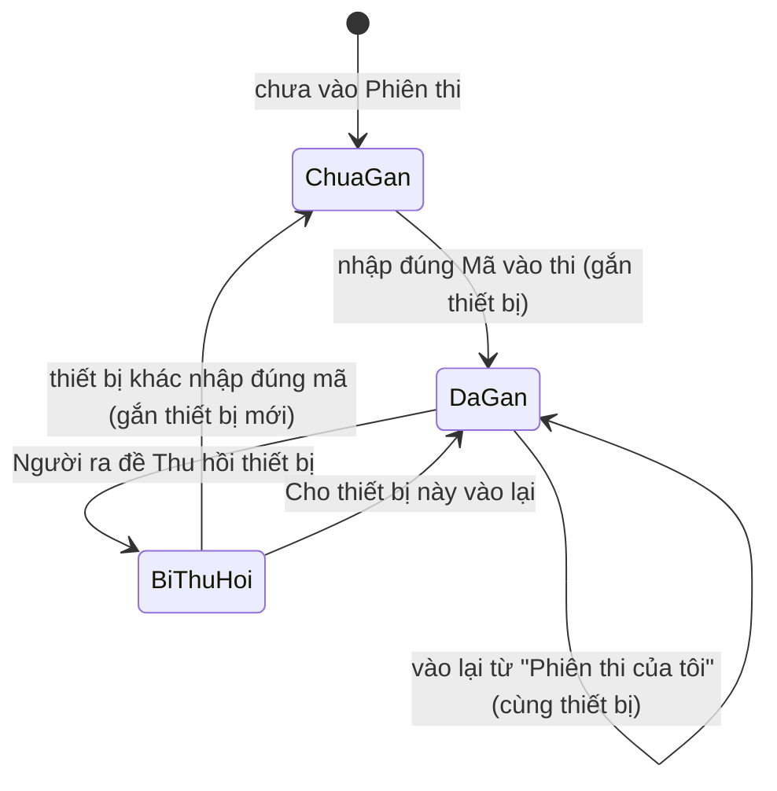
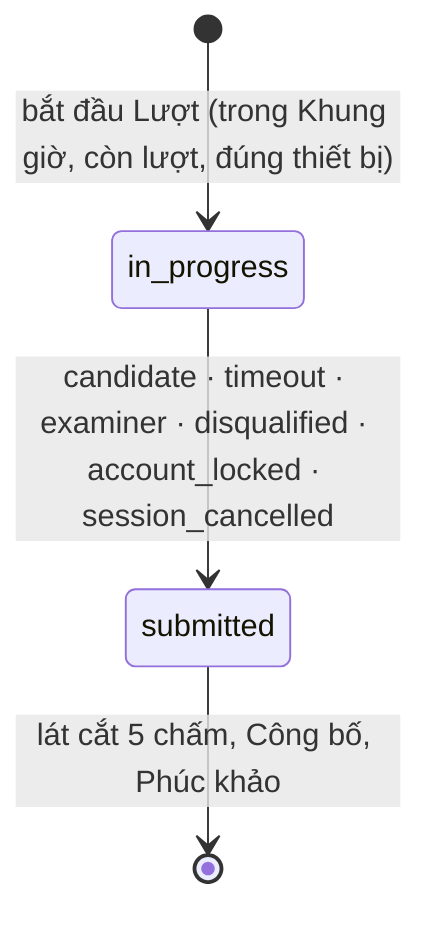
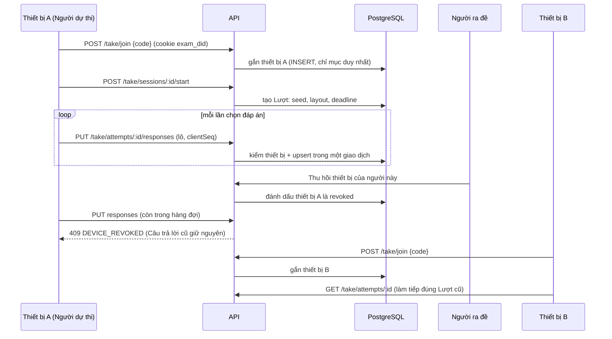

# Lát cắt 4: Phiên thi, Lượt làm bài và Theo dõi phòng thi

> Trạng thái: **accepted** (1/11/2026): chủ dự án đã đồng ý Q192–Q211 qua ba vòng hỏi đáp và Q212–Q222 cùng năm thuật ngữ mới. Chưa có dòng code nào; mỗi PR 4a–4e vẫn cần thiết kế chi tiết và seam test được duyệt riêng. Thuật ngữ theo [GLOSSARY.md](../../GLOSSARY.md) (đã thêm Thiết bị dự thi, Thu hồi thiết bị, Cắt cứng, Đóng cửa vào thi, Cộng giờ, Buộc nộp, Hủy Phiên thi); nền tảng ở [architecture.md](../architecture.md), [data-model.md](../data-model.md), [ADR-0005](../adr/0005-chup-noi-dung-khi-phat-hanh.md), [ADR-0007](../adr/0007-gan-thiet-bi-du-thi-bang-ma-thiet-bi.md) (accepted).

## Mục tiêu

Sau lát cắt 4:
- Người ra đề tạo **Phiên thi** từ một Bộ đề đã Phát hành, lập **Danh sách dự thi**, đặt **Mã vào thi**, Khung giờ, Thời lượng và các thiết lập làm bài.
- **Người dự thi** đăng nhập, nhập Mã vào thi, làm bài trên điện thoại (hai chế độ 1 câu / Cả đề), bài tự lưu và chịu được mạng chập chờn, rồi Nộp bài hoặc tự nộp khi hết giờ.
- Mỗi Người dự thi chỉ dự thi trên **một thiết bị** trong một Phiên thi; Người ra đề **Thu hồi thiết bị** khi thiết bị gặp sự cố để người đó làm tiếp trên máy khác.
- Người ra đề **theo dõi phòng thi trực tiếp**: ai đang làm, mất kết nối, rời màn hình; Cộng giờ, Thu hồi thiết bị, Đóng cửa vào thi, Buộc nộp, ghi Vi phạm và Đình chỉ.

**Ngoài phạm vi (lát cắt 5):** Chấm tự động và thủ công, điểm, Mức xử lý áp lên điểm, Công bố kết quả, Phúc khảo, Đính chính đáp án, Chốt kết quả, xuất Excel. Sau lát cắt 4, Lượt làm bài dừng ở trạng thái `submitted`; Người dự thi chỉ thấy "Đã nộp".

Bất biến vẫn giữ: Đáp án đúng không bao giờ có trong response gửi Người dự thi; server quyết định hạn và thời điểm; Câu trả lời ghi vào PostgreSQL trước khi API báo thành công; Lượt làm bài chỉ đọc `exam_items.snapshot`.

## Quyết định (Q192–Q222)

| # | Quyết định | Trạng thái |
|---|---|---|
| Q192 | Thiết bị nhận diện bằng **mã thiết bị** trong cookie `exam_did` (không theo Phiên đăng nhập, không vân tay trình duyệt). ADR-0007 | đã duyệt |
| Q193 | Thiết bị **gắn ở lần đầu nhập đúng Mã vào thi**; thiết bị khác không vào thi, bắt đầu hay lưu bài được, nhưng vẫn đăng nhập được | đã duyệt |
| Q194 | **Thu hồi thiết bị**: thiết bị cũ bị chặn ngay; bị loại vĩnh viễn khỏi Phiên thi cho người đó; thiết bị mới đầu tiên nhập đúng mã làm tiếp đúng Lượt cũ (đồng hồ không dừng, Người ra đề Cộng giờ nếu cần); thu hồi nhầm thì "Cho thiết bị này vào lại"; Câu trả lời đang nằm trong hàng đợi máy cũ bị từ chối | đã duyệt |
| Q195 | Thuật ngữ **Thiết bị dự thi**, **Thu hồi thiết bị**; bỏ cách nói "Cho phép đổi thiết bị" | đã duyệt (đã vào GLOSSARY) |
| Q196 | Chấm tự động thuộc lát cắt 5; lát cắt 4 chỉ lưu Câu trả lời và Nộp bài | đã duyệt |
| Q197 | Không có Tạm dừng toàn Phiên thi (backlog). Sự cố cả phòng: **Cộng giờ** (cá nhân hoặc cả phòng), **Đóng cửa vào thi**, **Buộc nộp cả phòng** | đã duyệt |
| Q198 | Hệ thống chỉ **ghi** sự kiện bất thường (rời màn hình, mất kết nối, thiết bị lạ vào thi); Vi phạm, Cảnh cáo, Đình chỉ, Mức xử lý do Người ra đề quyết định | đã duyệt |
| Q199 | Xáo trộn: công tắc Phiên thi tắt thì không xáo; bật thì xáo thứ tự câu trong từng Phần (không xáo Phần) và Phương án của những câu có `shuffleOptions`; mỗi Lượt có `seed` riêng, thứ tự cố định kể cả khi đổi thiết bị | đã duyệt |
| Q200 | **Danh sách dự thi**: thêm theo tên, Mã định danh hoặc cả Lớp (chụp tại thời điểm bấm); chỉ người mang Nhãn Người dự thi, chưa Khóa hay Xóa; Người ra đề không tự thêm mình (Q144, `owner_cannot_sit`); trước khi mở thêm bớt tự do, sau khi mở chỉ bớt người chưa có Lượt nào; tối đa 500 người; chưa có tài khoản thì dùng Yêu cầu cấp tài khoản; Cấp lại mật khẩu tạm cho người trong Danh sách | đã duyệt |
| Q201 | **Mã vào thi**: 6 ký tự chữ hoa và số bỏ ký tự dễ nhầm (0/O, 1/I/L), không phân biệt hoa thường, Người ra đề đặt tay được (4–12 ký tự); một thông báo lỗi chung cho "sai mã" và "không có trong Danh sách"; sai quá 5 lần/10 phút bị chặn tạm; mã chỉ dùng cho lần vào đầu tiên, sau đó vào lại từ "Phiên thi của tôi"; đổi mã không ảnh hưởng người đã vào | đã duyệt |
| Q202 | Trạng thái hiện cho Người ra đề: **Sắp mở, Đang mở, Đóng cửa vào thi, Đã đóng, Đã hủy** (lát cắt 5 thêm Đã Công bố, Đã Chốt). Sắp mở: sửa mọi thứ. Đã mở: chỉ kéo dài Khung giờ hoặc Thời lượng, đổi mã, thêm người; **không** đổi hai công tắc xáo trộn và Bộ đề. Xóa chỉ khi chưa từng có Lượt làm bài, còn lại **Hủy** | đã duyệt |
| Q203 | **Hủy Phiên thi** (không hoàn tác): nộp mọi Lượt đang làm với lý do `session_cancelled`, không ai vào nữa, không tính Kết quả, vẫn xem lại. Muốn thi lại: Nhân bản Bộ đề, Phát hành, tạo Phiên thi mới (Q173). Q178 giữ nguyên: Bộ đề đã Phát hành không xóa, chỉ Lưu trữ; Bộ đề Lưu trữ không chọn được cho Phiên thi mới, Phiên thi đã tạo vẫn chạy. **Nhân bản Phiên thi** (thiết lập và Danh sách; mã, giờ mới) có | đã duyệt |
| Q204 | Chia PR 4a–4e (xem mục "Chia PR"); mỗi PR có thiết kế chi tiết và seam test duyệt riêng | đã duyệt |
| Q205 | Xóa người dùng là Người ra đề: mọi Phiên thi (kể cả đang diễn ra) sang người nhận cùng Bộ đề; Chuyển giao Chủ đề không đụng Phiên thi; Xóa người dùng là Người dự thi đang có Lượt: Lượt nộp tự động (Q76) | đã duyệt |
| Q206 | `/take`: ô Nhập Mã vào thi ở đầu, dưới là **Phiên thi của tôi** (Đang mở / Sắp mở / Đã xong); menu chuyển khu "Soạn đề" ↔ "Làm bài" cho người mang cả hai Nhãn (Q143); chưa Công bố thì chỉ thấy "Đã nộp" | đã duyệt |
| Q207 | Trước PR 4d, dựng 2–3 **prototype màn Theo dõi** trên nhánh `prototype/theo-doi` để chủ dự án chọn (Q110) | đã duyệt |
| Q208 | Khung giờ chỉ giới hạn việc **bắt đầu** (đúng GLOSSARY); mỗi Lượt được đủ Thời lượng. Công tắc Phiên thi **"Cắt cứng khi đóng Khung giờ"** (mặc định tắt): Lượt kết thúc lúc đóng. Sửa mâu thuẫn giữa GLOSSARY và kiến trúc 5.1 | đã duyệt |
| Q209 | Một thiết bị chỉ phục vụ **một** Người dự thi trong một Phiên thi; không có công tắc tắt quy tắc 1 thiết bị | đã duyệt |
| Q210 | Màn xác nhận trước khi bắt đầu hiện tên Bộ đề, Thời lượng, số câu, số lượt còn lại và nói rõ hệ thống ghi nhận thiết bị, địa chỉ IP, việc rời màn hình | đã duyệt |
| Q211 | Chuông thông báo cho Người dự thi đúng ba loại: được thêm vào Danh sách, Phiên thi bị Hủy, Phiên thi đổi giờ mở hoặc đóng. Cộng giờ, Cảnh cáo, Đình chỉ hiện trực tiếp trên màn hình bài thi | đã duyệt |
| Q212 | **Tự nộp bằng job quét lặp** (BullMQ repeatable, mỗi 10 giây) cộng với đóng lười khi có request, thay cho một job trễ riêng cho mỗi Lượt như kiến trúc 5.1 bước 4 | đã duyệt |
| Q213 | **Heartbeat bằng REST** (15 giây, kèm sự kiện rời màn hình); response mang trạng thái (hạn mới, đã đóng, thiết bị bị thu hồi, Cảnh cáo). **Socket.IO chỉ để đẩy sớm** cho Người dự thi và để cập nhật màn Theo dõi; mất Socket.IO thì hệ thống vẫn đúng, chỉ chậm tối đa 15 giây | đã duyệt |
| Q214 | **Chưa cache** nội dung Bộ đề trong Redis ở bản đầu; đo bằng k6 ở PR 4e rồi mới quyết (kiến trúc mục 11 dự kiến có cache) | đã duyệt |
| Q215 | **Mệnh đề** của chùm đúng/sai **không xáo** (giữ nhãn a, b, c, d); chỉ xáo Phương án của câu chọn một và chọn nhiều | đã duyệt |
| Q216 | Lưu Câu trả lời **theo lô** (tối đa 50 câu mỗi request), idempotent theo `clientSeq`; một lần lưu một câu là lô có một phần tử | đã duyệt |
| Q217 | Lớp bảo vệ ở **cơ sở dữ liệu** (như Q172): trigger cấm sửa nội dung Lượt làm bài sau khi tạo, cấm sửa `value` của Câu trả lời khi Lượt đã nộp, cấm đổi Bộ đề và xáo trộn của Phiên thi đã có Lượt, cấm bớt người đã có Lượt khỏi Danh sách | đã duyệt |
| Q218 | **Khóa đăng nhập hoặc Xóa người dùng giữa lúc đang thi** (Q76): `identity` gọi các bên đăng ký qua một cổng `UserDeactivationHooks`, `attempt` đăng ký để nộp Lượt với lý do `account_locked`; `identity` không import `attempt` | đã duyệt |
| Q219 | **Ảnh cho Người dự thi**: xem được ảnh của Bộ đề khi có Lượt đang làm trên đúng thiết bị đã gắn; qua cổng `CandidateMedia`, `question-bank` không biết Lượt làm bài | đã duyệt |
| Q220 | **Xem thử qua Phiên thi** của Người ra đề dùng chính giao diện làm bài nhưng không tạo `attempts`, không gắn thiết bị, không lưu Câu trả lời lên server (chỉ giữ trong trình duyệt) | đã duyệt |
| Q221 | Lát cắt 4 chỉ **ghi Vi phạm** (hành động Cảnh cáo hoặc Đình chỉ, lý do); **Mức xử lý** (trừ phần trăm, hủy kết quả) chọn ở lát cắt 5 khi có điểm. Cột `penalty_*` có sẵn nhưng để mặc định `none` | đã duyệt |
| Q222 | **Mã vào thi duy nhất theo thời gian**: ràng buộc loại trừ (`EXCLUDE USING gist`) hai Phiên thi chưa hủy trùng mã mà Khung giờ chồng nhau, thay cho "duy nhất khi chưa Chốt" của data-model (vì Chốt chỉ có ở lát cắt 5 và sẽ giữ mã mãi) | đã duyệt |
| Q223 | **Ranh giới module bằng cổng thô theo nghiệp vụ** (phương án A, chủ dự án duyệt 2/11/2026, làm ở đầu 4b): `ExamCatalog` (`exam` cài đặt, `session` dùng), `CandidateDirectory` (`identity` cài đặt, `session` dùng), `SessionEntry` (`session` cài đặt, `attempt` dùng: một truy vấn nối trong chính `session` trả trạng thái, thiết lập và giờ cộng sẵn). Kèm một test kiến trúc cấm `session` import bảng của `exam` và `identity`. Đo trên 500 người: nối bảng p50 3,1 ms, qua cổng hai truy vấn p50 4,0 ms; đường nóng lúc thi không đi qua `users` hay `exams` | đã duyệt |
| Q224 | **Cấu hình cho 500 người cùng nơi** (làm ở 4b): kích thước nhóm kết nối Postgres đọc từ biến môi trường (`DB_POOL_MAX`, mặc định giữ 10) và kiểm tra lại cách api nhận địa chỉ IP thật sau nginx và Cloudflare; môi trường demo đặt `LOGIN_MAX_PER_IP` từ 1000 trở lên vì cả lớp dùng chung một IP | đã duyệt |
| Q225 | **Demo trên laptop WSL** theo [docs/ops/demo-wsl.md](../ops/demo-wsl.md): pod `prod-exam`, tên miền giá rẻ mua riêng, ra Internet qua `cloudflared`. Chủ dự án sẽ tự dừng và xóa pod `prod-plotracker` khi triển khai | đã duyệt |

### Lý do của Q212–Q222

- **Q212.** Kiến trúc đặt một job trễ cho mỗi Lượt. Mỗi lần Cộng giờ phải dời job (BullMQ có `changeDelay`, nhưng chỉ khi job còn ở trạng thái chờ), và mất Redis là mất hẹn giờ. Job quét lặp cần thao tác `UPDATE ... WHERE status = 'in_progress' AND deadline + ân hạn < now() ... FOR UPDATE SKIP LOCKED`, đọc hạn từ PostgreSQL (nguồn sự thật duy nhất), nên Cộng giờ không phải đụng hàng đợi và mất Redis không mất bài. Độ trễ tối đa 10 giây không ảnh hưởng điểm: Câu trả lời gửi sau `deadline + ân hạn (30 giây)` đã bị từ chối ngay ở request. *Loại:* job trễ mỗi Lượt (phức tạp hơn, không đúng hơn); chỉ dựa đóng lười (Lượt không ai chạm vào sẽ treo ở `in_progress`, làm sai màn Theo dõi).
- **Q213.** Safari/iPhone không đáng tin cậy với WebSocket nền và Background Sync (Workbox chỉ phát lại khi service worker khởi động), và Người dự thi chủ yếu dùng điện thoại. 300 người heartbeat mỗi 15 giây chỉ là 20 request/giây. Việc chặn thiết bị cũ luôn được thực thi ở lần lưu kế tiếp, không phụ thuộc kênh đẩy. *Loại:* heartbeat qua WebSocket (như kiến trúc 5.4): thêm một đường lỗi và mỗi kết nối phải xác thực lại.
- **Q214, Q215, Q216:** đơn giản hóa bản đầu, đo trước khi tối ưu; Mệnh đề giữ nhãn a, b, c, d vì xáo thứ tự dễ gây nhầm khi Người dự thi đối chiếu với đề in; lô giúp xả hàng đợi IndexedDB sau khi có mạng lại bằng một request.
- **Q217–Q222:** các lớp bảo vệ và quy tắc phụ giữ cho thiết kế nhất quán; lý do ghi trong từng mục tương ứng bên dưới.

## Luồng chính

### Vòng đời thiết bị và Lượt làm bài





### Vào thi, làm bài, Thu hồi thiết bị



### Hạn nộp bài

```text
Khi bắt đầu Lượt:
  deadline = bắt đầu + Thời lượng + roster.extra_minutes
  nếu Phiên thi bật "Cắt cứng": deadline = min(deadline, closes_at)

Cộng giờ (cá nhân/cả phòng): attempts.deadline += phút   (ghi attempt_time_extensions)
Nhận Câu trả lời : chỉ khi status = in_progress và now ≤ deadline + ân hạn (30 giây)
Quá hạn           : job quét lặp / đóng lười → submitted, reason = timeout
```

Mọi lúc, client chỉ hiển thị: `deadline` và `serverNow` trả về trong response để client tự tính độ lệch đồng hồ.

## Mô hình dữ liệu (đề xuất, thay đổi so với data-model mục 4–5)

Mỗi PR có migration riêng (expand-only): **0012** (4a), **0013** (4b), **0014** (4d). `data-model.md` và `architecture.md` được cập nhật khi PR tương ứng hợp nhất.

```sql
-- 0012 (PR 4a) -----------------------------------------------------------------------------
CREATE EXTENSION IF NOT EXISTS btree_gist;

sessions (
  id, exam_id → exams (không phải nháp; trigger kiểm), owner_id → users, title,
  opens_at, closes_at CHECK (closes_at > opens_at), duration_minutes CHECK (1..600),
  hard_close bool DEFAULT false,                        -- Q208
  max_attempts int DEFAULT 1 CHECK (1..5),
  attempt_scoring enum('highest','latest') DEFAULT 'highest',
  shuffle_items bool DEFAULT false, shuffle_options bool DEFAULT false,   -- Q199
  show_scoring_rules bool DEFAULT false,                -- Q170: Người dự thi có thấy scoringRule/ladder không
  access_code text NOT NULL CHECK (access_code = upper(access_code) AND length(access_code) BETWEEN 4 AND 12),
  entry_closed_at NULL,                                 -- "Đóng cửa vào thi"
  cancelled_at NULL, cancelled_by → users, cancel_reason text NULL,   -- "Hủy Phiên thi"
  version int DEFAULT 1                                 -- khóa lạc quan khi sửa
)
-- Q222: hai Phiên thi chưa hủy không trùng mã khi Khung giờ chồng nhau
EXCLUDE USING gist (access_code WITH =, tstzrange(opens_at, closes_at, '[]') WITH &&) WHERE (cancelled_at IS NULL)
-- Cột released_at, finalized_at, appeal_period_hours thêm ở lát cắt 5.

session_roster (
  session_id → sessions ON DELETE CASCADE, user_id → users, added_by → users, added_at,
  extra_minutes int DEFAULT 0 CHECK (0..600),           -- giờ cộng sẵn cho từng người (ví dụ hỗ trợ đặc biệt)
  PK (session_id, user_id)
)
INDEX (user_id)                                         -- "Phiên thi của tôi"
-- Trigger: INSERT thì user_id <> sessions.owner_id (Q144; đổi chủ sau đó xử lý ở mục Rủi ro); cấm DELETE dòng của người đã có Lượt (Q217).

-- 0013 (PR 4b) -----------------------------------------------------------------------------
session_devices (                                       -- Thiết bị dự thi (ADR-0007)
  id, session_id → sessions, user_id → users,
  device_hash text NOT NULL,                            -- SHA-256 của cookie exam_did
  ip inet, user_agent text,                             -- để Người ra đề nhận ra thiết bị lạ
  status enum('active','revoked'),                      -- Cho vào lại: revoked → active, ghi pardoned_at (Q234)
  bound_at, revoked_at, revoked_by → users, revoke_reason text NULL, pardoned_at NULL
)
UNIQUE (session_id, user_id)     WHERE status = 'active'    -- tối đa một thiết bị đang gắn mỗi người
UNIQUE (session_id, device_hash) WHERE status = 'active'    -- một thiết bị chỉ phục vụ một người (Q209)
-- Thiết bị bị loại = tồn tại dòng status='revoked' cho (session_id, user_id, device_hash).

attempts (
  id, session_id → sessions ON DELETE RESTRICT, user_id → users, attempt_no int,
  seed bigint, layout jsonb,                            -- thứ tự câu/Phương án, cố định suốt Lượt
  started_at, deadline timestamptz NOT NULL,            -- nguồn sự thật của hạn
  submitted_at NULL,
  submit_reason enum('candidate','timeout','examiner','disqualified','account_locked','session_cancelled') NULL,
  status enum('in_progress','submitted'),               -- lát cắt 5 thêm 'graded'
  UNIQUE (session_id, user_id, attempt_no)
)
UNIQUE (session_id, user_id) WHERE status = 'in_progress'
INDEX (status, deadline) WHERE status = 'in_progress'   -- job quét
-- Bỏ cột active_auth_session_id của data-model: thiết bị nằm ở session_devices.
-- Cột điểm (auto_score, manual_score, raw_score, max_score) thêm ở lát cắt 5.

responses (
  attempt_id → attempts ON DELETE RESTRICT, item_id → exam_items,
  value jsonb, client_seq int, saved_at, flagged bool DEFAULT false,
  PK (attempt_id, item_id)
)
-- Cột điểm và chấm thủ công thêm ở lát cắt 5.
-- Trigger (Q217): attempts: không đổi session_id, user_id, attempt_no, seed, layout, started_at; chỉ in_progress → submitted.
--   responses: không INSERT/UPDATE value, client_seq, flagged khi attempts.status <> 'in_progress'.
--   sessions: không đổi exam_id, shuffle_items, shuffle_options khi đã có attempts.

-- 0014 (PR 4d) -----------------------------------------------------------------------------
session_events (                                        -- Q198: chỉ ghi nhận
  id bigserial, session_id, user_id, attempt_id NULL,
  type enum('tab_hidden','tab_visible','went_offline','back_online','device_rejected'),
  data jsonb, at timestamptz                            -- `at` là giờ server nhận
)
attempt_time_extensions (
  id, attempt_id, minutes int, scope enum('one','all'), reason text, by → users, at
)
violations (                                            -- giữ nguyên data-model; Q221 chỉ dùng action + reason ở lát cắt 4
  id, attempt_id, session_id, user_id, action enum('warning','disqualify'), reason text NOT NULL,
  penalty_type enum('none','percent','void') DEFAULT 'none', penalty_percent NULL,
  recorded_by → users, recorded_at, penalty_decided_at NULL
)
```

Cấu trúc `value` của Câu trả lời (kiểm theo `snapshot`, id không có trong snapshot bị từ chối):

| Loại | `value` |
|---|---|
| Chọn một | `{ "optionId": "o2" }` hoặc `null` |
| Chọn nhiều | `{ "optionIds": ["o2", "o4"] }` |
| Chùm đúng/sai | `{ "answers": { "s1": true, "s2": false } }` (có thể thiếu Mệnh đề) |
| Tự luận ngắn | `{ "text": "..." }`, độ dài ≤ `maxLength` |

`layout`: `{ sections: [{ sectionId, items: [{ itemId, optionOrder?: [id...] }] }] }`, tạo bằng hàm thuần `layoutOf(seed, snapshotItems, { shuffleItems, shuffleOptions })` dùng bộ sinh số giả ngẫu nhiên có hạt giống, nên cùng `seed` cho cùng thứ tự.

## Cấu trúc module và seam

Theo kỹ năng `codebase-design`: mỗi module sâu, giao diện nhỏ, seam đặt ở nơi test và người gọi cùng đi qua.

```text
apps/api/src/modules/
  session/     Phiên thi, Danh sách dự thi, thiết lập, hành động của Người ra đề
  attempt/     vào thi, Thiết bị dự thi, Lượt làm bài, Câu trả lời, Nộp bài, hạn
  realtime/    Socket.IO gateway: đẩy sự kiện, presence (Q213)
```

### `attempt` (module sâu nhất)

Giao diện công khai (mọi thứ ngoài module chỉ biết các hàm này):

```ts
interface Attempts {
  join(user, deviceKey, code): Promise<JoinResult>;                    // gắn thiết bị, trả Phiên thi + trạng thái
  start(user, deviceKey, sessionId): Promise<AttemptView>;             // tạo Lượt hoặc làm tiếp Lượt đang mở
  view(user, deviceKey, attemptId): Promise<AttemptView>;              // nội dung đã lọc, theo layout, kèm Câu trả lời đã lưu
  saveResponses(user, deviceKey, attemptId, items): Promise<SaveResult[]>;  // lô, idempotent theo clientSeq
  submit(user, deviceKey, attemptId): Promise<void>;
  heartbeat(user, deviceKey, attemptId, events): Promise<AttemptState>;
  close(attemptId, reason): Promise<void>;                             // dùng cho worker, Người ra đề, Khóa đăng nhập, Hủy Phiên thi
}
```

Sau giao diện này là: `DeviceGate` (kiểm thiết bị **trong cùng giao dịch** với thao tác ghi, khóa dòng gắn bằng `FOR SHARE`, nên không có chuyện lưu xen vào giữa lúc Thu hồi), các hàm thuần `deadlineOf`, `layoutOf`, `responseSchemaFor(snapshot)`, `phaseOf`, và việc dựng `AttemptView` từ `candidateViewOf` (Đáp án không thể lọt vào). Seam nội bộ: `CLOCK` (đã có) để tua thời gian trong test.

**Thiết kế hai lần (giao diện của `attempt`)**

| | A. Một hàm cho mỗi việc (đề xuất) | B. Một lệnh `act(attemptId, command)` |
|---|---|---|
| Độ sâu | Mỗi hàm sâu, ít tham số | Một lối vào nhưng `command` là union lớn, gọi phải biết cả union |
| Test | Test theo từng hành vi, đọc như đặc tả | Test phải dựng lệnh, gom nhiều hành vi vào một chỗ |
| Quyền | Mỗi route khai báo quyền riêng, `@RequireTag('candidate')` rõ ràng | Phải phân quyền theo loại lệnh bên trong |
| Phù hợp NestJS/REST | Trùng với route | Phải ánh xạ lại |

Chọn A. Examiner không gọi `attempt` trực tiếp ngoài `close`; hành động của Người ra đề đi qua `session` (xem dưới), để quyền sở hữu được kiểm ở một nơi.

### `session`

```ts
interface Sessions {
  create / update / duplicate / cancel / remove(owner, ...)
  roster: add / addClass / remove / reissuePassword(owner, ...)
  monitor(owner, sessionId): MonitorSnapshot
  extendTime / closeEntry / forceSubmit / revokeDevice / pardonDevice / recordViolation(owner, ...)
}
```

`session` gọi `attempt.close` và `attempt.listOf(sessionId)` qua service công khai; `attempt` đọc `sessions` để biết thiết lập. Quan hệ hai chiều này nằm trong một cổng đọc nhỏ `SessionSettings` mà `session` cài đặt và `attempt` dùng, để không import vòng.

### Các cổng nối module (cùng mẫu `EXAM_USAGE`, `OWNED_CONTENT`)

| Cổng | Bên dùng | Bên cài | Việc |
|---|---|---|---|
| `SessionSettings` | `attempt` | `session` | đọc Phiên thi, Danh sách dự thi, giờ, thiết lập |
| `CandidateMedia` (Q219) | `question-bank` (phục vụ ảnh) | `attempt` | Người dự thi có Lượt đang làm trên đúng thiết bị thì xem được ảnh của Bộ đề |
| `UserDeactivationHooks` (Q218) | `identity` | `attempt` | Khóa đăng nhập hoặc Xóa người dùng thì nộp Lượt `account_locked` |
| `SessionUsage` (`SESSION_USAGE`) | `exam` | `session` | số Phiên thi chưa hủy dùng một Bộ đề (hiện ở Bộ đề) |
| `OWNED_CONTENT` thêm nhà cung cấp | `identity` | `session` | Xóa người dùng chuyển cả Phiên thi (Q205) |

### Seam test (đề nghị duyệt theo quy trình tdd)

| # | Seam | Bắt được | Không bắt được |
|---|---|---|---|
| S1 | Hàm thuần (unit): `phaseOf`, `deadlineOf` (cả "Cắt cứng"), `layoutOf` (xáo, hạt giống, Phần không xáo, Mệnh đề không xáo), `responseSchemaFor`, chuẩn hóa và sinh Mã vào thi | luật Q199, Q201, Q202, Q208 | nối dây, SQL |
| S2 | HTTP + PostgreSQL + Redis thật (integration) cho `session` và `attempt` | quyền sở hữu, luồng đầy đủ, mã lỗi, `NOT_FOUND` cho người khác, Đáp án không lọt vào JSON | giao diện |
| S3 | SQL trực tiếp vào bảng (như Q172): trigger, chỉ mục duy nhất, ràng buộc loại trừ | lớp bảo vệ thứ hai ở DB | hành vi service |
| S4 | Đồng thời: hai thiết bị nhập mã cùng lúc; lưu xen Thu hồi; lưu xen Nộp bài; hai lần bắt đầu; job quét xen Nộp bài | điều kiện tranh chấp | hành vi trên mạng thật |
| S5 | Worker: gọi trực tiếp hàm xử lý job với `CLOCK` giả | tự nộp đúng giờ, không nộp sớm, an toàn khi chạy hai lần | Redis/BullMQ thật |
| S6 | Playwright (điện thoại và máy tính): 4a luồng Người ra đề; 4c Người dự thi vào, làm, mất mạng (`setOffline`), tải lại, hết giờ, hai ngữ cảnh trình duyệt để thử thiết bị thứ hai; 4d Người ra đề Thu hồi, Người dự thi làm tiếp ở ngữ cảnh khác | toàn tuyến | tải lớn |
| S7 | Socket.IO bằng `socket.io-client` trong integration test | sự kiện đẩy đến đúng phòng; hỏng kênh đẩy vẫn đúng nhờ heartbeat | trình duyệt thật |
| S8 | Quét JSON mọi response `/take/*` | bất biến "không có Đáp án" (khóa `key`, `rubric`, và `scoringRule`/`ladder` khi tắt) | |
| S9 | k6 500 người (PR 4e) | điểm nghẽn, cần cache hay không (Q214) | |

Không kiểm: service worker và cache PWA ở mức đơn vị (kiểm bằng Playwright); giao diện từng pixel.

## API (đề xuất)

Người ra đề (`@RequireTag('examiner')`, chỉ chủ Phiên thi, người khác nhận `NOT_FOUND`):

| Route | Việc |
|---|---|
| `GET/POST /sessions`, `GET/PUT /sessions/:id` | danh sách, tạo, chi tiết, sửa (kèm `version`) |
| `POST /sessions/:id/duplicate`, `/cancel`; `DELETE /sessions/:id` | Nhân bản, Hủy, Xóa (chỉ khi chưa có Lượt) |
| `GET /sessions/:id/roster/search?q=&class=`; `POST/DELETE /sessions/:id/roster` | tìm người, thêm theo người hoặc theo Lớp, bớt |
| `POST /sessions/:id/roster/:userId/reissue-password` | Cấp lại mật khẩu tạm (hiện một lần) |
| `GET /sessions/:id/monitor` | ảnh chụp trạng thái cả phòng (cũng là đường dự phòng khi Socket.IO hỏng) |
| `POST /sessions/:id/close-entry`, `/force-submit` | Đóng cửa vào thi, Buộc nộp cả phòng |
| `POST /sessions/:id/attempts/:attemptId/extend \| force-submit \| violations` | Cộng giờ, Buộc nộp, ghi Vi phạm (Cảnh cáo hoặc Đình chỉ) |
| `POST /sessions/:id/roster/:userId/revoke-device \| pardon-device` | Thu hồi thiết bị, Cho thiết bị vào lại |
| `GET /sessions/:id/try` | Xem thử qua Phiên thi (nội dung như Người dự thi, không ghi gì, Q220) |

Người dự thi (`@RequireTag('candidate')`, cookie `exam_did` bắt buộc):

| Route | Việc |
|---|---|
| `GET /take/sessions` | Phiên thi của tôi |
| `POST /take/join` | nhập Mã vào thi, gắn thiết bị |
| `POST /take/sessions/:id/start` | bắt đầu hoặc làm tiếp Lượt |
| `GET /take/attempts/:id` | nội dung đã lọc, theo layout, kèm Câu trả lời và `deadline`, `serverNow` |
| `PUT /take/attempts/:id/responses` | lưu lô Câu trả lời |
| `POST /take/attempts/:id/submit`, `/heartbeat` | Nộp bài, heartbeat |

Mã lỗi mới: `INVALID_ACCESS_CODE` (một mã chung, Q201), `INVALID_STATE` với `reason` thuộc `DEVICE_BOUND_ELSEWHERE`, `DEVICE_REVOKED`, `NOT_OPEN_YET`, `ENTRY_CLOSED`, `WINDOW_CLOSED`, `ATTEMPTS_EXHAUSTED`, `ATTEMPT_CLOSED`, `SESSION_CANCELLED`, `OWNER_CANNOT_SIT`; `CONFLICT {field: version}` khi sửa Phiên thi từ hai nơi.

## Thời gian thực (PR 4d)

- **Presence** trong Redis: hash `presence:{sessionId}`, mỗi người một trường `{lastSeen, visible}`; trạng thái "mất kết nối" suy ra khi đọc (`now - lastSeen > 45 giây`), không cần bộ đếm giờ.
- **Heartbeat** `POST /take/attempts/:id/heartbeat` mỗi 15 giây, kèm các thay đổi hiển thị tab từ lần trước (`tab_hidden`/`tab_visible`, giờ nhận của server làm chuẩn). Response mang `{deadline, status, serverNow, deviceOk, notices[]}` nên mọi thay đổi (Cộng giờ, đã đóng, thiết bị bị thu hồi, Cảnh cáo) đến Người dự thi trong tối đa 15 giây dù Socket.IO hỏng.
- **Socket.IO** (`/ws`, xác thực cookie `exam_sid` ngay lúc bắt tay, kiểm `Origin`): phòng `session:{id}` cho Người ra đề nhận **gói cập nhật gộp mỗi 2 giây** (không đẩy từng sự kiện, tránh 300 sự kiện/giây); phòng `attempt:{id}` đẩy sớm `time.extended`, `attempt.closed`, `device.revoked`, `warning`. Redis adapter đã nằm trong kiến trúc để chạy nhiều tiến trình.
- Màn Theo dõi mở bằng `GET /sessions/:id/monitor` rồi nhận gói gộp; mất Socket.IO thì tự hỏi lại mỗi 5 giây.
- Con số "đã trả lời N/M câu" lấy từ một truy vấn nhóm `responses` mỗi 5 giây, dùng chung cho mọi người đang xem.

## Chia PR (Q204)

| PR | Phạm vi | Migration | Kiểm thử chính |
|---|---|---|---|
| **4a** Phiên thi và Danh sách dự thi | `session`: tạo theo các bước, danh sách và lọc trạng thái, chi tiết, sửa theo trạng thái (Q202), thiết lập, Mã vào thi, thêm theo người hoặc Lớp, Cấp lại mật khẩu tạm, Nhân bản, Hủy, Xóa, thông báo "được thêm vào" và "bị Hủy" và "đổi giờ"; `ExamUsage` hiện số Phiên thi trên Bộ đề; ràng buộc loại trừ mã | 0012 | S1, S2, S3, S6 |
| **4b** Vào thi và Lượt làm bài (API), chia 4b-1 và 4b-2 (Q226) | `attempt`: `join`, Gắn thiết bị, `start`, `view`, `saveResponses`, `submit`, `close`, job quét tự nộp, hook Khóa đăng nhập (Q218), ảnh cho Người dự thi (Q219), cookie `exam_did` | 0013 | S1, S2, S3, S4, S5, S8 |
| **4c** Khu làm bài `/take` | giao diện điện thoại theo prototype đã duyệt: Phiên thi của tôi, nhập mã, màn xác nhận (Q210), hai chế độ, lưới số câu, đồng hồ có cảnh báo 5 và 1 phút, hàng đợi IndexedDB tự xả, hộp thoại xác nhận Nộp bài, báo thiết bị bị thu hồi, menu chuyển khu (Q143), Xem thử qua Phiên thi (Q220), PWA | không | S6 |
| **4d** Theo dõi phòng thi | prototype trước (Q207), rồi: Socket.IO, presence, `session_events`, Cộng giờ, Thu hồi thiết bị và Cho vào lại, Đóng cửa vào thi, Buộc nộp, Vi phạm và Đình chỉ (Q221) | 0014 | S2, S4, S6, S7 |
| **4e** Hoàn thiện | Phiên thi trong Chuyển giao và Xóa người dùng (Q205), k6 500 người (Q214), hướng dẫn dùng thử trong README | không | S2, S6, S9 |

Quy trình mỗi PR: thiết kế chi tiết và seam test cho riêng PR đó chốt với chủ dự án trước; làm theo từng lát dọc đỏ-xanh; chạy `code-review` (Standards và Spec); mở PR bằng skill `pr`; chờ CI xanh; chỉ merge khi chủ dự án ra lệnh.

## PR 4a: thiết kế chi tiết (đã duyệt 2/11/2026)

Chủ dự án đã đồng ý sáu điểm sau (không đánh số Q mới vì chỉ chi tiết hóa Q200–Q203, Q211):

1. **Tạo Phiên thi 3 bước** (Bộ đề và tên; Thời gian; Thiết lập làm bài và Mã vào thi), tạo xong chuyển sang tab Danh sách dự thi. Mã được gợi ý sẵn (`GET /sessions/access-code-suggestion`), có nút "Gợi ý mã khác".
2. **Cấp lại mật khẩu tạm bởi Người ra đề**, ba lớp chặn: chỉ cho tài khoản do chính Người ra đề xin cấp qua Yêu cầu cấp tài khoản (`account_request_items.outcome = 'created'`, `account_requests.requested_by`; không dùng `users.created_by` vì cột đó là người duyệt) và chủ tài khoản còn `must_change_password`, chưa Khóa; mật khẩu hiện một lần, hạn 7 ngày, thu hồi mọi phiên đăng nhập, ghi nhật ký và báo cho chủ tài khoản; điều kiện kiểm trong cùng giao dịch với việc đặt mật khẩu. Trường hợp khác trả `INVALID_STATE` với `reason: ASK_ADMIN`.
3. **Thêm người** theo tên, Mã định danh, Lớp, hoặc dán nhiều Mã định danh; mọi cách đều qua một đường duy nhất `POST /sessions/:id/roster` với `dryRun` để xem trước kết quả khớp.
4. **Giờ cố định GMT+7** khi nhập và hiển thị; năm hiển thị đủ bốn chữ số.
5. **Danh sách Phiên thi** lọc trạng thái, tìm tên không dấu, sắp theo giờ mở mới nhất; **Chi tiết** hai tab Tổng quan và Danh sách dự thi; **Danh sách dự thi** có tìm, phân trang 50, phút cộng sẵn sửa tại chỗ, Bớt từng người hoặc hàng loạt.
6. **Seam test** S1, S2, S3, S6 (không dùng S4, S5, S7 ở 4a vì chưa có Lượt làm bài); thêm một test cho tranh chấp trùng mã.

### Chi tiết thực hiện cần biết

- **Hàm thuần** ở `packages/shared/src/session.ts`: `phaseOf`, `sessionEditableFields`, `sessionChangeProblems`, `sessionSettingsSchema`, `sessionUpdateSchema`, `normalizeAccessCode`, `generateAccessCode`, `parseCodeList`.
- **Sửa theo trạng thái (Q202)** hiểu chặt: khi đã mở chỉ còn Giờ đóng (chỉ kéo dài), Thời lượng (chỉ kéo dài) và Mã vào thi; đổi tên cũng bị khóa (chủ dự án chốt 2/11/2026: tên chỉ khóa khi đã có Người dự thi tham gia; chưa ai vào thì vẫn đổi được trước giờ mở, nên với 4a "Sắp mở" đổi được và "đã mở" bị khóa là đủ; xét lại ở 4b nếu muốn cho đổi cả khi đang mở mà chưa ai vào). Vi phạm trả `VALIDATION_FAILED` với `locked` hoặc `cannot_shorten`.
- **Thông báo** (Q211): `session.added`, `session.rescheduled` (chỉ khi đổi giờ mở hoặc giờ đóng), `session.cancelled` (cả khi Xóa Phiên thi chưa hủy mà đã có người trong Danh sách), cùng `account.password_reissued`.
- **Hủy** gọi được ở mọi trạng thái trừ Đã hủy; từ 4b sẽ nộp các Lượt đang làm với lý do `session_cancelled`. **Xóa** chỉ khi chưa có Lượt (ở 4a luôn đúng; 4b thêm kiểm).
- **Nhân bản** dời giờ sang tuần sau (hoặc đủ số tuần để còn ở tương lai), mã mới, tên thêm " (bản sao)", mang theo người còn đủ điều kiện kèm phút cộng sẵn và báo họ.
- **Sắp xếp Danh sách dự thi** theo tên gọi (từ cuối của họ tên) rồi họ và tên lót, như cách xếp danh sách lớp.
- **Cổng `SESSION_USAGE`** (thay cho "ExamUsage mở rộng" của bảng cổng): `exam` hỏi số Phiên thi chưa hủy của Bộ đề (`sessionCount` ở danh sách và chi tiết Bộ đề); nối ở `SessionUsageWiringModule`, có mặt cả ở CLI và worker.
- **Trigger Q217 chuyển sang migration 0013** vì bảng `attempts` chưa tồn tại: cấm bớt người đã có Lượt khỏi Danh sách, và cấm đổi `exam_id`, `shuffle_items`, `shuffle_options` của Phiên thi đã có Lượt. Trigger `sessions_guard` của 0012 thêm quy tắc không hoàn tác Hủy (sau Hủy chỉ đổi chủ).
- **Cấp lại mật khẩu** bị chặn khi Phiên thi Đã đóng hoặc Đã hủy (không còn lý do cấp); nhật ký ghi `via: session-roster` và `sessionId`.
- **Giới hạn đã biết:** ô chọn Bộ đề liệt kê tối đa 100 Bộ đề đã Phát hành gần nhất; Người dự thi chưa có giao diện nào để thấy thông báo "được thêm vào" ngoài chuông thông báo (khu `/take` làm ở 4c).

## Prototype màn Theo dõi (Q207)

Trước 4d, dựng trên nhánh `prototype/theo-doi` với dữ liệu giả (300 người, trạng thái đổi theo thời gian), chạy được ở kích thước điện thoại và máy tính, để chủ dự án chọn một:

| | A. Bảng dày đặc | B. Lưới ghế | C. Ngoại lệ trước |
|---|---|---|---|
| Ý tưởng | một dòng mỗi người, cột trạng thái, đã làm, giờ còn lại, thiết bị; lọc theo chip | mỗi người một ô vuông tô màu theo trạng thái, giống sơ đồ phòng | hàng đầu chỉ hiện người cần chú ý (mất kết nối, rời màn hình nhiều lần, thiết bị lạ); cả danh sách thu gọn bên dưới |
| Mạnh | đủ chi tiết, hợp máy tính | nhìn một lần thấy cả phòng | nhanh với phòng đông người |
| Yếu | khó nhìn tổng thể trên điện thoại | ít chữ, khó thấy chi tiết | có thể bỏ sót người im lặng |

Dùng skill `prototype` và `ui-ux-pro-max`, kiểm bằng Playwright ở hai kích thước màn hình.

## Rủi ro và giới hạn đã biết

- **Người nhận Xóa người dùng cũng nằm trong Danh sách dự thi của một Phiên thi được chuyển** (vi phạm Q144 sau khi đổi chủ): cho phép chuyển, người đó không bắt đầu được (`OWNER_CANNOT_SIT`), và giao diện Danh sách hiện cảnh báo. Trường hợp hiếm; không chặn Xóa người dùng vì lý do này.
- **Phòng máy xóa sạch trình duyệt mỗi lần đăng nhập** làm mỗi lần là một thiết bị mới (ADR-0007). Chấp nhận, xét lại nếu thực tế gặp nhiều.
- **Câu trả lời trong hàng đợi của máy bị Thu hồi bị mất** (Q194), chỉ khi máy đó đang mất mạng lúc bị thu hồi.
- **Mã thiết bị không chứng minh danh tính**: người có cả mật khẩu lẫn thiết bị trong phòng vẫn thi hộ được. Quy tắc chỉ chặn thi hộ từ xa.
- **Người dự thi mở hai tab cùng thiết bị**: hợp lệ (cùng thiết bị); mọi tab dùng chung Lượt, `clientSeq` chống ghi đè cũ; tab sau cùng thắng ở mức từng câu.
- **Giờ máy của Người dự thi sai**: không ảnh hưởng, vì hạn do server giữ; đồng hồ hiển thị dùng độ lệch tính từ `serverNow`.
- **Kênh đẩy hỏng**: đúng nhưng chậm tối đa 15 giây (Q213).
- **Redis mất**: mọi người phải đăng nhập lại và Theo dõi tạm mất trạng thái trực tuyến; không mất Câu trả lời hay hạn (ADR-0002, Q212).

## Việc cần làm ở tài liệu khác khi hợp nhất

- `architecture.md`: 5.1 (hạn theo Q208, job quét Q212, thiết bị), 5.4 (heartbeat REST Q213, "Thu hồi thiết bị" thay "Cho phép đổi thiết bị"), mục 6 ("Mỗi Lượt làm bài chỉ cho một phiên hoạt động" thành quy tắc Thiết bị dự thi), mục 11 (bỏ cache cho đến khi đo, Q214), mục 12.
- `data-model.md`: mục 4–5 theo phần "Mô hình dữ liệu" ở trên.
- `ui-design.md`: mẫu màn Theo dõi sau khi chọn prototype.

## PR 4b: thiết kế chi tiết (đã duyệt 2/11/2026)

Chủ dự án đồng ý cả mười một điểm Q226–Q236. Không có thuật ngữ mới (ân hạn 30 giây là dung sai kỹ thuật, không vào GLOSSARY).

| # | Quyết định |
|---|---|
| Q226 | Chia 4b thành **4b-1** (ranh giới module và cấu hình, không đổi hành vi, lưới an toàn là test 4a) và **4b-2** (vào thi và Lượt làm bài) |
| Q227 | 4b-2 làm: `join`, Gắn thiết bị, "Phiên thi của tôi", `start`, `view`, lưu lô, Nộp bài, `close`, job quét, Thu hồi và Cho vào lại (API), Hủy Phiên thi nộp Lượt, chặn Xóa Phiên thi và bớt người khi đã có Lượt, hook Q218, ảnh Q219. Để lại: heartbeat, presence, `session_events`, Cộng giờ, Buộc nộp, Vi phạm, Đóng cửa vào thi, màn Theo dõi (4d); Xem thử (4c); Chuyển giao (4e) |
| Q228 | Bảy cổng: `ExamCatalog` (`exam`→`session`), `CandidateDirectory` (`identity`→`session`), `SessionEntry` (`session`→`attempt`), `ExamContent` (`exam`→`attempt`), `SessionAttempts` (`attempt`→`session`), `CandidateMedia` (`attempt`→`question-bank`), `UserDeactivationHooks` (`attempt`→`identity`). Test kiến trúc cấm import chéo bảng với `session` và `attempt`; 8 import nợ cũ (5 cặp module) nằm trong danh sách cố định. Cấm bớt người đã có Lượt bằng khóa ngoại ghép `attempts(session_id,user_id)→session_roster ON DELETE RESTRICT` thay cho trigger; dòng thiết bị dùng khóa ngoại ghép `CASCADE` |
| Q229 | `join`: cookie `exam_did` 128 bit cấp ở lần `join` đầu; một lỗi chung `INVALID_ACCESS_CODE`; sau khi tìm thấy mới báo `NOT_OPEN_YET`, `ENTRY_CLOSED`, `WINDOW_CLOSED`, `SESSION_CANCELLED`; sai quá 5 lần/10 phút/người thì `RATE_LIMITED`; người đang có Lượt vẫn `join` được khi Đóng cửa vào thi hoặc Khung giờ đã đóng; `start` khi chưa `join` là `INVALID_STATE NOT_JOINED` |
| Q230 | `start`: làm tiếp Lượt đang mở nếu có; tạo mới chỉ khi Đang mở và còn lượt (`ATTEMPTS_EXHAUSTED`); `deadline = bây giờ + Thời lượng + giờ cộng sẵn`, Cắt cứng lấy `min` với giờ đóng; Cắt cứng mà còn dưới 60 giây thì `WINDOW_CLOSED`; `seed` 48 bit, `layout` lưu một lần |
| Q231 | Lưu lô 1–50 phần tử (kích thước **một lần gửi**, không giới hạn số câu của đề: tối đa 200 câu/Bộ đề, 500 người/Phiên thi); một giao dịch khóa thiết bị và Lượt `FOR SHARE`; ân hạn 30 giây; kết quả từng câu `saved`/`stale`/`rejected`; chỉ trả 200 sau khi đã ghi |
| Q232 | `view` theo `layout` qua `candidateViewOf`, kèm `points`; ảnh qua `GET /take-media/:attemptId/:illustrationId/:variant`; Lượt đã nộp chỉ trả `{status, submittedAt}`; "Phiên thi của tôi" mang đủ dữ liệu cho màn xác nhận Q210 |
| Q233 | Nộp bài idempotent; `close(tx, attemptId, reason)` nội bộ idempotent; job `attempt.sweep` cron `*/10 * * * * *`, lô 200, `FOR UPDATE SKIP LOCKED`; Hủy Phiên thi đóng Lượt cùng giao dịch, khóa Phiên thi trước rồi Lượt theo `id` |
| Q234 | Thu hồi: `active→revoked`; Cho vào lại thu hồi thiết bị mới (nếu có) và kích hoạt lại thiết bị cũ trong một thao tác. Bỏ giá trị `pardoned` khỏi enum, giữ cột `pardoned_at`. Danh sách dự thi mang thông tin thiết bị và số Lượt |
| Q235 | `DB_POOL_MAX` (1–100, mặc định 10); `TRUST_PROXY` (mặc định `loopback`; chỉ nhận `loopback` hoặc danh sách địa chỉ/dải, không nhận số bước vì Fastify không hỗ trợ kiểu số); nginx đặt `X-Forwarded-For` từ `CF-Connecting-IP` hoặc `$remote_addr`, bỏ `$proxy_add_x_forwarded_for` |
| Q236 | Script tải 500 người `pnpm load:exam` (không chạy trong CI), ngưỡng: 0 lỗi, lưu p99 < 100 ms, `start` p99 < 1 giây, xem đề p99 < 500 ms; k6 ở 4e vẫn làm |

Seam test: S1 (`deadlineOf`, `layoutOf`, `responseSchemaFor`, đỏ trước), S2, S3, S4, S5, S8, A1 (kiến trúc), L1 (tải). Không có S6, S7 ở 4b.

Thứ tự 4b-1: test kiến trúc đỏ, tách `ExamCatalog`, tách `CandidateDirectory`, xanh; rồi `DB_POOL_MAX`, `TRUST_PROXY` và `nginx.conf`. Thứ tự 4b-2: S1, migration 0013 và S3, `join`, "Phiên thi của tôi", `start`, `view`, lưu lô, nộp và `close`, job quét, Thu hồi, hook Q218, ảnh Q219, L1, tài liệu.

### Bổ sung sau 4a: sắp Danh sách dự thi (chủ dự án chốt 2/11/2026)

Danh sách dự thi sắp theo **tên gọi, rồi họ, rồi tên lót** (mặc định, `sort=name`) hoặc theo **Mã định danh** (`sort=code`). Mã định danh ở trường thật dài cố định (ví dụ `237480201001`: 23 là khóa, `7480201` là mã ngành, `001` là số thứ tự), và mã demo viết `SV01`…`SV99`, nên chỉ cần so **từng ký tự** (chữ và số, không phân biệt hoa thường), không cần sắp "tự nhiên"; người chưa có mã đứng cuối. Theo tên gọi, họ và tên lót đều xếp **theo thứ tự từ điển tiếng Việt** (a ă â b c d đ e ê ... o ô ơ ... u ư ...; thanh điệu: không dấu, huyền, hỏi, ngã, sắc, nặng), nên "Đ" đứng sau "D" (chủ dự án chốt 2/11/2026). Cài đặt bằng collation ICU `vi-x-icu` của PostgreSQL (image postgres chính thức có sẵn; test `session-roster.int.test.ts` bắt nếu thiếu).

### PR 4b-2: ghi chú triển khai (2/11/2026)

Làm đúng Q226–Q236, kèm các điều chỉnh nhỏ đã phát sinh khi cài đặt:

- **Trạng thái thiết bị** chỉ còn `active` và `revoked` (bỏ `pardoned`, giữ `pardoned_at`), theo Q234.
- **Lý do `INVALID_STATE` mới:** `NOT_JOINED`, `HAS_ATTEMPTS` (Xóa Phiên thi hoặc bớt người đã có Lượt; bớt người trả thêm `userIds`), `NO_ACTIVE_DEVICE` (Thu hồi khi chưa có thiết bị đang gắn).
- **Cổng thêm so với Q228:** `CANDIDATE_MEDIA` và `USER_DEACTIVATION_HOOKS` (đúng Q218, Q219); `ExamContent` có thêm `hasIllustration` và `summariesOf`.
- **Hàng đợi** chỉ có `schedule(name, cron)`; job quét dùng cron 6 trường `*/10 * * * * *`.
- **Đo tải 500 người** bằng `pnpm --filter @exam/api load:exam` (Q236): 0 lỗi, p99 lưu 28 ms, `start` 75 ms, xem đề 37 ms; xem [ops/demo-wsl.md](../ops/demo-wsl.md).
- **Thứ tự khóa** (sau review): Hủy, Thu hồi, Cho vào lại, Bớt người khóa Phiên thi trước; `start` khóa Phiên thi `FOR SHARE` ngay câu đọc đầu (qua `SessionEntry.gateFor(..., { lock: true })`), rồi thiết bị, rồi Lượt. `save` khóa thiết bị rồi Lượt (không khóa Phiên thi), `submit` khóa Lượt rồi thiết bị: không vòng nào. `closeAll`/`closeForUser` đóng theo thứ tự `id`.
- **Làm tiếp Lượt đã quá ân hạn:** `start` đóng Lượt cũ (hết giờ) trong giao dịch riêng rồi xét như chưa có Lượt dở: còn lượt và Phiên thi còn mở thì tạo Lượt mới (tốn một lượt), hết lượt thì `ATTEMPTS_EXHAUSTED`; việc đóng được giữ lại.
- **"Phiên thi của tôi"** mang `deviceStatus` (`active`, `revoked`, `other`, `none`) để giao diện chọn ô nhập mã hay nút Bắt đầu.
- **Giới hạn nhập mã** là cửa sổ cố định 10 phút theo ô giờ (như giới hạn đăng nhập), nên quanh ranh giới ô có thể nhiều hơn 5 lần.
- **Chưa làm (đúng phạm vi):** heartbeat, presence, `session_events`, Cộng giờ, Buộc nộp, Vi phạm, Đóng cửa vào thi, màn Theo dõi (4d); Xem thử (4c); Chuyển giao Phiên thi (4e). Giao diện cho Thu hồi và Cho vào lại thiết bị ở 4d.

## PR 4c: thiết kế chi tiết (đã duyệt 2/11/2026)

Chủ dự án đồng ý cả mười một điểm Q237–Q247 và yêu cầu **mỗi nhánh kèm hướng dẫn thử** các điểm của thiết kế để góp ý ngay trên sản phẩm. Không có thuật ngữ mới.

| # | Quyết định |
|---|---|
| Q237 | Chia 4c thành **4c-1** (làm bài trực tuyến), **4c-2** (chịu mất mạng: hàng đợi IndexedDB, đọc lại đề khi ngoại tuyến, PWA, màn thiết bị bị thu hồi), **4c-3** (Xem thử qua Phiên thi) |
| Q238 | `/take` (ô nhập mã và Phiên thi của tôi chia Đang mở / Sắp mở / Đã xong), `/take/sessions/$sessionId` (xác nhận), `/take/attempts/$attemptId` (làm bài, đã nộp). Khung riêng gọn, không thanh bên; người mang cả hai Nhãn có mục chuyển khu ở menu |
| Q239 | Ô mã: tự viết hoa, bỏ khoảng trắng và gạch nối, lỗi hiện dưới ô; nút mỗi dòng chọn theo `deviceStatus`, `inProgressAttemptId`, `attemptsUsed`; màn xác nhận chỉ nêu thiết bị và địa chỉ IP (câu về rời màn hình thêm ở 4d) |
| Q240 | Màn làm bài theo prototype: "1 câu" / "Cả đề", lưới số câu, đánh dấu, chỉ báo lưu; nút Aa lưu `exam:prefs`; vùng chạm ≥ 48 px; chữ nội dung đề Noto Serif (`@fontsource/noto-serif`, chỉ nạp ở khu làm bài) |
| Q241 | Chọn đáp án lưu gộp 300 ms, tự luận sau khi ngừng gõ 800 ms; lô ≤ 50; `clientSeq` theo từng câu, `view` trả thêm `clientSeq` đã lưu; thử lại 1, 2, 4, 8, tối đa 15 giây; chỉ báo "Đã lưu" sau khi server trả `saved` hoặc `stale`; câu `rejected` bị gỡ khỏi hàng đợi và báo nhẹ |
| Q242 | Đồng hồ chỉ hiển thị: độ lệch `serverNow`, đồng hồ đơn điệu, cập nhật lại mỗi response; cảnh báo 5 và 1 phút (có rung); hết giờ tự nộp, mất mạng thì thử lại liên tục |
| Q243 | (4c-2) IndexedDB giữ hàng đợi và bản sao `view` theo Lượt, xóa khi nộp hoặc đóng; service worker viết tay chỉ lưu đệm vỏ ứng dụng và `take-media`, không lưu đệm response API; có `manifest` |
| Q244 | `DEVICE_REVOKED` thì màn chiếm toàn bộ; `ATTEMPT_CLOSED` thì chuyển sang "Đã nộp" kèm lý do; hộp thoại Nộp bài liệt kê câu chưa làm và câu đánh dấu |
| Q245 | (4c-3) `GET /sessions/:id/try` chỉ chủ Phiên thi, không ghi gì; `SessionEntry.gateForOwner` |
| Q246 | JS riêng của khu làm bài (không tính lõi dùng chung) ≤ 40 KB gzip; KaTeX nạp lười chỉ khi đề có công thức; không nạp trình soạn; test E2E đo tổng JS ở `/take` |
| Q247 | Seam: U1 hàm thuần, U2 hàng đợi với kho giả, S6a–e Playwright, B1 đo gói, A11y. Test đỏ trước, kể cả E2E |

Thứ tự 4c-1: U1, khung `/take` và menu chuyển khu, Phiên thi của tôi và nhập mã, màn xác nhận, màn làm bài (1 câu, Cả đề, lưới, đánh dấu), lưu bài (hàng đợi trong bộ nhớ) kèm `clientSeq` ở API, đồng hồ, Nộp bài, tùy chọn hiển thị, B1.

### PR 4c-1: ghi chú triển khai (2/11/2026)

Làm đúng Q237–Q242 và Q244, Q246, Q247 (phần trực tuyến), kèm các điều chỉnh nhỏ:

- **API:** `view` trả thêm `clientSeq` đã lưu của từng Câu trả lời (Q241), để máy khác tiếp tục đếm đúng.
- **Giao diện sáng/tối** dùng chung công tắc của cả ứng dụng (`exam:theme`); bảng "Hiển thị" (nút Aa) nhúng công tắc đó, chỉ cỡ chữ, kiểu chữ và chế độ xem lưu ở `exam:prefs`. Không có hai nơi lưu cùng một thiết lập.
- **Chữ có chân:** dùng `font-serif` với danh sách "Noto Serif", Georgia…; **chưa thêm gói `@fontsource/noto-serif`** vì việc đó sửa `pnpm-lock.yaml` ở gốc, đang có thay đổi chưa commit của chủ dự án. Máy có Noto Serif (Android) hiện đúng; máy khác dùng chữ có chân hệ thống. Thêm gói là một commit nhỏ riêng khi chủ dự án cho phép.
- **Ô chọn Phương án** là `<input>` thật phủ kín cả dòng, trong suốt: chạm chỗ nào trên dòng cũng chọn, trình đọc màn hình vẫn đọc đúng.
- **Khung riêng:** màn làm bài khai báo `staticData: { bare: true }` nên bỏ khung chung; ảnh trong đề lấy qua `/api/take-media/<lượt>/...` nhờ `MediaSourceContext`.
- **Đo gói (B1):** JS riêng của khu làm bài **10,2 KB gzip** (ngưỡng 40 KB); không tải trình soạn, KaTeX, MathLive khi đề không có công thức.
- **Sau review hai trục:** `view` và Nộp bài trả thêm `submitReason` (màn "Đã nộp" nêu lý do khi không phải tự nộp); 4xx khác 400/413/422 (401, 408, 429) được thử lại, không bao giờ âm thầm bỏ câu trả lời; nhịp thử lại 1, 2, 4… giây không bị phá bởi thao tác mới hay rời ô tự luận; rời màn (chuyển trang) gửi nốt phần chờ; hết giờ chỉ nộp sau khi lưu xong các câu còn chờ, mất mạng thì thử lại; hiện lại tab thì hỏi server giờ chính xác; câu bị server từ chối (`rejected`) có thông báo; nút đánh dấu giữ một nhãn cố định với `aria-pressed`.
- **Giới hạn đã biết (4c-1):** tải lại trang thì quay về câu 1 (đáp án vẫn còn); bảng "Hiển thị" chưa có ô xem trước một câu mẫu (ui-design 4.1); chưa có E2E màn thu hồi và kiểm thử `use-saver` bằng kho giả (U2, thuộc 4c-2 cùng IndexedDB). Thử mất mạng ngắn đã có E2E.
- **Chưa có (đúng phạm vi):** hàng đợi giữ qua IndexedDB, đọc lại đề lúc ngoại tuyến, PWA, màn thu hồi đầy đủ (4c-2); Xem thử (4c-3). Hiện tải lại trang lúc mất mạng thì chưa làm tiếp được, và trình duyệt hỏi lại trước khi đóng tab nếu còn câu chưa lưu.

#### Hướng dẫn thử 4c-1 (cho chủ dự án)

Chuẩn bị: `podman pod start dev-exam`, `pnpm dev`, mở `http://localhost:5173`. Cookie thiết bị `exam_did` có thuộc tính `Secure` nên chỉ chạy trên `localhost` hoặc HTTPS; thử "như điện thoại" bằng chế độ giả lập thiết bị của Chrome (360 × 780), không dùng địa chỉ mạng LAN dạng `http://192.168…`.

1. Người ra đề: tạo Bộ đề Phát hành (đủ bốn Loại câu), tạo Phiên thi mở từ bây giờ, Thời lượng 5 phút để thử cảnh báo, thêm một Người dự thi vào Danh sách, ghi Mã vào thi.
2. Người dự thi (cửa sổ ẩn danh hoặc trình duyệt khác):

| Điểm thiết kế | Cách thử | Mong đợi |
|---|---|---|
| Q238 khung và danh sách | Đăng nhập, vào `/take` | Ô "Mã vào thi" ở đầu; Phiên thi nằm ở nhóm "Đang mở"; có nút "Nhập mã" |
| Q239 ô nhập mã | Gõ `  ab-c 12 ` và mã sai | Tự viết hoa, bỏ khoảng trắng và gạch; mã sai báo một lỗi chung ngay dưới ô |
| Q239 màn xác nhận | Nhập mã đúng | Tên Bộ đề, số câu, Thời lượng, số lượt; câu nêu việc ghi nhận thiết bị và địa chỉ IP; chưa chạy đồng hồ |
| Q239 thiết bị thứ hai | Mở trình duyệt khác, đăng nhập cùng tài khoản, nhập cùng mã | Bị từ chối "đã vào trên một thiết bị khác" |
| Q240 hai chế độ | Bấm "Từng câu" / "Cả đề"; thu cửa sổ xuống 360 px | Mặc định "Từng câu" dưới 900 px, "Cả đề" từ 900 px; không cuộn ngang; nút ≥ 48 px |
| Q240 lưới và đánh dấu | Làm câu 1, làm dở chùm đúng/sai, đánh dấu câu 2, mở "Danh sách câu" | Ô số đổi màu theo đã làm / làm dở / chưa làm, câu đánh dấu có viền riêng; chạm ô để nhảy tới câu |
| Q240 nút Aa | Mở "Hiển thị", đổi cỡ chữ, kiểu chữ, sáng/tối, tải lại trang | Nội dung đề đổi theo; lựa chọn còn nguyên sau khi tải lại |
| Q241 lưu bài | Chọn đáp án, gõ tự luận | Chỉ báo "Đang lưu…" rồi "Đã lưu"; tải lại trang thấy đủ đáp án và đánh dấu |
| Q241 mất mạng | Trong DevTools bật Offline, trả lời vài câu, bật lại mạng | Chỉ báo "Mất kết nối (n câu chưa lưu)"; có mạng lại thì tự lưu và về "Đã lưu" |
| Q242 đồng hồ | Phiên 5 phút: quan sát; hoặc để đồng hồ chạy tới mốc | Còn 5 phút và 1 phút có dải cảnh báo (rung nếu máy hỗ trợ); hết giờ tự nộp |
| Q244 Nộp bài | Bấm "Nộp bài" khi còn câu chưa làm | Hộp thoại nêu số câu chưa làm, làm dở, đánh dấu; chạm số để nhảy tới; "Làm tiếp" quay lại; "Nộp bài" xong hiện "Đã nộp", không còn đề, không có điểm |
| Q244 Thu hồi | Người ra đề Thu hồi thiết bị (API; giao diện ở 4d) khi đang làm | Lần lưu kế tiếp hiện màn "Thiết bị này đã bị thu hồi" |

Chỗ cần anh nhận xét: bố cục thanh trên (đồng hồ, chỉ báo lưu, Aa, Nộp bài) trên 360 px; thứ tự và chữ trên các nút; mức nổi bật của dải cảnh báo; chữ trong màn xác nhận.

## Thuật ngữ mới (đã vào GLOSSARY)

Thiết bị dự thi, Thu hồi thiết bị, Cắt cứng, Đóng cửa vào thi, Cộng giờ, Buộc nộp, Hủy Phiên thi. "Nhân bản" cố ý không thành thuật ngữ riêng (chủ dự án: người dùng dùng một lần là hiểu). Các định nghĩa trong GLOSSARY là nguồn để viết hướng dẫn sử dụng cho người dùng cuối, nên giữ chúng chính xác khi hành vi thay đổi.

Trước khi code mỗi PR còn cần: danh sách seam test chi tiết cho PR đó (bảng S1–S9 là khung) và mọi câu hỏi giao diện nảy sinh. Không bắt đầu code khi chưa được duyệt.
